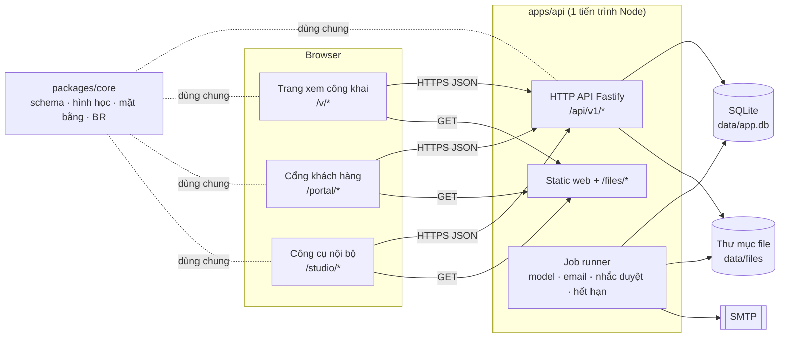
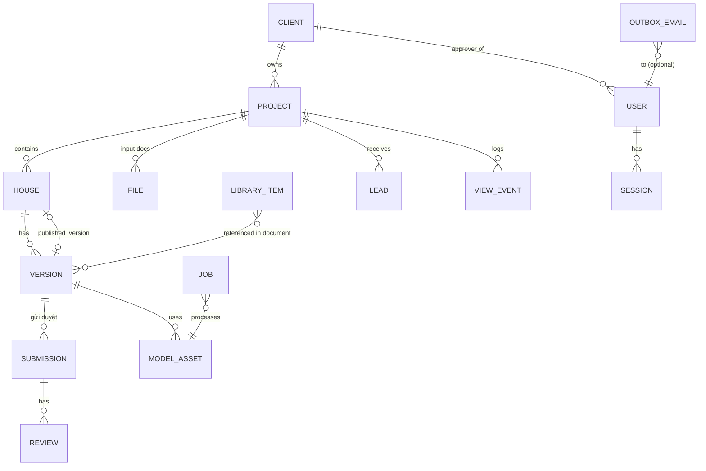
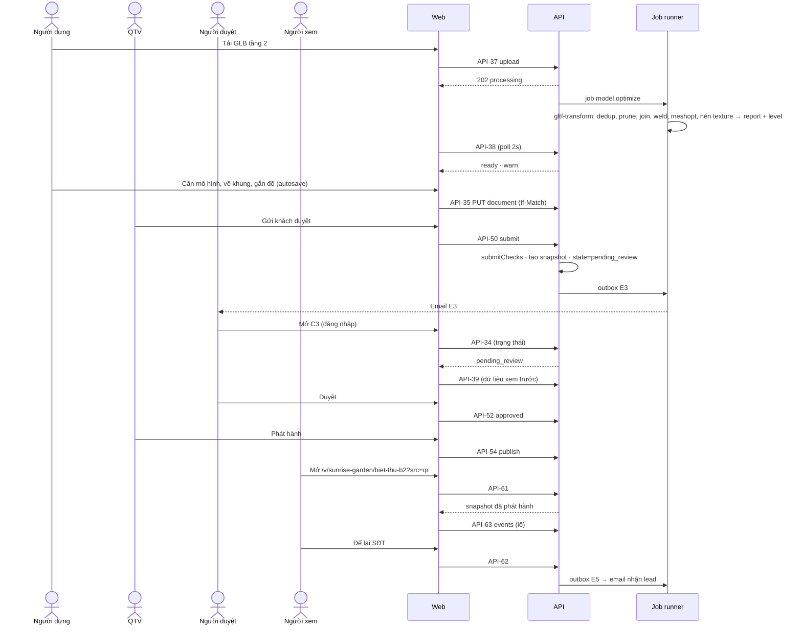

# Tech Spec (tổng quan & contract) — Nhà mẫu online có bản vẽ · Phase 1

| | |
|---|---|
| Tác giả (Architect) | Agent (ủy quyền DEC-16) |
| Reviewer | ai-lead-review (subagent) |
| Trạng thái | Approved (G2 ✅ 2026-10-24 · agent theo DEC-16, review subagent 2 vòng) |
| SRS | [`system/SRS.md`](../../system/SRS.md) v0.2 · FR phủ: mọi FR Phase 1 (M01–M11) |
| Spec con | BE: [`02a-be-spec.md`](02a-be-spec.md) · FE: [`02b-fe-spec-web.md`](02b-fe-spec-web.md) |
| ADR | [ADR-001](../../system/decisions/ADR-001-house-document-model.md) · [ADR-002](../../system/decisions/ADR-002-monolith-sqlite-phase1.md) |
| Last update | 2026-10-24 · Architect |

> **TL;DR**
> - Monorepo TypeScript gồm 3 package: `packages/core` (mô hình mẫu nhà, hình học, diện tích, sinh mặt bằng SVG — dùng chung), `apps/api` (Fastify + SQLite qua `node:sqlite`, lưu file trên đĩa, job chạy nền trong cùng tiến trình), `apps/web` (React + three.js, 3 bề mặt: trang xem công khai, cổng khách hàng, công cụ nội bộ).
> - **Mẫu nhà là một tài liệu JSON theo phiên bản** (ADR-001). Khi gửi duyệt, tài liệu được "chụp" thành bản khoá đã giải sẵn thông tin đồ và đường dẫn mô hình. Duyệt và phát hành đều dùng bản khoá này, nên nội dung công khai đúng bằng nội dung đã duyệt.
> - **Mặt bằng sinh từ một hàm duy nhất trong `core`**, dùng cho trình dựng, trang xem và PDF (xuất ngay trong trình duyệt). Kích thước và diện tích do đó luôn khớp.
> - Rủi ro lớn nhất: hiệu năng 3D trên máy yếu và trong trình duyệt của Zalo (NFR-01–03). Giảm rủi ro bằng tối ưu GLB phía server, ngân sách hiệu năng chặn cứng (BR-07), tải theo tầng và chế độ dự phòng.

---

## 1. Bối cảnh
SRS Phase 1 yêu cầu: công cụ nội bộ dựng mẫu nhà cho 4 loại nhà (P4, P7), trang xem 3D công khai có mặt bằng kích thước (P1, P3), quy trình duyệt có bằng chứng (P6), lead và thống kê (P5). Hiện trạng kỹ thuật là prototype chỉ có frontend, dữ liệu viết tay trong code (`src/data/houses.ts`). Chưa có backend, chưa có lưu trữ.

## 2. Goals / Non-goals

| Goals | Non-goals |
|---|---|
| Mọi FR có cột Phase = 1 trong SRS §5 | FR Phase 2/3: trần/điện, TCVN khung tên, DXF, giá, tên miền riêng, CRM |
| Đạt NFR-01…NFR-10 trên một server | Mở rộng ngang nhiều server, CDN đa vùng |
| Bản vẽ và 3D sinh từ cùng một mô hình (`core`) | Đọc SKP/DWG/FBX phía server (CN-01) |
| Người dựng thêm mẫu nhà không cần lập trình viên (AC-01) | Khách hàng tự dựng mẫu nhà |
| Một lệnh chạy toàn bộ hệ thống ở local | Hạ tầng production (thuộc `05-release`) |

## 3. Hiện trạng & tác động (reuse-first)

| Thành phần | Component | Hiện có (file:line) | Phân loại | Thay đổi |
|---|---|---|:---:|---|
| Kiểu dữ liệu nhà/phòng/cửa | core | `src/data/types.ts:1-85` — phòng là hình chữ nhật, cửa gắn theo đường thẳng | EXTEND → NEW schema | Thay bằng schema tường–phòng đa giác–lỗ cửa theo tường, đơn vị mm, nhiều tầng (§5.2) |
| Sinh tường + lỗ cửa | core + web | `src/three/Structure.tsx:51-94` (`buildWalls`) | EXTEND | Chuyển phần hình học thuần sang `core`; tường xiên; cửa theo tường |
| Cắt tường kiểu dollhouse | web | `src/three/Structure.tsx:96-141` | EXTEND | Thuật toán cũ chỉ đúng tường song song trục (`run.axis`, dòng 109-111) → đổi sang kiểm phía bằng tích có hướng với đoạn tường bất kỳ; đơn vị mm → m |
| Camera toàn cảnh/phòng/đứng trong phòng | web | `src/three/HouseScene.tsx:66-130` | EXTEND | Thêm chọn tầng, ẩn tầng trên, mặt tiền |
| Chọn đồ + khung viền | web | `src/three/Furniture.tsx` | EXTEND | Nguồn dữ liệu từ bản khoá; thêm đồ là node trong GLB |
| Model đồ dựng bằng khối | web | `src/three/models.tsx` | REUSE | Dùng làm hình mặc định khi đồ thư viện chưa có GLB |
| Mặt bằng SVG | core | `src/components/FloorPlan.tsx` | EXTEND | Chuyển sang `core/plan` (thuần, không React), thêm kích thước, cung cửa, cầu thang |
| Danh sách nhà, khung trang xem | web | `src/components/HouseList.tsx`, `Viewer.tsx` | EXTEND | Thành V1, V2 |
| Backend, DB, auth, file, job, email | api | — | NEW | Không có sẵn |
| Cổng khách hàng, công cụ nội bộ | web | — | NEW | Không có sẵn |

Prototype `src/` sẽ được chuyển vào cấu trúc monorepo. File gốc giữ trong lịch sử git; thư mục `src/` cũ bị xoá sau khi chuyển xong (DEC-17).

## 4. Kiến trúc



| Thành phần | Trách nhiệm | Spec chi tiết |
|---|---|---|
| `packages/core` | Schema mẫu nhà (zod), đơn vị, hình học (diện tích, offset tường, lỗ cửa), sinh mặt bằng SVG có kích thước, kiểm điều kiện gửi duyệt (BR-05, BR-07), chuẩn hoá SĐT (BR-09) | 02a §core (BE giữ), FE dùng |
| `apps/api` — HTTP | Auth, phân quyền, CRUD, workflow phiên bản, lead, sự kiện, thống kê, phục vụ file | 02a |
| `apps/api` — Job runner | Tối ưu GLB, gửi email, nhắc duyệt, tự gỡ dự án quá hạn | 02a |
| `apps/web` — Trang xem `/v` | V1–V4: 3D, mặt bằng, PDF, lead, gửi sự kiện | 02b |
| `apps/web` — Cổng `/portal` | C1–C5 | 02b |
| `apps/web` — Studio `/studio` | A1–A6, trình dựng | 02b |

**Đóng gói web:** Vite multi-page với 2 entry. `viewer.html` cho `/v/*`: nhẹ, không chứa code studio. `app.html` cho `/portal/*` và `/studio/*`. Mục tiêu là bundle trang xem ≤ 900 KB gzip, chủ yếu là three.js (NFR-01).

## 5. Data model (chung)

### 5.1 Thực thể lưu trữ



| Thực thể | Field chính (kiểu chi tiết ở 02a) | Ghi chú |
|---|---|---|
| `client` | id, name, logoFileId, brandColor, contact {phone, zalo, email, address}, plan, hostingUntil (date), status `active·suspended`, showPoweredBy | FR-01.01, 01.06 |
| `user` | id, email (unique), name, role `admin·producer·approver`, clientId (bắt buộc khi approver), passwordHash, status `invited·active·disabled`, failedLogins, lockedUntil | FR-01.04 |
| `session` | id (token ngẫu nhiên 32 byte), userId, expiresAt | Cookie `sid` |
| `token` | id, userId, kind `invite·reset`, expiresAt, usedAt | E1 72 giờ, E2 1 giờ |
| `project` | id, clientId, slug (unique), slugLocked, name, location, description, coverFileId, contact {phone, zalo, leadEmails[]}, disclaimer, privacyPolicy (văn bản, mặc định mẫu), status `active·unavailable` | FR-01.02, 01.03, NFR-04 |
| `house` | id, projectId, slug (unique trong project), slugLocked, name, houseType `apartment·townhouse·villa·cottage`, declaredArea (m²), bedrooms, bathrooms, description, publishedVersionId, sortOrder | FR-03.01 |
| `version` | id, houseId, number, state (SRS §7), document (JSON, §5.2), revision (int, khoá lạc quan), currentSubmissionId, publishedAt/by | ADR-001 |
| `submission` | id, versionId, seq (lần gửi thứ mấy của phiên bản), snapshot (JSON), snapshotHash (sha256), submittedAt/by, withdrawnAt/by | **Mỗi lần gửi duyệt một bản ghi, nội dung bất biến** (R-12) |
| `review` | id, submissionId, versionId, decision `approved·changes_requested`, note, targets [{floorId, roomId?}], userId, onBehalf (bool), evidenceFileId, snapshotHash, createdAt | Chỉ thêm, không sửa/xoá (BR-03); gắn với đúng nội dung đã xem |
| `submission_file` | submissionId, storageKey | Mọi file tham chiếu trong snapshot — dùng cho quyền đọc file (§6 `/files`) |
| `model_asset` | id, projectId, originalFileId, optimizedFileId, status `processing·ready·failed`, error, report {triangles, drawCalls, textureBytes, fileBytes, bbox}, level `ok·warn·block` | FR-04.02 |
| `library_item` | id, name, category, sizeMm [w,h,d], material, brand, description, imageFileIds[], modelAssetId?, fallbackShape (key model khối), variants [{id, name, color}], archived | FR-05.01 |
| `file` | id, projectId?, kind, originalName, mime, bytes, storageKey, uploadedBy, createdAt | FR-02.01 |
| `lead` | id, projectId, houseId?, name, phone (chuẩn hoá), email, interest, message, consentAt, context {floorId, roomId}, source `link·qr·embed`, contactCount, status `new·contacted`, createdAt, lastContactAt | FR-10.*, dữ liệu cá nhân |
| `view_event` | id, projectId, houseId?, sessionId, deviceId, type, targetId?, source, deviceClass `mobile·desktop·fallback`, ts | FR-11.01 |
| `job` | id, kind, payload, status, attempts, runAt, lastError | Hàng đợi trong DB |
| `outbox_email` | id, to, template `E1…E5`, data, status, attempts, sentAt | |

### 5.2 Tài liệu mẫu nhà (`HouseDocument`, schema trong `core`)

Đơn vị: **mm** cho mọi độ dài, cao độ và toạ độ. Toạ độ mặt bằng: trục x sang phải, trục y xuống dưới (khi nhìn trên giấy). Trong 3D: x → X, y → Z, cao độ → Y. Góc tính bằng độ.

```ts
HouseDocument {
  schemaVersion: 1
  floors: Floor[]                       // sắp theo order tăng dần
  exterior?: { modelRef?: ModelRef }    // ngoại thất / mái / cảnh quan
  wholeModel?: ModelRef                 // mô hình cả nhà (thay cho model từng tầng)
  viewpoints: Viewpoint[]
  lighting: { night: boolean }
  coverFileId?: string
  gallery: string[]                     // ảnh phối cảnh (fileId kind gallery_image, ≤ 12) — dùng cho V4 dự phòng (R-32)
}
Floor {                                 // tối đa 10 tầng (FR-03.02)
  id, name, order: int, elevation: mm, height: mm,
  underlay?: { fileId, page?: int, mmPerPx: number, offset: [x,y], rotation: deg, opacity: 0..1 },
  calibrated: boolean,                  // BR-05
  outline?: Point[],                    // đường bao ngoài tầng (BR-04 diện tích sàn)
  walls: Wall[], openings: Opening[], rooms: Room[], stairs: Stair[], areas: OutdoorArea[],
  modelRef?: ModelRef, items: PlacedItem[]
}
Wall      { id, a: Point, b: Point, thickness: mm, height?: mm /*mặc định = floor.height*/ }
Opening   { id, wallId, kind: 'door'|'window', offset: mm /*từ a tới mép gần*/, width: mm, height: mm,
            sill: mm /*0 với cửa đi*/, hinge: 'start'|'end', swing: 'left'|'right' /*phía mở*/ }
Room      { id, name, function: RoomFunction, polygon: Point[] /*lòng tường*/ }
Stair     { id, polygon: Point[], upDirection: deg, toFloorId?: string }
OutdoorArea { id, name, kind: 'yard'|'garden'|'pool'|'terrace'|'balcony'|'loggia', polygon: Point[] }
PlacedItem  { id, source: { libraryItemId } | { modelNode: { modelAssetId, nodeName } },
              info?: Partial<ItemInfo> /*ghi đè hiển thị; imageFileIds[] kind item_image*/, position: Point, elevation: mm,
              rotation: deg, variantId?: string }
ModelRef  { modelAssetId, offset: [x,y,z] mm, rotation: deg, scale: number }
Viewpoint { id, name, kind: 'overview'|'facade'|'room', floorId?, roomId?, position: [x,y,z], target: [x,y,z], isDefault: boolean }
**Quy ước tên node trong GLB** (người dựng đặt trong SketchUp/3ds Max/Blender trước khi xuất, R-07/R-09): `item_<tên>` = đồ muốn gắn thông tin; `wall_<tên>` = tường (dùng cho cắt tường trên mô hình GLB). Khi tối ưu, **mỗi node `item_*`/`wall_*` cùng toàn bộ cây con của nó được gộp thành một node mesh mang đúng tên đó** (gộp theo vật liệu bên trong). Phần còn lại bị gộp theo vật liệu. Khuyến nghị gộp tường của một phòng vào một node `wall_*` để giữ draw call thấp (N-02).

RoomFunction = 'living'|'kitchen'|'dining'|'bedroom'|'bathroom'|'wc'|'study'|'worship'|'laundry'|'storage'|'garage'|'hall'|'stair'|'other'
```

**Quy tắc tính trong `core`** (FE và BE dùng chung một hàm):

| Hàm | Quy tắc | Nguồn |
|---|---|---|
| `roomArea(room)` | Diện tích đa giác (shoelace) ÷ 10⁶ → m², làm tròn 2 chữ số | BR-04 |
| `floorGrossArea(floor)` | Dùng `outline` nếu có; không có thì lấy hình chữ nhật bao mép ngoài các tường (có cảnh báo) | BR-04 |
| `planSvg(floor, opts)` | Sinh SVG mặt bằng: tường đặc, lỗ cửa, cung mở cửa, cửa sổ, cầu thang, tên + diện tích phòng, đồ dạng đường bao, kích thước tổng hai phương, kích thước từng đoạn tường ngoài, kích thước thông thuỷ phòng | FR-07.01, 07.02 |
| `submitChecks(doc, models)` | Trả danh sách `{ level, code, floorId?, objectId?, message }` theo bảng §5.3 | FR-08.02, BR-05, BR-07 |
| `wallSegments(floor)` | Chia tường thành đoạn đặc + lỗ cửa (đầu vào cho 3D khối và mặt bằng) | FR-04.04, 07.01 |
| `escapeXml(s)` | Mọi chuỗi người dùng nhập đưa vào `planSvg` phải qua hàm này (R-16) | NFR-05 |
| `normalizePhoneVN(s)` | Bỏ khoảng trắng/dấu; `+84`/`84` → `0`; hợp lệ khi `^0\d{9}$` | BR-09 |

**Bản khoá (`snapshot`)** — tạo mỗi lần gửi duyệt, lưu trong `submission`, bất biến (R-05, R-12):

| Phần | Nội dung | Nguồn khi hiển thị công khai |
|---|---|---|
| `document` | `HouseDocument` (đã bỏ `underlay` của mọi tầng — ảnh nền là tài liệu đầu vào bí mật, R-01) | snapshot |
| `house` | name, houseType, declaredArea, bedrooms, bathrooms, description | **snapshot** (sửa thông tin mẫu nhà sau khi duyệt không làm đổi trang công khai) |
| `resolved.libraryItems` | ItemInfo + biến thể + URL ảnh, URL mô hình | snapshot |
| `resolved.models` | URL GLB đã tối ưu + bbox (+ report, chỉ trong snapshot lưu trữ; API-39/61 bỏ report) | snapshot |
| `resolved.files` | URL ảnh đại diện, gallery, ảnh trong `PlacedItem.info` | snapshot |
| `branding`, `contact`, `disclaimer`, `privacyPolicy` | **không** nằm trong snapshot | bản hiện tại của client/project (đổi logo, SĐT không cần duyệt lại) — DEC-28 |

**Dạng xem trước** (API-39): cùng shape API-61, dựng tại chỗ. Bản nháp → từ `document` hiện tại + resolve ngay. Đã gửi duyệt → từ snapshot của submission hiện tại. A, P xem thêm được lớp ảnh nền trong A3 qua API-34 (không qua API-39).

### 5.3 Mã kiểm gửi duyệt (`submitChecks`)

| Mã | Mức | Khi nào | Đối tượng |
|---|---|---|---|
| `NO_FLOORS` | block | Không có tầng | — |
| `TOO_MANY_FLOORS` | block | > 10 tầng | — |
| `FLOOR_NOT_CALIBRATED` | block | Tầng có `calibrated=false` | floorId |
| `ROOM_NOT_CLOSED` | block | Đa giác phòng < 3 điểm hoặc tự cắt | floorId, roomId |
| `MODEL_PROCESSING` | block | Mô hình được tham chiếu còn `processing` | modelAssetId |
| `MODEL_FAILED` | block | Mô hình được tham chiếu `failed` | modelAssetId |
| `MODEL_NODE_MISSING` | block | `PlacedItem.modelNode.nodeName` không còn trong mô hình | itemId |
| `BUDGET_BLOCK` | block | Tổng ngân sách một góc xem tầng vượt mức Chặn (BR-07, bảng §6 API-37) | floorId |
| `BUDGET_WARN` | warn | Vượt mức Cảnh báo | floorId |
| `NO_COVER` | block | Thiếu `coverFileId` | — |
| `FLOOR_NO_OUTLINE` | warn | Không có `outline`, diện tích sàn tính theo hình chữ nhật bao | floorId |
| `NO_DEFAULT_VIEWPOINT` | warn | Không có điểm nhìn mặc định (dùng toàn cảnh tự tính) | — |

### 5.4 Ánh xạ trạng thái SRS ↔ hệ thống (N-1)

| SRS §7 | `version.state` |
|---|---|
| DANG_DUNG | `draft` |
| CHO_DUYET | `pending_review` |
| DA_DUYET | `approved` |
| DA_PHAT_HANH | `published` |
| DA_THAY_THE | `superseded` |
| DA_GO | `unpublished` |

## 6. API contract

**Quy ước chung**

| Mục | Quy ước |
|---|---|
| Base | `/api/v1`; JSON UTF-8; tên field camelCase |
| Auth | Cookie phiên `sid` (HttpOnly, Secure ở production, SameSite=Lax, hết hạn sau 14 ngày không hoạt động). API công khai (`/public/*`) không cần cookie |
| CSRF | Mọi request đổi dữ liệu có cookie phải gửi header `X-Requested-With: fetch` và `Origin` khớp host; sai → 403 `CSRF` |
| Lỗi | `{ "error": { "code": "VALIDATION_ERROR", "message": "…", "fields": { "phone": "…" } } }` |
| Thời gian | ISO-8601 UTC (`2026-10-24T07:05:00Z`); FE hiển thị giờ Việt Nam |
| Phân trang | `?limit=50&cursor=<opaque>` → `{ items, nextCursor }`; limit tối đa 200 |
| Khoá lạc quan | Ghi tài liệu phiên bản: header `If-Match: <revision>`; lệch → 409 `REVISION_CONFLICT` |
| Upload | `multipart/form-data`, field `file`; giới hạn 200 MB (FR-02.01) |
| Phiên bản API | Đổi phá vỡ → `/api/v2`; thêm field không phá vỡ |
| Ngày lọc | Tham số `from`, `to` dạng `YYYY-MM-DD`, hiểu theo giờ Việt Nam (UTC+7), `to` tính cả ngày |
| Slug | Khoá sau lần phát hành đầu tiên của project/house (`slugLocked`); đổi → 409 `SLUG_LOCKED` (FR-01.03, R-17) |

**Mã lỗi chung** (mọi API): 401 `UNAUTHENTICATED` → FE chuyển C1/đăng nhập studio · 403 `FORBIDDEN` → màn "Không có quyền" · 403 `CSRF` → tải lại trang · 404 `NOT_FOUND` · 400 `VALIDATION_ERROR` → lỗi theo field · 413 `FILE_TOO_LARGE` · 429 `RATE_LIMITED` · 500 `INTERNAL` → "Đã có lỗi, thử lại sau".

Ký hiệu quyền: **A** = admin (QTV) · **P** = producer (người dựng) · **R** = approver (người duyệt, chỉ khách hàng của mình) · **Pub** = công khai.

| ID | Method + path | Mục đích | Quyền | FR | Client |
|---|---|---|---|---|---|
| API-01 | `POST /auth/login` | Đăng nhập | Pub | 01.05, NFR-05 | portal, studio |
| API-02 | `POST /auth/logout` | Đăng xuất | đã đăng nhập | — | portal, studio |
| API-03 | `GET /auth/me` | Người dùng hiện tại | đã đăng nhập | — | portal, studio |
| API-04 | `POST /auth/password/forgot` | Gửi E2 | Pub | 01.05 | portal, studio |
| API-05 | `POST /auth/password/set` | Đặt mật khẩu bằng token mời/đặt lại | Pub | 01.05 | portal, studio |
| API-10 | `GET /clients` · `POST /clients` | Danh sách / tạo khách hàng | A | 01.01 | studio |
| API-11 | `GET /clients/:id` · `PATCH /clients/:id` | Xem/sửa, tạm ngưng | A | 01.01, 01.06 | studio |
| API-12 | `GET /users` · `POST /users` | Danh sách / tạo tài khoản (gửi E1) | A | 01.04 | studio |
| API-13 | `PATCH /users/:id` · `POST /users/:id/resend-invite` | Sửa, vô hiệu, gửi lại E1 | A | 01.04 | studio |
| API-20 | `GET /projects` · `POST /projects` | Danh sách (R chỉ thấy của mình) / tạo | A,P,R(đọc) / A | 01.02 | studio, portal |
| API-21 | `GET /projects/:id` · `PATCH /projects/:id` | Xem / sửa. **P chỉ sửa** name, location, description, coverFileId; contact, leadEmails, disclaimer, privacyPolicy, slug, clientId, status chỉ A (R-03) | A,P,R(đọc) / A,P(giới hạn field) | 01.02, BR-11 | studio, portal |
| API-22 | `GET /projects/:id/files` · `POST /projects/:id/files` | Tài liệu đầu vào | A,P | 02.01–02.02 | studio |
| API-23 | `POST /files` | Tải tệp dùng chung (logo, ảnh thư viện, bằng chứng) | A,P | 01.01, 05.01, 08.07 | studio |
| API-30 | `GET /projects/:id/houses` · `POST /projects/:id/houses` | Mẫu nhà của dự án / tạo (kèm phiên bản 1 rỗng) | A,P,R(đọc) / A,P | 03.01 | studio, portal |
| API-31 | `GET /houses/:id` · `PATCH /houses/:id` | Xem / sửa thông tin mẫu nhà | A,P,R(đọc) / A,P | 03.01 | studio, portal |
| API-32 | `POST /houses/:id/duplicate` | Sao chép mẫu nhà (tài liệu bản mới nhất) | A,P | 03.09 | studio |
| API-33 | `GET /houses/:id/versions` | Lịch sử phiên bản + bản ghi duyệt | A,P,R | 08.01, 08.05 | studio, portal |
| API-34 | `GET /versions/:id` | A,P: tài liệu + trạng thái + revision + checks. R: state ≠ draft → snapshot submission hiện tại; state = draft → chỉ metadata (§6.1) | A,P,R(scope) | 03.*, 08.03 | studio, portal (C3 gọi trước để biết trạng thái) |
| API-35 | `PUT /versions/:id/document` | Lưu tài liệu (autosave) | A,P; chỉ khi state = `draft` | 03.*, 04.*, 05.02–05.04 | studio |
| API-36 | `POST /houses/:id/versions` | Tạo phiên bản mới từ phiên bản mới nhất | A,P | 08.01 | studio |
| API-37 | `POST /projects/:id/models` · `POST /library/models` | Tải GLB → tạo `model_asset` + job tối ưu (dự án / thư viện) | A,P | 04.01, 04.02, 05.01 | studio |
| API-38 | `GET /models/:id` | Trạng thái + báo cáo mô hình | A,P | 04.02 | studio |
| API-39 | `GET /versions/:id/preview` | Dữ liệu xem trước, **cùng shape API-61** (R-04) | A,P mọi trạng thái; R chỉ khi state ≠ draft và cùng khách hàng | 08.03, 06.* | studio (A3), portal (C3) |
| API-40 | `GET /library/items` · `POST /library/items` | Thư viện đồ | A,P | 05.01 | studio |
| API-41 | `PATCH /library/items/:id` · `DELETE /library/items/:id` | Sửa / lưu trữ đồ (xoá chặn khi đang dùng) | A,P | 05.01 | studio |
| API-50 | `POST /versions/:id/submit` | Gửi khách duyệt: kiểm `submitChecks`, tạo snapshot, gửi E3 | A | 08.01–08.03 | studio |
| API-51 | `POST /versions/:id/withdraw` | Rút về Đang dựng (khi Chờ duyệt) | A | 08.01 | studio |
| API-52 | `POST /versions/:id/review` | Duyệt / yêu cầu sửa | R (của mình) | 08.04, 08.05 | portal |
| API-53 | `POST /versions/:id/review-on-behalf` | Ghi nhận duyệt thay + bằng chứng | A | 08.07 | studio |
| API-54 | `POST /versions/:id/publish` | Phát hành (state = approved / superseded / unpublished) | A | 08.06, 08.08 | studio |
| API-55 | `POST /houses/:id/unpublish` | Gỡ phát hành | A | 08.08 | studio |
| API-60 | `GET /public/projects/:slug` | Dữ liệu V1 | Pub | 06.01, 09.01 | viewer |
| API-61 | `GET /public/projects/:slug/houses/:houseSlug` | Bản khoá đã phát hành cho V2 | Pub | 06.*, 07.* | viewer |
| API-62 | `POST /public/leads` | Gửi lead (honeypot + formToken + Turnstile, §8) | Pub | 10.01–10.06 | viewer |
| API-63 | `POST /public/events` | Gửi lô sự kiện xem (≤ 64 KB, ≤ 120 lô/phút/IP, R-29) | Pub | 11.01 | viewer |
| API-70 | `GET /leads` | Danh sách lead (lọc theo clientId — chỉ A, projectId, houseId, ngày, trạng thái) | A, R(của mình) | 10.05 | portal, studio |
| API-71 | `PATCH /leads/:id` · `DELETE /leads/:id` | Đánh dấu đã liên hệ / xoá | A, R(của mình) | 10.05, NFR-04 | portal, studio |
| API-72 | `GET /leads.csv` | Tải CSV | A, R(của mình) | 10.05 | portal, studio |
| API-80 | `GET /stats` | Báo cáo thống kê; `projectId` bắt buộc với R, tuỳ chọn với A (không có = mọi dự án, lọc `clientId`) | A, R(của mình) | 11.02 | portal, studio |
| API-81 | `GET /stats.csv` | Tải CSV | A, R(của mình) | 11.03 | portal, studio |
| — | `GET /files/:storageKey` | Phục vụ file (ngoài `/api`), quyền theo bảng §6.2 | xem §6.2 | — | mọi client |
| — | `GET /v/*`, `/portal/*`, `/studio/*` | Phục vụ `viewer.html` / `app.html` (SPA fallback); `/v/*` chèn thẻ OG (R-14) | Pub | 06.14 | — |
| — | `GET /healthz` | Kiểm tra sống | Pub | NFR-06 | ops |

<details><summary><b>API-01</b> — POST /auth/login</summary>

```json
// request
{ "email": "duyet@sunrise.vn", "password": "••••••••" }
// 200
{ "user": { "id": "usr_1", "email": "duyet@sunrise.vn", "name": "Lan", "role": "approver", "clientId": "cli_1" } }
```

| HTTP | Mã lỗi | Khi nào | FE xử lý |
|---|---|---|---|
| 401 | INVALID_CREDENTIALS | Sai email/mật khẩu | "Email hoặc mật khẩu chưa đúng." |
| 423 | ACCOUNT_LOCKED | Sai 5 lần, khoá 15 phút (`lockedUntil` trong body) | "Tài khoản tạm khoá 15 phút do nhập sai nhiều lần." |
| 403 | ACCOUNT_DISABLED | Tài khoản bị vô hiệu / khách hàng tạm ngưng | "Tài khoản không còn hoạt động. Liên hệ nhà cung cấp." |
</details>

<details><summary><b>API-05</b> — POST /auth/password/set</summary>

```json
// request
{ "token": "tok_…", "password": "ít nhất 8 ký tự" }
// 200
{ "user": { … } }   // đồng thời đặt cookie phiên
```

| HTTP | Mã lỗi | Khi nào | FE xử lý |
|---|---|---|---|
| 400 | TOKEN_INVALID | Token sai, đã dùng hoặc hết hạn | "Liên kết đã hết hạn. Yêu cầu gửi lại." |
| 400 | VALIDATION_ERROR | Mật khẩu < 8 ký tự | lỗi tại ô |
</details>

<details><summary><b>API-10/11</b> — Client</summary>

```json
// POST /clients
{ "name": "Sunrise Land", "logoFileId": "fil_9", "brandColor": "#0E6B5C",
  "contact": { "phone": "0901234567", "zalo": "0901234567", "email": "sales@sunrise.vn", "address": "Bắc Giang" },
  "plan": "project", "hostingUntil": "2027-10-31", "showPoweredBy": true }
// 201 → Client đầy đủ + "status": "active"
// PATCH /clients/:id   { "status": "suspended" } → 200 Client
```

| HTTP | Mã lỗi | Khi nào | FE xử lý |
|---|---|---|---|
| 400 | VALIDATION_ERROR | Thiếu tên, màu sai `#RRGGBB`, ngày sai | lỗi tại ô |
</details>

<details><summary><b>API-12</b> — POST /users</summary>

```json
{ "email": "lan@sunrise.vn", "name": "Lan", "role": "approver", "clientId": "cli_1" }
// 201 { "user": { …, "status": "invited" } }  — E1 vào outbox
```

| HTTP | Mã lỗi | Khi nào | FE xử lý |
|---|---|---|---|
| 409 | EMAIL_TAKEN | Email đã tồn tại | lỗi tại ô email |
| 400 | VALIDATION_ERROR | approver thiếu clientId | lỗi tại ô |
</details>

<details><summary><b>API-20/21</b> — Project</summary>

```json
// POST /projects
{ "clientId": "cli_1", "name": "Sunrise Garden", "slug": "sunrise-garden", "location": "Bắc Giang",
  "description": "…", "coverFileId": "fil_2",
  "contact": { "phone": "0901234567", "zalo": "0901234567", "leadEmails": ["sales@sunrise.vn"] },
  "disclaimer": null }   // null → dùng câu mặc định BR-06
// 201 Project { id, clientId, slug, name, …, status: "active", publicUrl: "/v/sunrise-garden" }
```

| HTTP | Mã lỗi | Khi nào | FE xử lý |
|---|---|---|---|
| 409 | SLUG_TAKEN | Slug trùng | lỗi tại ô slug, gợi ý slug khác |
</details>

<details><summary><b>API-30/31/32</b> — House</summary>

```json
// POST /projects/:id/houses
{ "name": "Biệt thự B2", "slug": "biet-thu-b2", "houseType": "villa", "declaredArea": 280.5,
  "bedrooms": 4, "bathrooms": 5, "description": "…" }
// 201 { "house": { …, "publishedVersionId": null }, "version": { "id": "ver_1", "number": 1, "state": "draft", "revision": 0 } }
// GET /projects/:id/houses → { items: [ { …house, "latestVersion": { id, number, state }, "published": { versionId, number } | null } ] }
// POST /houses/:id/duplicate { "name": "Biệt thự B3", "slug": "biet-thu-b3" } → 201 như trên (tài liệu sao chép, id tầng/phòng mới)
```
</details>

<details><summary><b>API-34/35/36</b> — Version & document</summary>

```json
// GET /versions/:id
{ "id": "ver_3", "houseId": "hou_1", "number": 3, "state": "draft", "revision": 41,
  "document": { "schemaVersion": 1, "floors": [ … ], … },
  "snapshot": null, "checks": [ { "level": "block", "code": "FLOOR_NOT_CALIBRATED", "floorId": "flr_3", "message": "Tầng 3 chưa hiệu chỉnh tỷ lệ" } ] }

// PUT /versions/:id/document   (If-Match: 41)
{ "document": { … } }
// 200 { "revision": 42, "checks": [ … ] }
// POST /houses/:id/versions → 201 { "version": { number: 4, state: "draft", revision: 0 } }
```

| HTTP | Mã lỗi | Khi nào | FE xử lý |
|---|---|---|---|
| 409 | REVISION_CONFLICT | Revision lệch (2 tab cùng sửa) | "Mẫu nhà vừa được sửa ở nơi khác. Tải lại để tiếp tục." + nút Tải lại |
| 409 | VERSION_LOCKED | State ≠ draft | chuyển trình dựng sang chỉ xem (A3 trạng thái Chờ duyệt) |
| 400 | DOCUMENT_INVALID | Không qua schema (fields: đường dẫn JSON) | báo lỗi kỹ thuật, không lưu |
| 409 | DRAFT_EXISTS | Tạo phiên bản mới khi đã có bản draft/pending | mở bản đang có |
</details>

<details><summary><b>API-37/38</b> — Model asset</summary>

```json
// POST /projects/:id/models   multipart: file=<.glb|.gltf>
// 202 { "model": { "id": "mdl_7", "status": "processing" } }
// GET /models/mdl_7
{ "id": "mdl_7", "status": "ready", "url": "/files/m/7f…/opt.glb",
  "report": { "triangles": 182340, "drawCalls": 96, "textureBytes": 50331648, "fileBytes": 7340032,
              "bbox": { "min": [0,0,0], "max": [10000, 9800, 20000] } },
  "level": "warn", "reasons": ["drawCalls > 80"] }
```

| HTTP | Mã lỗi | Khi nào | FE xử lý |
|---|---|---|---|
| 415 | UNSUPPORTED_FILE | Không phải GLB/glTF | "Chỉ nhận tệp .glb hoặc .gltf." |
| — | status=`failed`, `error` | Không đọc được (EX-1) | Thẻ đỏ với `error` |

**Ngưỡng BR-07 — tính cho một góc xem tầng** (R-06): tổng của mô hình tầng đó + ngoại thất + mô hình cả nhà (nếu dùng) + GLB các đồ thư viện đặt trên tầng đó. Mỗi mô hình vẫn có báo cáo riêng để người dựng biết phần nào nặng. `submitChecks` tính tổng theo từng tầng và báo `BUDGET_WARN`/`BUDGET_BLOCK` kèm `floorId`.

| Chỉ số (tổng một góc xem tầng) | Cảnh báo khi > | Chặn khi > |
|---|---|---|
| Tam giác | 400.000 | 800.000 |
| Draw call (sau tối ưu) | 120 | 250 |
| Bộ nhớ texture GPU ước tính | 128 MB | 256 MB |
| Dung lượng tải | 10 MB | 14 MB (cộng bundle ≤ 0,9 MB → ≤ 15 MB, NFR-01) |

Giới hạn tải lên một tệp: **200 MB** (UI khuyến cáo ≤ 100 MB; R-33). Ngưỡng được đo lại ở G4 với 3 mẫu nhà AC-14 (DEC khi chỉnh).
</details>

<details><summary><b>API-40/41</b> — Library</summary>

```json
// POST /library/items
{ "name": "Giường Haven 1m8", "category": "bed", "sizeMm": [1800, 1050, 2100], "material": "Khung gỗ sồi, bọc nỉ",
  "brand": "Haven", "description": "…", "imageFileIds": ["fil_3"], "modelAssetId": null, "fallbackShape": "bed",
  "variants": [ { "id": "stone", "name": "Xám đá", "color": "#8a8f94" } ] }
// GET /library/items?q=giường&category=bed → { items, nextCursor }
```

| HTTP | Mã lỗi | Khi nào | FE xử lý |
|---|---|---|---|
| 409 | ITEM_IN_USE | Xoá đồ đang dùng (`usage` = số mẫu nhà) | "Đồ này đang dùng ở {n} mẫu nhà, không xoá được." |
</details>

<details><summary><b>API-50…55</b> — Workflow</summary>

```json
// POST /versions/:id/submit
// 200 { "version": { state: "pending_review", submittedAt, … } }
// POST /versions/:id/review   (approver)
{ "decision": "changes_requested", "note": "Đổi phòng ngủ 2 thành phòng làm việc", "targets": [ { "floorId": "flr_2", "roomId": "rom_5" } ] }
// 200 { "review": { id, decision, note, userId, createdAt }, "version": { state: "draft" } }
// POST /versions/:id/review-on-behalf  { "decision": "approved", "note": "Duyệt qua Zalo 24/10", "evidenceFileId": "fil_12" }
// POST /versions/:id/publish → 200 { "house": { publishedVersionId }, "version": { state: "published" }, "previous": { id, state: "superseded" } }
// POST /houses/:id/unpublish → 200 { "house": { publishedVersionId: null }, "version": { state: "unpublished" } }
```

| HTTP | Mã lỗi | Khi nào | FE xử lý |
|---|---|---|---|
| 422 | SUBMIT_BLOCKED | `submitChecks` có lỗi chặn (`checks` trong body) | A5 liệt kê lý do |
| 409 | INVALID_STATE | Thao tác không hợp với trạng thái hiện tại (`state` trong body) | C3/A5 hiện "Phiên bản đã được xử lý…" và tải lại |
| 400 | VALIDATION_ERROR | Yêu cầu sửa thiếu ghi chú (< 10 ký tự); duyệt thay thiếu bằng chứng | lỗi tại ô |
</details>

<details><summary><b>API-60/61</b> — Public viewer</summary>

```json
// GET /public/projects/sunrise-garden
{ "project": { "slug", "name", "location", "description", "coverUrl", "disclaimer",
               "contact": { "phone", "zalo" }, "hasLeadForm": true, "privacyPolicyUrl": "/v/sunrise-garden/chinh-sach-du-lieu" },
  "antiBot": { "formToken": "ft_…", "turnstileSiteKey": "0x4AAA…" | null },
  "branding": { "name": "Sunrise Land", "logoUrl", "brandColor": "#0E6B5C", "showPoweredBy": true },
  "houses": [ { "slug", "name", "houseType", "declaredArea", "bedrooms", "bathrooms", "floors": 4, "coverUrl" } ] }

// GET /public/projects/sunrise-garden/houses/biet-thu-b2   (API-39 trả cùng shape, thêm "preview": { versionNumber, state, submittedAt, submittedByName })
{ "project": { … }, "branding": { … }, "antiBot": { … },
  "house": { "slug", "name", "houseType", "declaredArea", "bedrooms", "bathrooms", "description" },   // từ snapshot
  "version": { "number": 3, "publishedAt" },
  "document": { …HouseDocument },
  "resolved": { "libraryItems": { "lib_1": { "name", "category", "sizeMm", "material", "brand", "description", "imageUrls": [], "variants": [], "modelUrl": null, "fallbackShape": "bed" } },
                "models": { "mdl_7": { "url", "bbox": { "min": [x,y,z], "max": [x,y,z] } } },   // payload công khai KHÔNG có report (N-07)
                "files": { "fil_2": "/files/…" } } }
```

| HTTP | Mã lỗi | Khi nào | FE xử lý |
|---|---|---|---|
| 404 | NOT_FOUND | Slug không có / mẫu nhà chưa phát hành | V4 Không khả dụng (liên hệ nhà cung cấp) |
| 410 | PROJECT_UNAVAILABLE | Khách hàng tạm ngưng / quá hạn (BR-08); body có `contact` nếu còn hợp đồng | V4 Không khả dụng |

Cache: `Cache-Control: public, max-age=60` (API); file mô hình `immutable, max-age=31536000`.
</details>

<details><summary><b>API-62</b> — POST /public/leads</summary>

```json
// request
{ "projectSlug": "sunrise-garden", "houseSlug": "biet-thu-b2", "name": "Minh", "phone": "+84 912 345 678",
  "email": "", "interest": "live", "message": "", "consent": true,
  "context": { "floorId": "flr_2", "roomId": "rom_5" }, "source": "qr", "deviceId": "d_…",
  "website": "",                 // honeypot — phải rỗng
  "formToken": "ft_…",           // nhận từ API-60/61 (antiBot.formToken), hợp lệ khi đã ≥ 3 giây và ≤ 2 giờ
  "captchaToken": null }         // Turnstile, bắt buộc khi API trả CAPTCHA_REQUIRED
// 201 { "lead": { "id": "led_1" }, "merged": false }
// 200 { "lead": { "id": "led_1" }, "merged": true }   // trùng SĐT trong 24 giờ (BR-09)
```

| HTTP | Mã lỗi | Khi nào | FE xử lý |
|---|---|---|---|
| 400 | VALIDATION_ERROR | `phone` sai, `consent` ≠ true, email sai | lỗi tại ô (chữ ở SRS §10.4 V3) |
| 429 | CAPTCHA_REQUIRED | > 3 lần/10 phút theo deviceId hoặc > 20 lần/10 phút theo IP; hoặc `formToken` thiếu/sai/quá nhanh | hiện Turnstile (site key từ API-60/61), gửi lại kèm `captchaToken` |
| 201 | (giả, không lưu) | `website` khác rỗng (bot) — trả như thành công để bot không nhận ra | FE coi như thành công |
| 410 | PROJECT_UNAVAILABLE | Dự án đã gỡ | V4 |
</details>

<details><summary><b>API-63</b> — POST /public/events</summary>

```json
{ "projectSlug": "sunrise-garden", "sessionId": "s_…", "deviceId": "d_…", "source": "link", "deviceClass": "mobile",
  "events": [ { "type": "house_open", "houseSlug": "biet-thu-b2", "ts": "…" },
              { "type": "room_select", "houseSlug": "biet-thu-b2", "targetId": "rom_5", "ts": "…" } ] }
// 204
```

`type` ∈ `project_open · house_open · floor_select · room_select · walk_mode · item_open · plan_open · pdf_download · contact_click · lead_submit · fallback_shown`. Tối đa 50 sự kiện/lô. Sự kiện sai bị bỏ qua, không trả lỗi. Trang xem trước (C3/A3) **không gửi** sự kiện.
</details>

<details><summary><b>API-70…72</b> — Leads</summary>

```json
// GET /leads?projectId=prj_1&houseId=&from=2026-10-01&to=2026-10-31&status=new&limit=50
{ "items": [ { "id", "createdAt", "lastContactAt", "name", "phone", "email", "interest", "message",
               "house": { "id", "name" }, "context": { "floorName", "roomName" }, "source", "contactCount", "status" } ],
  "nextCursor": null }
// PATCH /leads/:id { "status": "contacted" } → 200 Lead
// DELETE /leads/:id → 204 (xoá vĩnh viễn)
// GET /leads.csv?… → text/csv; UTF-8 BOM; cột: Thời điểm, Họ tên, SĐT, Email, Quan tâm, Lời nhắn, Mẫu nhà, Tầng, Phòng, Nguồn, Số lần liên hệ, Trạng thái
```
</details>

<details><summary><b>API-80/81</b> — Stats</summary>

```json
// GET /stats?projectId=prj_1&from=2026-10-01&to=2026-10-31&houseId=
{ "totals": { "views": 1240, "uniqueViewers": 860, "avgDurationSec": 154, "leads": 31, "leadRate": 0.025 },
  "daily": [ { "date": "2026-10-01", "views": 40, "leads": 1 } ],
  "topHouses": [ { "id", "name", "views" } ], "topRooms": [ { "houseName", "roomName", "selects" } ],
  "topItems": [ { "name", "opens" } ],
  "bySource": { "link": 700, "qr": 300, "embed": 240 },
  "byDevice": { "mobile": 900, "desktop": 320, "fallback": 20 } }
```

Định nghĩa: `views` = số `sessionId` khác nhau có `project_open` hoặc `house_open` (BR-10: client đổi sessionId sau 30 phút không tương tác). `uniqueViewers` = số `deviceId` khác nhau. `avgDurationSec` = trung bình (ts cuối − ts đầu) mỗi phiên. `leadRate` = leads ÷ views.
</details>

### 6.1 Bổ sung contract (R-15)

**Enum dùng chung**

| Enum | Giá trị |
|---|---|
| `plan` (gói khách hàng) | `unit` (theo mẫu) · `project` (gói dự án) · `library` (thư viện mẫu nhà) |
| `houseType` | `apartment` · `townhouse` · `villa` · `cottage` |
| `interest` (lead) | `live` (Mua để ở) · `invest` (Đầu tư) · `interior` (Tư vấn nội thất) · `other` (Khác) |
| `category` (đồ) | `sofa` · `chair` · `table` · `bed` · `storage` · `kitchen` · `appliance` · `bath` · `lighting` · `decor` · `plant` · `rug` · `other` |
| `fallbackShape` | khoá model khối trong prototype: `sofa` `sofaL` `armchair` `coffeeTable` `tvStand` `rug` `floorLamp` `plant` `bookshelf` `diningTable` `chair` `kitchen` `fridge` `bed` `nightstand` `wardrobe` `desk` `officeChair` `vanity` `toilet` `shower` |
| `file.kind` | `input` · `logo` · `cover` · `gallery_image` · `library_image` · `item_image` · `model_original` · `model_optimized` · `evidence` |
| `user.status` | `invited` · `active` · `disabled` |

**API thiếu shape ở bản 0.1**

| API | Request | Response 2xx | Lỗi riêng |
|---|---|---|---|
| API-03 `GET /auth/me` | — | `{ user: { id, email, name, role, status, clientId \| null, clientName \| null } }` | 401 |
| API-13 `PATCH /users/:id` | `{ name?, role?, clientId?, status?: 'active'\|'disabled' }` (không đổi email) | `{ user }`; `disabled` → xoá mọi phiên của user (R-19) | 400 VALIDATION_ERROR, 409 LAST_ADMIN (không vô hiệu admin cuối cùng) |
| API-13 `POST /users/:id/resend-invite` | — | 204 (chỉ khi `invited`) | 409 INVALID_STATE |
| API-22 `GET /projects/:id/files` | `?kind=input` | `{ items: [ { id, kind, originalName, mime, bytes, url, uploadedByName, createdAt } ] }` | |
| API-22 `POST /projects/:id/files` | multipart `file` | 201 `{ file: { id, kind:'input', originalName, mime, bytes, url } }` | 413 FILE_TOO_LARGE, 415 UNSUPPORTED_FILE (jpg, png, webp, pdf, glb, gltf, dxf) |
| API-23 `POST /files` | multipart `file`, `kind` ∈ logo · cover · gallery_image · library_image · item_image · evidence, `projectId?` (bắt buộc với cover, gallery_image, item_image, evidence). Quyền: A,P; riêng `evidence` chỉ A | 201 `{ file: { id, kind, url } }` | 403 FORBIDDEN (P tải evidence), 413, 415 (ảnh: jpg/png/webp; evidence thêm pdf) |
| API-31 `GET /houses/:id` | — | `{ house, latestVersion: { id, number, state, revision }, published: { versionId, number, publishedAt } \| null, openVersionId \| null }` | 404 |
| API-21 `PATCH /projects/:id` | P gửi field ngoài name, location, description, coverFileId | — | 403 FIELD_FORBIDDEN; 409 SLUG_LOCKED (đổi slug sau phát hành); 409 SLUG_TAKEN |
| API-31 `PATCH /houses/:id` | `{ name?, slug?, houseType?, declaredArea?, bedrooms?, bathrooms?, description?, sortOrder? }` | `{ house }` | SLUG_TAKEN, SLUG_LOCKED |
| API-33 `GET /houses/:id/versions` | — | `{ items: [ { id, number, state, createdAt, publishedAt, submissions: [ { id, seq, submittedAt, submittedByName, withdrawnAt, snapshotHash, reviews: [ { id, decision, note, targets, userName, onBehalf, evidenceUrl, createdAt } ] } ] } ] }` | |
| API-34 cho R khi `draft` | — | `{ id, number, state: 'draft', lastSubmission: { seq, withdrawnAt, reviews } }` — không có document (R-11) | |
| API-41 `PATCH /library/items/:id` | các field như POST (partial) | `{ item }` | VALIDATION_ERROR |
| API-51 `POST /versions/:id/withdraw` | — | `{ version: { state: 'draft' }, submission: { id, withdrawnAt } }` | 409 INVALID_STATE |
| API-53 `POST /versions/:id/review-on-behalf` | `{ decision, note (≥ 10), evidenceFileId }` | `{ review, version }` | 400 VALIDATION_ERROR, 409 INVALID_STATE |
| API-55 `POST /houses/:id/unpublish` | — | `{ house: { publishedVersionId: null }, version: { id, state: 'unpublished' } }` | 409 INVALID_STATE |
| API-30, 32 | — | — | 409 SLUG_TAKEN |
| API-35 | — | — | 400 DOCUMENT_INVALID cả khi **tham chiếu sai**: wallId không có, modelAssetId không thuộc dự án, libraryItemId không tồn tại/đã lưu trữ, fileId không thuộc dự án (R-34) |

### 6.2 Quyền đọc file `/files/:storageKey` (R-01, R-02)

| File | Người xem công khai | R (người duyệt) | A, P |
|---|---|---|---|
| Key nằm trong `submission_file` của submission thuộc version đang `published` | ✔ | ✔ | ✔ |
| File đang là `client.logo_file_id` của client khả dụng (BR-08), hoặc `project.cover_file_id` của project khả dụng — **chỉ đúng hai tham chiếu này**, không phải mọi file kind logo/cover (N-03) | ✔ | ✔ | ✔ |
| Key nằm trong `submission_file` của bất kỳ submission nào thuộc khách hàng của R | ✗ | ✔ | ✔ |
| `input`, `evidence`, `model_original` | ✗ | ✗ (evidence: ✔ nếu thuộc khách hàng của R) | ✔ |
| Mọi file khác | ✗ | ✗ | ✔ |

`submission_file` **không bao giờ** chứa file `input` (ảnh nền đã bị bỏ khỏi snapshot). Cache: file công khai `public, max-age=31536000, immutable`; file cần đăng nhập `private, no-store`.

## 7. Luồng chính (end-to-end)

**UC-05 + UC-06 — Dựng → duyệt → phát hành → xem**



## 8. Quyết định xuyên suốt

| Chủ đề | Quyết định |
|---|---|
| AuthN | Email + mật khẩu; băm `scrypt` (N=2^15, r=8, p=1, salt 16 byte) bằng `node:crypto`; phiên trong DB, cookie `sid`; khoá 15 phút sau 5 lần sai (NFR-05). Mỗi request kiểm lại `user.status = active` và (approver) `client.status = active`; vô hiệu user / tạm ngưng client → xoá phiên (R-19). Token mời/đặt lại đặt trong fragment `#token=` để không vào log, `Referrer-Policy: no-referrer` (R-28) |
| AuthZ | Kiểm ở API theo vai trò + phạm vi: approver chỉ truy cập tài nguyên có `clientId` = của mình (BR-11); producer không đọc lead/stats; không tin dữ liệu quyền từ FE |
| Bảo mật & dữ liệu nhạy cảm | Lead là dữ liệu cá nhân: chỉ A và R của khách hàng đó đọc; xoá cứng khi khách hàng xoá; không ghi SĐT vào log; chính sách dữ liệu nêu việc lưu `deviceId` liên kết lượt xem. File đầu vào không công khai (§6.2). File công khai có `storageKey` ngẫu nhiên 128 bit. Header bảo mật: CSP chặt cho studio/portal; trang xem cho phép nhúng iframe (`frame-ancestors *`), studio/portal `frame-ancestors 'none'` |
| Chống bot lead | (1) Honeypot `website`; (2) `formToken` ký HMAC (thời điểm phát) trả trong API-60/61, hợp lệ khi ≥ 3 giây và ≤ 2 giờ; (3) giới hạn 3 lần/10 phút theo deviceId, 20 lần/10 phút theo IP; (4) vượt hoặc token sai → `CAPTCHA_REQUIRED` + Turnstile. **Production bắt buộc** `TURNSTILE_SECRET` + `TURNSTILE_SITE_KEY` (server từ chối khởi động nếu thiếu khi `NODE_ENV=production`). Local không có Turnstile: (1)–(3) vẫn chạy, `CAPTCHA_REQUIRED` không có lối thoát cho tới khi hết cửa sổ (R-13) |
| Dữ liệu sinh từ người dùng | `planSvg` escape mọi chuỗi; CSV thêm `'` trước giá trị bắt đầu bằng `= + - @` (R-27); xoá lead → xoá luôn dữ liệu E5 của lead trong outbox (R-26) |
| CSP | **Viewer:** `default-src 'self'; script-src 'self' 'wasm-unsafe-eval' https://challenges.cloudflare.com; style-src 'self' 'unsafe-inline' https://fonts.googleapis.com; font-src 'self' https://fonts.gstatic.com; img-src 'self' blob: data:; connect-src 'self' blob: https://challenges.cloudflare.com; frame-src https://challenges.cloudflare.com; worker-src 'self' blob:; frame-ancestors *`. Không inline script. `wasm-unsafe-eval` cho bộ giải nén meshopt (WebAssembly). **App:** như viewer + `frame-ancestors 'none'` (pdfjs dùng `worker-src 'self' blob:`). E2E chạy với CSP thật (N-01) |
| NFR-01/02 | Tối ưu GLB phía server trong **worker thread** (không chặn API, R-08); ngưỡng BR-07 theo góc xem tầng; trang xem tải tầng mặc định trước, tầng khác tải ngầm; meshopt (không Draco); texture WebP ≤ 2048 px; gộp mesh theo vật liệu trừ node `item_*`/`wall_*` (R-07) |
| Cắt tường | Tầng dựng từ khung: hạ tường theo phía camera (tích có hướng). Tầng có GLB: "Tự cắt" ẩn các node `wall_*` nằm giữa camera và điểm nhìn; không có node `wall_*` → mặt cắt ngang ở sàn + 1.500 mm. "Tường thấp" = mặt cắt ngang ở sàn + 1.200 mm. Mọi chế độ khi chọn tầng có thêm mặt cắt ở đỉnh tầng để ẩn phần trên của `wholeModel`/`exterior`. Đồ đặt từ thư viện không bị cắt (R-09, DEC-29) |
| PDF | Nhúng font Be Vietnam Pro (TTF, nạp động) cho jsPDF + svg2pdf; trình duyệt trong Zalo/Facebook (nhận diện UA) → hiện "Mở bằng trình duyệt để tải PDF" + nút sao chép link (R-10) |
| NFR-03 | WebGL2 bắt buộc cho 3D; không có → V4 dự phòng. Kiểm trình duyệt trong Zalo/Facebook ở G4 |
| NFR-04 | Ô đồng ý bắt buộc; lưu `consentAt`; trang chính sách `/v/:slug/chinh-sach-du-lieu` hiển thị `project.privacyPolicy` (QTV sửa, mặc định một mẫu văn bản) (R-25) |
| NFR-09 | SQLite chế độ WAL; sao lưu bằng `VACUUM INTO` hằng ngày + sao chép thư mục file (thuộc `05-release`) |
| Observability | Log JSON (pino của Fastify) có `reqId`; không log body lead/mật khẩu; job lỗi ghi `lastError`; `GET /healthz` trả trạng thái DB + số job lỗi |
| Email | Bảng outbox + job gửi qua SMTP (`nodemailer`); local: ghi ra console và thư mục `data/mail/` |
| Thời gian | Lưu UTC; ngày làm việc cho E4 tính theo giờ Việt Nam, bỏ Thứ 7, Chủ nhật |
| Feature flag | N/A — Phase 1 chưa có người dùng thật |
| Lint/test | `tsc --noEmit` cho mọi package (đóng vai lint), Vitest cho unit/integration, Playwright cho E2E trang xem (DEC-18) |

## 9. Phương án đã cân nhắc

| Quyết định | Phương án | Ưu | Nhược | Chọn |
|---|---|---|---|:---:|
| Lưu mẫu nhà | **A. Tài liệu JSON theo phiên bản** (ADR-001) | Khoá/snapshot đơn giản; autosave một lần ghi; schema dùng chung FE/BE | Truy vấn sâu vào phòng/đồ khó hơn | ✔ |
| | B. Chuẩn hoá thành bảng tầng/phòng/tường | Truy vấn SQL dễ | Snapshot, sao chép, autosave phức tạp; nhiều migration | |
| DB | **A. SQLite (`node:sqlite`)** (ADR-002) | Không cài thêm; một tệp; đủ cho tải Phase 1 | Một server; ghi tuần tự | ✔ |
| | B. PostgreSQL | Mở rộng tốt | Phải cài và vận hành thêm, chưa cần | |
| Xuất PDF | **A. Trong trình duyệt** (jsPDF + svg2pdf từ SVG của `core`) | Không cần headless browser trên server; dùng được cả ở V4 | Phụ thuộc thiết bị người xem | ✔ |
| | B. Server render (Chromium) | Đồng nhất | Nặng, tốn RAM | |
| Xử lý GLB | **A. Job nền trong worker thread** (gltf-transform + sharp), 1 job/lúc, `terminate()` khi quá 5 phút | Không chặn API; không cần hàng đợi ngoài | Tốn RAM khi file lớn | ✔ |
| | B. Đồng bộ trong request | Đơn giản | Timeout với file lớn | |
| Nén texture | **A. WebP** | Có sẵn qua sharp; giảm dung lượng tải | Không giảm bộ nhớ GPU như KTX2 | ✔ (P1) |
| | B. KTX2 | Giảm bộ nhớ GPU | Cần binary `toktx` trên server | P2 nếu NFR-02 không đạt |
| Kiến trúc | **A. Một server (API + web + job)** | Dễ triển khai, rẻ | Không tách tải | ✔ |
| | B. Tách viewer tĩnh lên CDN | Nhanh hơn ở xa | Phức tạp hơn, chưa cần | Xem lại khi > 50 dự án |

## 10. Rollout & rollback
1. Tạo cấu trúc monorepo, chuyển prototype vào `apps/web` + `packages/core` (giữ chạy được).
2. `core` (schema, hình học, mặt bằng) → `api` (migration SQLite chạy tự động khi khởi động) → `web` theo lát trong `03`.
3. Dữ liệu mẫu (seed) gồm 4 mẫu nhà đúng AC-01 để kiểm thử và demo.
4. Triển khai môi trường staging khi qua G4 (`05-release`).

**Rollback:** chưa có dữ liệu thật trước go-live. Sau go-live: migration chỉ thêm, không xoá cột. Mỗi bản phát hành phần mềm có bản sao DB trước khi nâng cấp; rollback = khởi động bản cũ + khôi phục bản sao DB (mất dữ liệu phát sinh sau thời điểm sao lưu; cảnh báo trong `05`).

## 11. Rủi ro & câu hỏi mở

| Rủi ro / câu hỏi | Mức | Hướng xử lý |
|---|:---:|---|
| Phạm vi Phase 1 rộng cho một người | Cao | `03` chia lát dọc; lát 1 = xem 3D đa tầng từ dữ liệu seed, các lát sau thêm dựng, duyệt, lead, thống kê |
| Trình dựng khung (vẽ tường/phòng/cửa) là phần UI phức tạp nhất | Cao | 02b giới hạn công cụ ở mức cần cho AC-01; tự phát hiện phòng (C) để sau |
| `node:sqlite` còn mới (Node ≥ 22.5) | TB | Bọc trong module `db` riêng; có thể đổi sang better-sqlite3 mà không đổi repository |
| sharp là native module | Thấp | Có bản build sẵn cho macOS/Linux; lỗi → bỏ nén texture, vẫn tối ưu hình học |
| Ngưỡng BR-07 là ước tính | TB | Đo lại với 3 mẫu nhà ở AC-14, chỉnh ngưỡng (DEC) |

---

## Phụ lục — FR coverage

| FR | API / mục spec | BE (02a) | FE (02b) |
|---|---|:---:|:---:|
| 01.01, 01.06 | API-10, 11; job hết hạn | ✔ | A1 |
| 01.02, 01.03 | API-20, 21; khoá slug | ✔ | A2 |
| 01.04, 01.05 | API-01…05, 12, 13; E1, E2 | ✔ | C1, A1 |
| 02.01, 02.02 | API-22, 23, `/files` | ✔ | A2 |
| 03.01, 03.09 | API-30…32 (sao chép mẫu nhà); sao chép tầng = thao tác trên tài liệu ở A3 | ✔ | A2, A3 |
| 03.02–03.08 | §5.2 schema + API-35; `core` diện tích | ✔ (core) | A3 Khung |
| 04.01–04.03 | API-37, 38; job tối ưu; ModelRef | ✔ | A3 Mô hình |
| 04.04 | `core.wallSegments` (BE viết) → khối 3D (FE dựng) | ✔ (core) | V2 |
| 04.05–04.07 | §5.2 lighting, viewpoints, coverFileId | — | A3 |
| 05.01 | API-40, 41 | ✔ | A4 |
| 05.02–05.04 | §5.2 PlacedItem; `core` gán phòng | ✔ (core) | A3 Đồ |
| 05.05 | Variant trong snapshot | — | V2 |
| 06.01 | API-60 | ✔ | V1 |
| 06.02–06.15 | API-61 | ✔ | V2, V4 |
| 07.01–07.03, 07.05 | `core.planSvg` | ✔ (core) | V2, A3 |
| 07.04 | `core.planSvg` + PDF trong trình duyệt | — | V2, V4 |
| 08.01–08.08 | API-33…36, 50…55; snapshot | ✔ | A5, C3 |
| 08.09 | Job nhắc duyệt, E4 | ✔ | — |
| 09.01 | Branding trong API-60/61 | ✔ | V1–V4 |
| 09.02, 09.03 | URL công khai (§6) | — | C2, A2 (mã nhúng, QR tạo ở FE; QR kèm `?src=qr`) |
| 09.04 | `source` trong API-62, 63 | ✔ | V1, V2 |
| 10.01–10.06 | API-62, 70…72; E5 | ✔ | V3, C4 |
| 11.01–11.03 | API-63, 80, 81 | ✔ | V1–V4, C5 |

## Phụ lục — Decisions

| DEC | Bối cảnh | Lựa chọn | Lý do | Người chốt | Ngày |
|---|---|---|---|---|---|
| DEC-16 | User: "Chạy build solo tự quyết định đi" | Agent tự duyệt CP/gate từ bước 3, ghi DEC; review vẫn bằng subagent; không push/deploy production | Lời user ưu tiên luật skill | khanhtt | 2026-10-24 |
| DEC-17 | Prototype `src/` | Chuyển vào monorepo (`apps/web`, `packages/core`), xoá `src/` cũ | Một nguồn code | Agent | 2026-10-24 |
| DEC-18 | Chưa có lint | `tsc --noEmit` làm lint; Vitest; Playwright E2E | Đủ cho quy mô S, ít cấu hình | Agent | 2026-10-24 |
| DEC-28 | Branding trong snapshot (R-05) | Meta mẫu nhà lấy từ snapshot; branding/contact/disclaimer lấy bản hiện tại | Đổi logo/SĐT không cần duyệt lại; nội dung nhà vẫn đúng bản duyệt | Agent | 2026-10-24 |
| DEC-29 | Cắt GLB (R-09) — thay DEC-26 của 02b | Quy ước node `wall_*` để Tự cắt đúng FR-06.06; dự phòng mặt cắt ngang | Giữ FR-06.06 mức M, không đổi yêu cầu | Agent (thay PO, DEC-16) | 2026-10-24 |
| DEC-30 | Bằng chứng duyệt (R-12) | Bảng `submission` bất biến + `snapshotHash` trong review | Mỗi lần duyệt gắn đúng nội dung đã xem | Agent | 2026-10-24 |
| DEC-31 | Slug (R-17) | Khoá sau lần phát hành đầu | Link/QR đã in không chết | Agent | 2026-10-24 |
| DEC-34 | G2 | Agent duyệt G2 sau review vòng 2 + sửa N-01…N-08; điều kiện: spike GLB đạt trước F12/F13 | DEC-16 | Agent | 2026-10-24 |
| DEC-19 | Stack | TypeScript; Fastify 5; `node:sqlite`; gltf-transform + sharp; React 19 + three/r3f; zod | Giữ stack prototype; ít phụ thuộc native | Agent | 2026-10-24 |

## Chốt G2 (áp cho bộ 02 + 02a + 02b)
- [x] Mọi FR/BR/NFR trong phạm vi có chỗ trong spec (bảng FR coverage)
- [x] API contract đủ request/response/lỗi/quyền — FE, BE, QA làm song song được
- [x] Spec con BE và FE đã Approved, không mâu thuẫn contract
- [x] Mọi thứ NEW có lý do (đã kiểm không có sẵn)
- [x] Migration + rollback rõ; bảo mật & observability đã tính

> Review: vòng 1 Fail (4 blocker, 15 major) → v0.2; vòng 2 Pass có điều kiện (N-01…N-08) → đã sửa trong spec. Điều kiện còn lại: spike GLB (02a §7) đạt trước F12/F13 (DEC-34).
