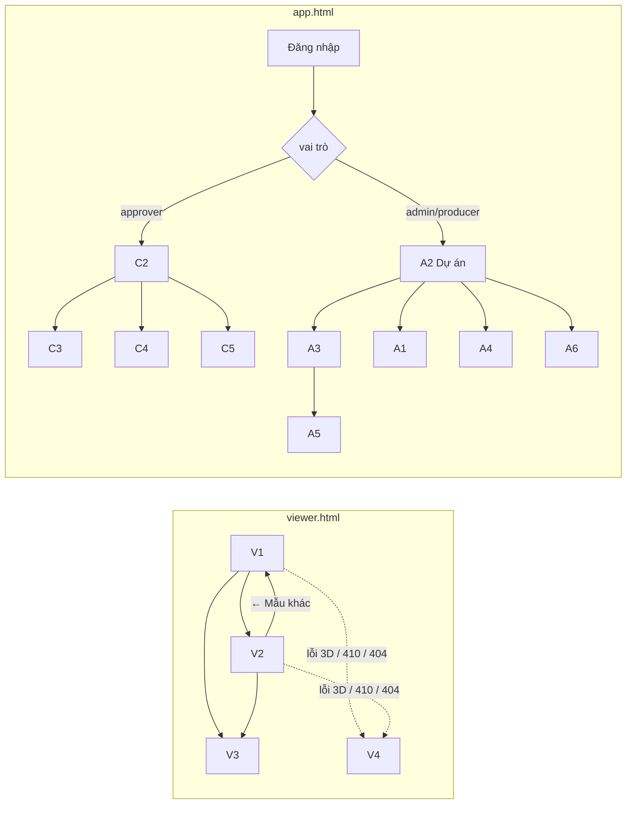

# FE Spec — Nhà mẫu online có bản vẽ · Phase 1 · client `web`

| | |
|---|---|
| Tác giả | FE (agent, DEC-16) |
| Reviewer | ai-lead-review (subagent) |
| Trạng thái | Approved (G2 ✅ 2026-10-24 · agent theo DEC-16, review subagent 2 vòng) |
| Tổng quan & contract | [02-tech-spec.md](02-tech-spec.md) · Màn: [SRS §10](../../system/SRS.md) |
| Last update | 2026-10-24 · FE |

> **TL;DR**
> - `apps/web` là Vite multi-page với 2 entry. `viewer.html` cho `/v/*` (V1–V4, nhẹ). `app.html` cho `/portal/*` (C1–C5) và `/studio/*` (A1–A6).
> - Cảnh 3D mở rộng từ prototype (r3f + drei): nhiều tầng, ẩn tầng trên, tải GLB đã tối ưu (meshopt), cắt ngang cho tầng có GLB, cắt tường cho tầng dựng từ khung.
> - Mặt bằng và PDF đều dùng `core.planSvg`; PDF tạo trong trình duyệt bằng jsPDF + svg2pdf.
> - Phần khó nhất là **trình dựng A3**: trình vẽ 2D bằng SVG (tường, phòng, cửa, cầu thang, hiệu chỉnh tỷ lệ, bắt điểm, hoàn tác), cùng tab 3D để căn mô hình và gắn đồ. State dùng zustand, autosave với `If-Match`.

---

## 1. Phạm vi

| Goals | Non-goals |
|---|---|
| Mọi màn SRS §10 (V1–V4, C1–C5, A1–A6) và FR cột FE trong 02 | Trần/điện, DXF, TCVN (P2); giá (P3) |
| Đạt NFR-01–03 trên trang xem | Tự phát hiện phòng bằng cách bấm vào vùng kín (để P2) |
| E2E Playwright cho luồng người xem | Ứng dụng mobile native |

| Màn / luồng | Route | FR / UC | Phân loại |
|---|---|---|:---:|
| V1 Trang dự án | `/v/:projectSlug` | 06.01, 09.01, 10.01 / UC-06 | EXTEND `HouseList.tsx` |
| V2 Xem mẫu nhà | `/v/:projectSlug/:houseSlug?floor=&room=&src=` | 06.*, 07.01–07.04, 05.05 / UC-06, 07 | EXTEND `Viewer.tsx`, `HouseScene.tsx` |
| V3 Form lead | ngăn kéo trong V1/V2 | 10.01–10.06 / UC-08 | NEW |
| V4 Dự phòng / Không khả dụng | trong V1/V2 | 06.12, EX-10 | NEW |
| C1 Đăng nhập, quên, đặt mật khẩu | `/portal/login`, `/portal/forgot`, `/portal/set-password#token=` (token ở fragment để không vào log, R-28; studio dùng chung `/studio/login`…) | 01.05 | NEW |
| V5 Chính sách dữ liệu | `/v/:projectSlug/chinh-sach-du-lieu` | NFR-04 | NEW |
| C2 Dự án của tôi | `/portal` | 09.02, 09.03 | NEW |
| C3 Xem trước & duyệt | `/portal/review/:versionId` — **gọi API-34 trước**: `draft` → hiện thông báo theo metadata (rút về / đã yêu cầu sửa); khác → gọi **API-39** (cùng shape API-61) để dựng cảnh; API-33 cho lịch sử (N-05) | 08.03–08.05 / UC-05 | NEW (dùng lại V2) |
| C4 Lead | `/portal/leads?project=` | 10.05 / UC-09 | NEW |
| C5 Thống kê | `/portal/stats?project=` | 11.02, 11.03 / UC-09 | NEW |
| A1 Khách hàng & tài khoản | `/studio/clients`, `/studio/clients/:id`, `/studio/users` | 01.01, 01.04, 01.06 / UC-01 | NEW |
| A2 Dự án | `/studio/projects`, `/studio/projects/:id` (tab Thông tin · Tài liệu · Mẫu nhà · **Chia sẻ**: link, mã nhúng, QR) | 01.02, 01.03, 02.*, 03.01, 03.09, 09.02, 09.03 | NEW |
| A3 Trình dựng | `/studio/houses/:houseId/edit` (phiên bản mở mới nhất) | 03.02–03.08, 04.*, 05.02–05.04 / UC-02…04 | NEW |
| A4 Thư viện đồ | `/studio/library` | 05.01 | NEW |
| A5 Phiên bản & phát hành | `/studio/houses/:houseId/versions` | 08.01–08.08 / UC-05, 11 | NEW |
| A6 Lead & thống kê toàn hệ thống | `/studio/leads`, `/studio/stats` — lọc `clientId` (chỉ admin), project tuỳ chọn | 10.05, 11.02 | NEW (dùng lại C4/C5) |

## 2. Điều hướng

**Guard (app.html):** `useMe()` (API-03).
- 401 → `/portal/login?next=`, hoặc `/studio/login?next=` nếu đang ở `/studio`.
- approver vào `/studio/*` → `/portal`. admin/producer vào `/portal/*` → `/studio/projects` (admin vẫn mở được C3 để xem như khách).
- producer vào A1/A5 (hành động), A6 → màn "Không có quyền". Producer được xem danh sách phiên bản ở chế độ chỉ đọc.

## 3. Cây component

| Component | Mới / reuse (path) | Props / input chính | Ghi chú |
|---|---|---|---|
| `core` (package) | `packages/core` | — | schema, `planSvg`, `roomArea`, `submitChecks`, `normalizePhoneVN` |
| `HouseScene` | EXTEND `src/three/HouseScene.tsx` → `apps/web/src/scene/HouseScene.tsx` | `data: ViewerData`, `floorId \| 'all'`, `roomId`, `mode: orbit·facade·inside`, `wallMode`, `night`, `selectedItemId`, callbacks | Một cảnh dùng cho V2, C3, A3 (xem trước) |
| `FloorGroup` | NEW `scene/FloorGroup.tsx` | `floor`, `elevation`, `visible`, `wallMode`, `model?`, `topClip` | Theo 02 §8 "Cắt tường" (DEC-29): **Không GLB** → tường từ `core.wallSegments`, Tự cắt = hạ đoạn tường có camera và điểm nhìn ở hai phía (tích có hướng, đúng với tường xiên). **Có GLB** → Tự cắt = ẩn node `wall_*` có tâm bbox nằm giữa camera và điểm nhìn (kiểm phía theo trục dài của bbox); không có node `wall_*` → mặt cắt ngang sàn + 1.500 mm; Tường thấp = mặt cắt ngang sàn + 1.200 mm; Đầy đủ = không cắt. `renderer.localClippingEnabled = true`; clipping chỉ gắn vào vật liệu của mô hình tầng/cả nhà/ngoại thất, **không** gắn vào đồ thư viện. Khi chọn một tầng: thêm mặt cắt đỉnh tầng (cao độ + chiều cao) cho `wholeModel` và `exterior` để ẩn phần trên |
| `WallsFromDoc` | EXTEND `src/three/Structure.tsx:51-141` | `floor` | Sinh khối tường có lỗ cửa từ `core.wallSegments()`; thuật toán cắt cũ chỉ cho tường song song trục → thay bằng tích có hướng |
| `FloorSurface` | EXTEND `Structure.tsx#Floor` | `room` (đa giác) | Sàn phòng: `ShapeGeometry` từ polygon; texture theo `function` (gỗ cho phòng ngủ/khách, gạch cho WC/bếp) |
| `ItemNode` | EXTEND `src/three/Furniture.tsx` | `item`, `resolved`, `selected` | GLB thư viện → `useGLTF`; không có → `FurnitureModel` (REUSE `src/three/models.tsx`) theo `fallbackShape`; `modelNode` → highlight node trong GLB tầng |
| `ModelLoader` | NEW `scene/useModel.ts` | url | `useGLTF(url, false, true /*meshopt*/)`; nhân bản an toàn cho nhiều instance |
| `CameraRig` | EXTEND `HouseScene.tsx#CameraRig` | | Thêm cao độ tầng, viewpoint có sẵn, mặt tiền |
| `PlanView` | EXTEND `src/components/FloorPlan.tsx` → `components/PlanView.tsx` | `floor`, `onRoomClick`, `highlightRoomId` | Render `core.planSvg()` bằng `dangerouslySetInnerHTML`. An toàn nhờ `escapeXml` trong core (02a test UT-core có `<script>`, `"onload=`) và CSP không cho inline script (R-16). Pan/zoom bằng pointer; bấm phòng nhận qua `data-room-id` |
| `exportPlanPdf` | NEW `lib/pdf.ts` | `payload` (shape API-61), `disclaimer` | jsPDF A3 ngang; mỗi tầng 1 trang; `planSvg` tỷ lệ 1:50 nếu vừa khung, không thì 1:100; khối chữ góc phải: dự án, mẫu nhà, tầng, ngày phiên bản, logo, dòng miễn trừ. **Nhúng font Be Vietnam Pro** (`public/fonts/BeVietnamPro-Regular.ttf` + Bold, nạp động, đăng ký cho cả jsPDF và svg2pdf) để có dấu tiếng Việt (R-10). Trình duyệt trong Zalo/Facebook (UA chứa `Zalo` hoặc `FBAN`/`FBAV`) → không tạo PDF; hiện hộp "Mở bằng trình duyệt để tải PDF" + nút Sao chép link |
| `ViewerShell` (V2) | EXTEND `src/components/Viewer.tsx` | | Thanh trên, `FloorPicker`, `RoomPanel`, `ItemPanel`, `ModeBar`, `Disclaimer`, `ContactBar` |
| `ProjectPage` (V1) | EXTEND `src/components/HouseList.tsx` | | Thẻ mẫu nhà + bộ lọc loại nhà |
| `LeadDrawer` (V3) | NEW | `projectSlug`, `houseSlug?`, `context` | |
| `Fallback` (V4) | NEW | `kind: no3d·unavailable`, `payload?` | `no3d`: ảnh đại diện + `gallery` (R-32) + PlanView từng tầng + Tải PDF + liên hệ |
| `BrandTheme` | NEW | `branding` | Đặt CSS var `--brand` (+ màu chữ tương phản tự tính) |
| `AppLayout`, `DataTable`, `FormField`, `ConfirmDialog`, `Toast`, `EmptyState`, `ErrorState`, `Forbidden` | NEW `app/ui/*` | | Dùng chung cho portal/studio |
| `MiniBarChart`, `StatTiles` | NEW `app/ui/charts.tsx` | | SVG tự vẽ, không thêm thư viện chart |
| `StudioEditor` (A3) | NEW `studio/editor/*` | `versionId` | Xem §3.1 |

### 3.1 Trình dựng A3

| Phần | File | Nội dung |
|---|---|---|
| Store | `studio/editor/store.ts` (zustand) | `doc`, `revision`, `floorId`, `tool`, `selection`, `undo[]`/`redo[]` (lưu bản sao tài liệu trước mỗi thao tác, tối đa 100), `dirty`, `saveState: idle·saving·error·conflict` |
| Autosave | `studio/editor/useAutosave.ts` | Debounce 1.500 ms sau thay đổi → API-35 kèm `If-Match`. 409 REVISION_CONFLICT → `conflict` (thông báo + Tải lại). Mất mạng → thử lại sau 5 giây; chặn rời trang (`beforeunload`) khi `dirty` |
| Canvas 2D | `studio/editor/PlanCanvas.tsx` | SVG toạ độ mm; pan (giữ Space/chuột giữa, kéo hai ngón), zoom (cuộn/chụm) 1:10–1:500; lớp nền (ảnh hoặc trang PDF render bằng `pdfjs-dist` thành ảnh), lớp khung, lớp kích thước, lớp chọn |
| Tầng | `studio/editor/FloorList.tsx` | Thêm (tối đa 10), sắp xếp, sửa tên/cao độ/chiều cao, **sao chép tầng** (FR-03.09: sao chép khung + đồ, đổi id, cao độ = tầng trên cùng + chiều cao), xoá (xác nhận) |
| Công cụ | `studio/editor/tools/*.ts` | `select` (chọn, kéo đỉnh, xoá), `calibrate` (vẽ đoạn → nhập mm → `mmPerPx`, `calibrated=true`), `wall` (click liên tiếp, Enter/đúp để kết thúc, độ dày mặc định 200 ngoài/100 trong), `room` (đa giác, bắt vào mặt trong tường), `door`/`window` (click lên tường → offset theo vị trí; mặc định cửa đi 900×2.100, cửa sổ 1.200×1.400 bậu 900), `stair` (chữ nhật + hướng lên + tầng nối), `area` (đa giác ngoài nhà), `outline` (đường bao tầng), `measure` |
| Bắt điểm | `studio/editor/snap.ts` | Bắt đỉnh tường ≤ 12 px màn hình, bắt góc 0/45/90° khi giữ Shift (hoặc bật sẵn), bắt lưới 50 mm |
| Thuộc tính | `studio/editor/Inspector.tsx` | Theo loại đối tượng (02 §5.2); nhập số mm |
| Tab Mô hình | `studio/editor/ModelTab.tsx` | Tải GLB (API-37), poll API-38 mỗi 2 giây, thẻ báo cáo (từng mô hình + tổng ngân sách góc xem tầng từ `core.budgetForFloor`); gắn cho tầng / ngoại thất / cả nhà; căn bằng ô số + `TransformControls` (drei); lớp khung trong suốt chồng lên. **EX-4:** sau khi căn, so bbox mặt bằng của mô hình (đã biến đổi) với bbox mép ngoài tường của tầng; lệch > 200 mm ở cạnh bất kỳ → cảnh báo vàng "Mô hình lệch khung {n} mm ở cạnh {trái/phải/trên/dưới}" (R-31). Hướng dẫn quy ước tên node `item_*`, `wall_*` ngay trên thẻ tải lên |
| Tab Đồ | `studio/editor/ItemsTab.tsx` | Danh sách thư viện (API-40) → bấm "Đặt" rồi bấm sàn trong 3D; xoay/di chuyển bằng ô số và kéo; "Chọn từ mô hình" → bấm mesh trong GLB → lấy `nodeName` → form thông tin; `core.assignItemsToRooms` hiển thị phòng |
| Tab Điểm nhìn & ảnh | `studio/editor/ViewpointsTab.tsx` | "Lưu góc nhìn hiện tại", đặt mặc định, bật Đêm, "Chụp ảnh đại diện" (canvas `toBlob` → API-23 kind cover → `coverFileId`); **thư viện ảnh phối cảnh** (≤ 12, API-23 kind `gallery_image` → `gallery`) cho V4 |
| Kiểm gửi duyệt | `studio/editor/ChecksBar.tsx` | `core.submitChecks` chạy ngay trên client (cùng logic server) |

## 4. State & data fetching

| Dữ liệu | Nguồn | Nơi giữ | Cache & làm mới | Optimistic? |
|---|---|---|---|:---:|
| Dự án công khai | API-60 | state trang (viewer không dùng TanStack Query, giữ bundle nhẹ) | Tải một lần | — |
| Mẫu nhà công khai / xem trước | API-61 (công khai) · API-39 (C3, nút Xem trước của A3 — cùng shape) | state trang | Tải một lần; mô hình GLB tải theo tầng (tầng mặc định trước, các tầng khác sau khi cảnh đầu tiên hiện) | — |
| Sự kiện xem | API-63 | `lib/tracker.ts` (hàng đợi bộ nhớ) | Gửi lô mỗi 5 giây hoặc khi đủ 20; `pagehide` → `fetch(keepalive)` | — |
| Phiên/thiết bị | — | `deviceId` ở localStorage; `sessionId` + `lastActivity` ở sessionStorage; > 30 phút không tương tác → session mới (BR-10). Lỗi storage → id trong bộ nhớ | | |
| Người dùng | API-03 | TanStack Query `['me']` | staleTime 5 phút | — |
| Danh sách (clients, users, projects, houses, library, leads) | API-10, 12, 20, 30, 40, 70 | TanStack Query | Invalidate sau mutation tương ứng | Không |
| Đánh dấu lead đã liên hệ | API-71 | TanStack Query | | ✔ (hoàn tác khi lỗi) |
| Phiên bản + tài liệu | API-34 | Query → nạp vào zustand khi mở A3 | Không refetch tự động khi đang sửa | — |
| Báo cáo mô hình | API-38 | Query poll 2 giây khi `processing` | Dừng khi ready/failed | — |
| Thống kê | API-80 | Query `['stats', projectId, from, to, houseId]` | staleTime 60 giây | — |

**Lớp gọi API:** `lib/api.ts`: `api<T>(method, path, body?, {ifMatch?})`. Hàm này luôn gửi `credentials: 'include'` và `X-Requested-With: fetch`, parse lỗi `02` §6 thành `ApiError {status, code, fields}`. Upload dùng `XMLHttpRequest` để có tiến trình, **tự đặt** `X-Requested-With: fetch` và `withCredentials` (N-3). Dev: Vite proxy `/api`, `/files` → `http://localhost:8787`.

## 5. Form & validate

Không dùng thư viện form. `useForm(schema)` tự viết nhỏ, validate bằng zod (dùng chung schema với `core` khi có).

| Form | Field | Rule client | Lỗi server → field |
|---|---|---|---|
| Đăng nhập | email, password | email hợp lệ; password bắt buộc | INVALID_CREDENTIALS/ACCOUNT_LOCKED/ACCOUNT_DISABLED → thông báo đầu form |
| Đặt mật khẩu | password, nhập lại | ≥ 8 ký tự; khớp | TOKEN_INVALID → thông báo + link "Yêu cầu gửi lại" |
| Khách hàng | name, brandColor, contact.*, plan, hostingUntil, logo | name bắt buộc; màu `#RRGGBB`; SĐT `normalizePhoneVN` | VALIDATION_ERROR.fields |
| Tài khoản | email, name, role, client | approver phải chọn khách hàng | EMAIL_TAKEN → email |
| Dự án | name, slug (tự sinh từ tên, bỏ dấu), location, description, cover, phone, zalo, leadEmails, disclaimer | slug `^[a-z0-9]+(-[a-z0-9]+)*$` | SLUG_TAKEN → slug |
| Mẫu nhà | name, slug, houseType, declaredArea, bedrooms, bathrooms, description | số trong khoảng 02a §4 | SLUG_TAKEN → slug |
| Đồ thư viện | name, category, sizeMm, material, brand, description, images, model, fallbackShape, variants | kích thước 1–20.000 | VALIDATION_ERROR.fields |
| Yêu cầu sửa (C3) | note, targets | note ≥ 10 ký tự | VALIDATION_ERROR |
| Duyệt thay (A5) | decision, note, evidence | bằng chứng bắt buộc | VALIDATION_ERROR |
| Lead (V3) | name, phone, email, interest (4 lựa chọn enum 02 §6.1), message, consent, *(formToken quá 1 giờ 50 phút kể từ lúc tải trang → gọi lại API-60 lấy token mới trước khi gửi, N-08)*, `website` (honeypot ẩn bằng CSS + `tabindex=-1`, `autocomplete=off`), `formToken` (từ `antiBot` của API-60/61) | phone qua `normalizePhoneVN`; consent bắt buộc | VALIDATION_ERROR.fields; CAPTCHA_REQUIRED → nạp script Turnstile với `antiBot.turnstileSiteKey`, gửi lại kèm `captchaToken`. Không có site key (local) → "Bạn đã gửi quá nhiều lần. Thử lại sau ít phút." (R-13) |

## 6. Trạng thái UI

Chữ và trạng thái chi tiết theo SRS §10.4. Bảng dưới chỉ ánh xạ sang hiện thực.

| Màn | Loading | Empty | Error | Forbidden | Success |
|---|---|---|---|---|---|
| V1 | Thẻ xương 3 ô | "Dự án đang cập nhật mẫu nhà…" | `ErrorState` + Thử lại; 404/410 → V4 | — | — |
| V2 | Ảnh đại diện mờ + % tải tầng; >15 giây → gợi ý xem mặt bằng | Phòng không có đồ: chữ trong panel | Lỗi GLB → thông báo + Thử lại + Xem mặt bằng; không WebGL2 → V4 | — | Toast "Đã sao chép link" |
| V3 | Nút "Đang gửi…" | — | Giữ dữ liệu, "Chưa gửi được…" | — | Màn cảm ơn |
| C2 | Bảng xương | "Chưa có dự án nào…" | `ErrorState` | → C1 nếu 401 | Toast "Đã sao chép mã nhúng" |
| C3 | Như V2 | — | INVALID_STATE → thông báo đã xử lý + tải lại. API-34 trả draft-metadata → nếu `lastSubmission.withdrawnAt` → "Phiên bản này đã được nhà cung cấp rút lại để chỉnh sửa."; nếu review cuối là changes_requested → "Phiên bản {n} đã được yêu cầu sửa lúc {giờ} bởi {người}." (R-11) | `Forbidden` (khác khách hàng) | Toast duyệt / yêu cầu sửa |
| C4 / A6 | Dòng xương | "Chưa có lead nào…" | `ErrorState` | `Forbidden` | Toast; CSV tải về |
| C5 / A6 | Ô số xương | "Chưa có lượt xem…" + "Lấy link & QR" | `ErrorState` | `Forbidden` | — |
| A1, A2, A4 | Bảng xương | Chữ trống + nút tạo | `ErrorState` | `Forbidden` | Toast "Đã lưu" |
| A3 | Spinner toàn màn khi nạp tài liệu | Tầng chưa có khung: hướng dẫn hiệu chỉnh | Lưu lỗi → dải đỏ "Mất kết nối — sẽ lưu khi có mạng"; 409 → hộp xung đột | `Forbidden` | "Đã lưu lúc HH:MM" |
| A5 | Bảng xương | "Chưa gửi duyệt lần nào." | SUBMIT_BLOCKED → danh sách lý do | Producer: nút ẩn, chỉ xem | Toast phát hành / gỡ |

## 7. Phân quyền trên UI

| Hành động / màn | Role thấy | Không quyền thì |
|---|---|---|
| A1, A5 (nút hành động), A6 | admin | Ẩn mục menu; vào thẳng URL → `Forbidden` |
| A2, A3, A4 | admin, producer | approver bị chuyển `/portal` |
| C2–C5 | approver (admin xem C3 qua link) | Không thuộc khách hàng → `Forbidden` (server trả 403) |
| Sửa liên hệ, email nhận lead, miễn trừ, chính sách, slug của dự án (A2) | admin | producer: ô chỉ đọc (server trả 403 FIELD_FORBIDDEN) |
| Lead trong A6 | admin | producer: ẩn |

## 8. Xử lý lỗi API

| Mã lỗi | Hiển thị | Hành động |
|---|---|---|
| UNAUTHENTICATED | — | Chuyển trang đăng nhập kèm `next` |
| FORBIDDEN | `Forbidden`: "Bạn không có quyền xem trang này." | Về trang chính theo vai trò |
| CSRF | Toast "Phiên làm việc đã thay đổi. Tải lại trang." | Nút Tải lại |
| VALIDATION_ERROR | Lỗi dưới từng ô | — |
| REVISION_CONFLICT | Hộp: "Mẫu nhà vừa được sửa ở nơi khác. Tải lại để tiếp tục." | Tải lại tài liệu, bỏ thay đổi chưa lưu (đã cảnh báo) |
| VERSION_LOCKED | A3 chuyển chỉ xem | — |
| SUBMIT_BLOCKED | A5 liệt kê `checks` (bấm → mở A3 đúng tầng) | — |
| INVALID_STATE | "Phiên bản đã được xử lý bởi người khác." | Refetch |
| DRAFT_EXISTS | Mở phiên bản đang có | — |
| ITEM_IN_USE | "Đồ này đang dùng ở {n} mẫu nhà, không xoá được." | — |
| SLUG_TAKEN, EMAIL_TAKEN | Lỗi tại ô | — |
| SLUG_LOCKED | "Đường dẫn đã khoá vì đã phát hành (link và QR đã chia sẻ sẽ hỏng nếu đổi)." | — |
| FIELD_FORBIDDEN | "Bạn không có quyền sửa mục này." | — |
| LAST_ADMIN | "Không thể vô hiệu quản trị viên cuối cùng." | — |
| FILE_TOO_LARGE, UNSUPPORTED_FILE | Toast tên tệp + lý do | — |
| CAPTCHA_REQUIRED | Xác minh trong V3 | Gửi lại |
| PROJECT_UNAVAILABLE, NOT_FOUND (công khai) | V4 Không khả dụng | — |
| RATE_LIMITED, INTERNAL, mạng | "Đã có lỗi, thử lại sau." | Thử lại |

## 9. Nội dung chữ · i18n · a11y · responsive
- Chỉ tiếng Việt ở Phase 1. Chuỗi gom vào `src/i18n/vi.ts` (object key → chuỗi) để P3 thêm ngôn ngữ. Chữ lấy từ SRS §10.4.
- Định dạng: `Intl.NumberFormat('vi-VN')` cho diện tích (`15,12 m²`) và số; ngày `dd/MM/yyyy HH:mm` theo `Asia/Ho_Chi_Minh`.
- A11y:
  - Mọi nút có nhãn; focus nhìn thấy được.
  - Panel tầng/phòng điều khiển được bằng bàn phím (Tab, Enter).
  - Cảnh 3D có danh sách phòng/đồ thay thế cho trình đọc màn hình.
  - Tương phản chữ trên màu thương hiệu được tự tính (đen hoặc trắng theo độ sáng).
- Responsive: breakpoint 860 px. Dưới 860 px, V2 dùng chip tầng cuộn ngang, ngăn kéo phòng/đồ và thanh liên hệ cố định đáy (DEC-13, DEC-14). Studio chỉ hỗ trợ màn ≥ 1.280 px; nhỏ hơn thì hiện thông báo "Trình dựng cần màn hình máy tính".

## 10. Riêng nền tảng (web)
- **Trình duyệt:** NFR-03. Cần WebGL2 cho 3D; kiểm bằng `canvas.getContext('webgl2')`. Trình duyệt trong Zalo/Facebook: tránh API không có sẵn (Web Share → nút sao chép link dự phòng; `navigator.clipboard` lỗi → chọn sẵn văn bản).
- **Bundle:**
  - `viewer.html` ≤ 900 KB gzip (three + r3f + drei chọn lọc; jsPDF và svg2pdf nạp động khi bấm "Tải PDF"; form lead nạp động).
  - `app.html` không giới hạn chặt; `pdfjs-dist` nạp động trong A3.
- **Hiệu năng cảnh:**
  - `dpr` tối đa 2 (mobile 1,5).
  - Bóng đổ chỉ ở desktop; trên mobile chỉ dùng ánh sáng môi trường, không đổ bóng.
  - Đèn điểm ban đêm tối đa 1 đèn mỗi phòng đang xem.
  - Tầng ẩn không render (`visible=false`).
- **SEO / chia sẻ:** server chèn thẻ `og:title`, `og:description`, `og:image` cho `/v/:slug` và `/v/:slug/:house` vào placeholder `<!--OG-->` của `viewer.html` (02a §4 "web /v/*", task B3/B9). Studio/portal: server đặt `X-Robots-Tag: noindex`.
- **CSP:** viewer không có inline script (Vite build tách file). Chuỗi CSP đầy đủ ở 02 §8 (meshopt WASM cần `wasm-unsafe-eval`; Turnstile iframe; ảnh `blob:`/`data:`). E2E-01 chạy qua server thật để kiểm CSP (N-01).
- **Nhúng:** `?src=embed` hoặc `window.self !== window.top` → nguồn `embed`; ẩn nút toàn màn hình nếu không hỗ trợ.
- **QR & mã nhúng (C2, A2):** thư viện `qrcode` tạo PNG/SVG phía client; nội dung QR = `{origin}/v/{slug}[/{house}]?src=qr` (FR-09.04, R-24). Mã nhúng: `<iframe src="{origin}/v/{slug}?src=embed" width="100%" height="640" style="border:0" allow="fullscreen" loading="lazy"></iframe>`.

## 11. Analytics & theo dõi lỗi

| Event (API-63 `type`) | Khi nào | Thuộc tính |
|---|---|---|
| project_open | V1 hiển thị | — |
| house_open | V2 hiển thị cảnh đầu tiên | houseSlug |
| floor_select | Chọn tầng | targetId = floorId |
| room_select | Chọn phòng | targetId = roomId |
| walk_mode | Bật đứng trong phòng | targetId = roomId |
| item_open | Mở chi tiết đồ | targetId = itemId |
| plan_open | Mở tab Mặt bằng | — |
| pdf_download | Tải PDF | — |
| contact_click | Bấm Gọi / Zalo / Để lại SĐT | targetId = `call·zalo·form` |
| lead_submit | Gửi lead thành công | — |
| fallback_shown | V4 dự phòng | — |

Lỗi JS: `window.onerror` và `unhandledrejection` được ghi `console.error`. Phase 1 chưa có dịch vụ thu lỗi (Q mở FE-Q1).

## 12. Mock khi BE chưa xong
Lát 1 (`03`) làm trang xem từ dữ liệu seed qua API thật nên không cần mock. Trong unit test, `lib/api.ts` được thay bằng `vi.fn()` trả fixture đúng shape 02 §6 (thư mục `test/fixtures/`).

## 13. Test FE

| Mức | Phạm vi | Case chính |
|---|---|---|
| Unit | `tracker` (session 30 phút), `useForm`, `exportPlanPdf` (số trang = số tầng), snap, tools (calibrate tính `mmPerPx`), store undo/redo | UT-web-* |
| Component (Vitest + jsdom) | LeadDrawer (validate, lỗi server), FloorPicker, PlanView bấm phòng | CT-web-* |
| E2E (Playwright, Chrome) | Seed → mở V1 → lọc Biệt thự → V2 → chọn tầng 2 → chọn phòng → mở đồ → tab Mặt bằng → Tải PDF → gửi lead → đăng nhập portal → thấy lead; luồng duyệt: studio submit → portal duyệt → studio phát hành → V2 hiện phiên bản mới | E2E-01, E2E-02 |
| Thiết bị thật | Zalo/Facebook in-app iOS + Android (G4) | thủ công |

## 14. Task

| # | Việc | Màn / FR | Phụ thuộc | Ước lượng |
|---|---|---|---|---|
| F1 | Chuyển prototype vào `apps/web`; Vite multi-page; `lib/api.ts`; i18n; theme | — | B1 | 0,5 ngày |
| F2 | Cảnh 3D đa tầng từ `HouseDocument`: tường từ core, sàn đa giác, ẩn tầng trên, camera theo tầng, cắt ngang GLB, đồ thư viện / fallback, viewpoint | V2 / 04.04, 06.02–06.07 | B2, B9 | 2 ngày |
| F3 | V1 + V2 shell (panels, chế độ, mobile, chia sẻ, deep link, miễn trừ, branding) + V4 | 06.*, 09.01 | F2 | 1,5 ngày |
| F4 | Tab Mặt bằng + PDF (font tiếng Việt, dự phòng in-app browser) | 07.01–07.04 | B2, F3 | 1 ngày |
| F5 | Tracker sự kiện | 11.01 | B11, F3 | 0,5 ngày |
| F6 | V3 lead + chống bot + V5 chính sách dữ liệu | 10.01–10.06, NFR-04 | B10, F3 | 0,5 ngày |
| F7 | app.html: layout, auth (C1), guard, ui kit | 01.05 | B4 | 1 ngày |
| F8 | A1 khách hàng & tài khoản | 01.01, 01.04 | F7 | 0,5 ngày |
| F9 | A2 dự án (thông tin, tài liệu, mẫu nhà, sao chép) | 01.02, 02.*, 03.01, 03.09 | F7, B5 | 1 ngày |
| F10 | A4 thư viện đồ | 05.01 | F7, B7 | 0,5 ngày |
| F11 | A3 trình dựng — store, autosave, canvas, tầng, công cụ khung, hiệu chỉnh, bắt điểm, undo | 03.02–03.08 | F9, B5 | 3 ngày |
| F12 | A3 — tab Mô hình (upload, báo cáo, căn) | 04.01–04.03 | F11, B6 | 1 ngày |
| F13 | A3 — tab Đồ, Điểm nhìn & ánh sáng, ảnh đại diện, thanh kiểm | 04.05–04.07, 05.02–05.04 | F12, F10 | 1,5 ngày |
| F14 | A5 phiên bản & phát hành | 08.01–08.08 | F11, B8 | 1 ngày |
| F15 | C2 dự án (link, nhúng, QR) + C3 xem trước & duyệt (API-39, trạng thái rút về/đã xử lý) + tab Chia sẻ ở A2 | 08.03–08.05, 09.02, 09.03 | F3, F7, B8 | 1 ngày |
| F16 | C4 lead + C5 thống kê + A6 | 10.05, 11.02, 11.03 | F7, B10, B11 | 1 ngày |
| F17 | E2E Playwright | AC-* | tất cả | 0,5 ngày |

## Phương án đã cân nhắc

| Phương án | Ưu | Nhược | Chọn? |
|---|---|---|---|
| Trình vẽ 2D bằng SVG vs Canvas 2D vs thư viện (Konva) | SVG: toạ độ mm trực tiếp, sự kiện theo phần tử, dùng chung kiểu `planSvg` | Chậm khi > 5.000 phần tử (không xảy ra với một tầng) | SVG |
| Cắt GLB: clipping ngang vs ẩn node `wall_*` theo hướng | Clipping: ổn định mọi mô hình | Clipping: Tự cắt = Tường thấp, sai FR-06.06 | Ẩn `wall_*` theo hướng + clipping làm dự phòng (DEC-29) |
| TanStack Query cho viewer | Thống nhất | +13 KB, không cần cho 2 request | Chỉ dùng ở app.html |
| PDF bằng `window.print()` | Không thêm thư viện | Không kiểm soát tỷ lệ, không chạy được trong in-app browser | jsPDF + svg2pdf |

## Rủi ro & câu hỏi mở

| ID | Rủi ro / câu hỏi | Ảnh hưởng | Giảm thiểu | Hạn |
|---|---|---|---|---|
| FE-R1 | Trình dựng A3 tốn công hơn ước lượng | Trễ P1 | Giới hạn công cụ ở mức AC-01; tự phát hiện phòng để P2 | F11 |
| FE-R2 | Bundle viewer vượt 900 KB | NFR-01 | Import drei theo đường dẫn con; nạp động PDF/lead | F3 |
| FE-R3 | Clipping plane trên mobile cũ chạy chậm | NFR-02 | Đo ở G4; tắt clipping khi FPS < 25 | G4 |
| FE-Q1 | Có dùng dịch vụ thu lỗi (Sentry…) không? | Theo dõi lỗi | Để P2 | — |

## Decisions

| DEC | Bối cảnh | Lựa chọn | Lý do | Người chốt |
|---|---|---|---|---|
| DEC-24 | Router | react-router 7 cho cả 2 entry | Quen thuộc, hỗ trợ lazy route | Agent |
| DEC-25 | State | TanStack Query (app), zustand (A3), state cục bộ (viewer) | Đúng việc, viewer nhẹ | Agent |
| DEC-26 | Cắt mô hình GLB | ~~Clipping ngang cố định~~ → **thay bằng DEC-29** (02): node `wall_*` + dự phòng clipping | Giữ FR-06.06 | Agent |
| DEC-27 | Studio chỉ máy tính | ≥ 1.280 px | Trình dựng cần chuột và màn lớn | Agent |
