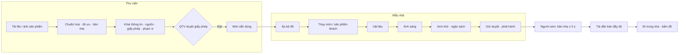
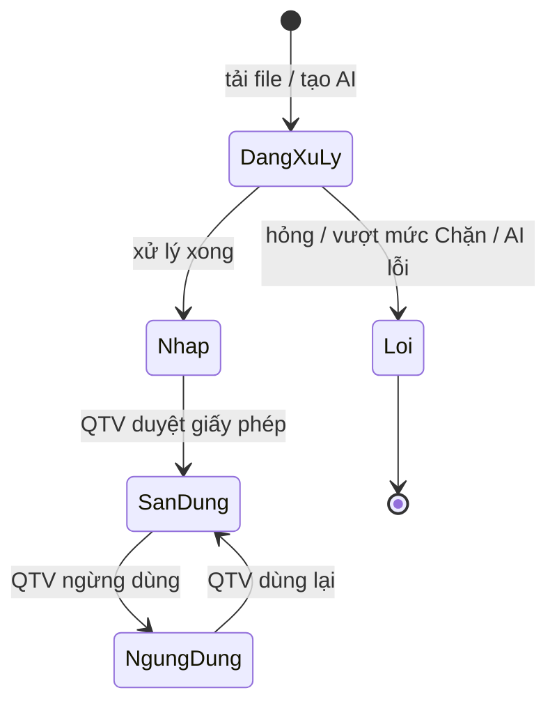

# SRS item 03 — Đồ thật trong nhà 3D

| | |
|---|---|
| Item | `03-realistic-furniture` · lane feature · quy mô L |
| Phiên bản | 1.0 — Approved (G1 ✅ 2026-10-26, user: "Code đi"); Q-R1…Q-R4 đã chốt (DEC-R5…R8) · 0.1 — Draft |
| Liên quan SRS hệ thống | Sẽ thành CR-3 của `docs/ai/system/SRS.md` sau G1: thêm module **M13 Đồ thật & nhà chân thực**; sửa FR-05.01, FR-05.05, FR-06.08, BR-07, NFR-01/02 (chi tiết §5.2) |
| Nguồn | Yêu cầu user 2026-10-26: "Mở rộng tính năng sa hình. Giờ t muốn chèn đồ thật, thay vì mô hình vào từng thiết kế, cảm giác người dùng đang đi trong 1 ngôi nhà thật." · Trả lời làm rõ cùng ngày (DEC-R1…R4) · Khảo sát nguồn đồ 3D 2026-10-26 (§11) |
| Owner | khanhtt |
| Last update | 2026-10-26 · PO |

> **TL;DR**
> - Hiện đồ trong nhà 3D là **khối hình học** (sofa, giường… dựng bằng hộp), tường và sàn một màu, ánh sáng phẳng. Nhìn giống mô hình, không giống nhà thật.
> - Item này thay bằng **đồ 3D chân thực**, kèm **vật liệu thật** cho tường, sàn, trần, cửa (gỗ, đá, gạch, sơn) và **ánh sáng tự nhiên** (nắng qua cửa sổ theo hướng nhà, bóng đổ mềm, đèn ban đêm). Người xem đi trong nhà ở chế độ Đứng trong phòng (đã có bộ vật lý, DEC-53) và thấy như đang ở trong một ngôi nhà thật.
> - Đồ có hai loại (DEC-R1):
>   - **kho đồ chuẩn** do đội mình chuẩn bị, dùng cho mọi nhà;
>   - **sản phẩm thật của khách** (đúng mẫu họ bán, có thương hiệu), chỉ dùng trong dự án của khách đó.
>
>   Mỗi mẫu nhà dùng đồ chuẩn làm mặc định và thay được từng món bằng sản phẩm của khách.
> - Nguồn đồ (DEC-R3):
>   - kho miễn phí có giấy phép thương mại (Poly Haven CC0…);
>   - **AI tạo mô hình từ ảnh sản phẩm**;
>   - **file 3D của khách**.
>
>   Mỗi món bắt buộc có nguồn và giấy phép, thiếu thì không cho phát hành.
> - Trên điện thoại và trong Zalo, trình xem **tải dần** (DEC-R4): bản nhẹ hiện trước, vẫn giữ mốc hiện hình ≤ 5 giây và ≤ 15 MB lần đầu; đồ và vật liệu chi tiết của phòng đang xem tải sau.
> - **Đã chốt:**
>   - AI tạo 3D để tới lát R5 mới chọn dịch vụ;
>   - khách xuất file GLB/FBX/OBJ, không nhận `.skp`;
>   - kho chuẩn ban đầu 60 món, 30 vật liệu, 2 bộ đồ;
>   - **có cổng tải lên cho khách** (FR-13.19).

---

## 1. Phạm vi

| Trong | Ngoài |
|---|---|
| Mô hình 3D chân thực cho từng món trong thư viện đồ (bản đầy đủ + bản nhẹ) · nhập file 3D (GLB/glTF, FBX, OBJ), tự chuẩn hoá và tối ưu · tạo mô hình từ ảnh sản phẩm bằng AI · nguồn, giấy phép, ghi công · phạm vi sở hữu (kho chung / của một khách) · thay đồ từng món hoặc hàng loạt, bộ đồ theo phong cách · thư viện vật liệu chuẩn và gán vật liệu cho tường, sàn, trần, cửa, bậc thang · ánh sáng tự nhiên theo hướng nhà và giờ, đèn ban đêm · tải dần theo thiết bị và phòng đang xem · mở rộng kiểm gửi duyệt · nâng 4 nhà mẫu demo lên bản chân thực | **Đồ trang trí nhỏ** (rèm, tranh, chăn gối, đồ bếp, sách…) — Phase sau (DEC-R2) · mua mô hình trên chợ mô hình (CGTrader, Fab…) — chưa chọn (DEC-R3), thêm sau được · render ảnh tĩnh kiểu V-Ray/Corona · VR kính · streaming GPU (Pixel Streaming) · giá đồ và tổng giá (FR-05.06, Phase 3, không đổi) · quét 3D cả căn nhà thật (Gaussian splatting, photogrammetry) |

**Thuật ngữ**

| Từ | Nghĩa |
|---|---|
| Đồ thật / mô hình chân thực | Mô hình 3D của một món đồ có hình dáng, kích thước, vật liệu (màu, vân, độ bóng) giống sản phẩm thật. Khác với **khối hình học** hiện nay |
| Kho đồ chuẩn | Các món đồ chân thực do đội mình chuẩn bị, dùng được cho mọi dự án |
| Sản phẩm của khách | Món đồ là sản phẩm thật khách hàng bán (nhà sản xuất, công ty nội thất), thuộc riêng khách đó |
| Bản đầy đủ / bản nhẹ | Hai mức chi tiết của cùng một mô hình. Bản nhẹ dùng cho điện thoại và khi ở xa; bản đầy đủ dùng khi đứng gần, trên máy khoẻ |
| Vật liệu | Bề mặt chân thực (gỗ sồi, đá marble, gạch 600 × 600, sơn trắng ngà…), có vân và kích thước viên/vân thật |
| Bộ đồ | Tập đồ chuẩn cùng một phong cách (Hiện đại, Tối giản, Bắc Âu, Indochine…) để áp nhanh cho cả mẫu nhà |
| Nguồn & giấy phép | Món/vật liệu lấy từ đâu (kho miễn phí, AI, file khách, đội tự làm) và được phép dùng thế nào (CC0, CC BY kèm ghi công, thương mại, độc quyền của khách) |

## 2. Bài toán

**AS-IS.**
- Thư viện đồ (M05) có sẵn chỗ gắn mô hình 3D cho từng món (FR-05.01), nhưng chưa có quy trình nào để có mô hình: lấy ở đâu, chỉnh kích thước, tối ưu cho điện thoại, ghi bản quyền.
- Vì thế cả 4 nhà mẫu và nhà của khách đều hiển thị đồ bằng khối hình học.
- Tường, sàn, trần dùng một màu phẳng; ánh sáng là một nguồn sáng chung, không có nắng qua cửa sổ.

| # | Vấn đề | Hệ quả |
|---|---|---|
| P-R1 | Đồ là khối hình học | Trông như mô hình đồ chơi. Người mua không cảm nhận được chất liệu, tỉ lệ, phong cách. Ảnh chụp từ 3D thua ảnh phối cảnh trên tin đăng |
| P-R2 | Tường, sàn một màu, ánh sáng phẳng | Không có chiều sâu và cảm giác không gian thật. Chế độ Đứng trong phòng (đã đi lại được như game) chưa tạo được cảm giác "đang ở trong nhà" |
| P-R3 | Khách là nhà sản xuất hoặc công ty nội thất muốn người mua thấy **đúng sản phẩm họ bán**, nhưng file 3D của họ thường nặng (hàng chục tới hàng trăm MB, xuất từ 3ds Max), sai đơn vị, sai trục | Đội dựng phải chỉnh tay từng file; dễ vượt ngân sách hiệu năng (BR-07) và chạy giật trên điện thoại |
| P-R4 | Không có kho đồ chân thực sẵn | Mỗi mẫu nhà phải tự tìm, mua, chỉnh đồ; không đạt năng suất NFR-07 |
| P-R5 | Không ghi nguồn và giấy phép của mô hình | Rủi ro vi phạm bản quyền khi phát hành công khai cho khách hàng |

**Mục tiêu**

| Chỉ số | Hiện tại | Mục tiêu |
|---|---|---|
| Tỉ lệ món đồ trong 4 nhà mẫu là đồ chân thực (không phải khối hình học) | 0% | 100% |
| Điểm "giống nhà thật" do ≥ 10 người xem thử chấm (thang 1–5, cùng 3 nhà mẫu, cùng câu hỏi) | đo trước khi làm | ≥ 4,0 và tăng ≥ 1,5 điểm so với hiện tại |
| Thời gian đưa một sản phẩm của khách (đã có file 3D) vào thư viện, dùng được trong mẫu nhà | chưa làm được | ≤ 30 phút |
| Thời gian đưa một sản phẩm chỉ có ảnh (AI tạo + người dựng chỉnh) | chưa làm được | ≤ 2 giờ |
| Áp đồ chuẩn cho cả một mẫu nhà 3 phòng ngủ | — | ≤ 15 phút |
| Hiệu năng trên máy tham chiếu NFR-01 | đạt | **vẫn đạt**: hình 3D đầu ≤ 5 s, ≥ 30 khung hình/giây |
| Món đồ và vật liệu có nguồn + giấy phép | 0% | 100% |

## 3. Tác nhân

Như SRS hệ thống §3. Vai trò thêm hoặc mở rộng:

| Tác nhân | Trong item này |
|---|---|
| Người dựng (đội mình) | Chuẩn bị kho đồ chuẩn và vật liệu; nhập sản phẩm của khách; chạy AI tạo mô hình từ ảnh và chỉnh lại; thay đồ, gán vật liệu, đặt ánh sáng cho từng mẫu nhà |
| QTV | Duyệt giấy phép trước khi món/vật liệu được dùng; quản lý bộ đồ theo phong cách |
| Khách hàng (bên bán) | Tải file 3D hoặc ảnh sản phẩm của họ lên cổng khách (FR-13.19); theo dõi trạng thái; duyệt mẫu nhà ở C3 như hiện có |
| Người xem | Đi trong nhà chân thực; bấm vào đồ xem thông tin sản phẩm |

## 4. Quy trình TO-BE

**Map yêu cầu thô → bước TO-BE**

| Yêu cầu thô | Bước |
|---|---|
| "chèn đồ thật" | A1–A5 (có đồ thật trong thư viện), C2–C3 (đưa vào mẫu nhà) |
| "thay vì mô hình vào từng thiết kế" | C1–C3: thay khối hình học bằng đồ chân thực, từng món hoặc cả bộ |
| "cảm giác người dùng đang đi trong 1 ngôi nhà thật" | C4–C5 (vật liệu, ánh sáng), D1–D3 (trình xem tải dần, đi trong nhà) |

**A. Đưa một món đồ chân thực vào thư viện**

| Bước | Ai | Làm gì | Hệ thống |
|---|---|---|---|
| A1 | Người dựng | Chọn nguồn: **tải file** (GLB/glTF, FBX, OBJ kèm texture) hoặc **tạo từ ảnh sản phẩm** (1–4 ảnh, nền trơn) | Ảnh → gửi dịch vụ AI, chờ kết quả (Q-R1). File → nhận |
| A2 | Hệ thống | — | Tự nhận đơn vị (mm, cm, m, inch), trục đứng, đặt gốc ở giữa đáy; tối ưu (giảm tam giác, nén texture); sinh **bản nhẹ** và ảnh xem trước; đo kích thước; báo số liệu và mức Đạt/Cảnh báo/Chặn theo BR-R2 |
| A3 | Người dựng | Xem mô hình xoay 360°; khai: loại, tên, kích thước (mặc định lấy từ mô hình), chất liệu, thương hiệu, mã sản phẩm, biến thể màu/vật liệu; **nguồn & giấy phép**; **phạm vi**: kho chung hoặc của khách hàng nào | Kích thước khai báo lệch mô hình > 3% → cảnh báo (BR-R4) |
| A4 | QTV | Duyệt giấy phép | Chưa duyệt → món ở trạng thái Nháp, chỉ dùng thử trong trình dựng, không gửi duyệt được |
| A5 | — | — | Món Sẵn dùng: hiện trong thư viện cho đúng phạm vi (BR-R3) |

**B. Sản phẩm của khách**

| Bước | Ai | Làm gì | Hệ thống |
|---|---|---|---|
| B1 | Khách hàng | Ở cổng khách: tải file 3D (GLB/FBX/OBJ) hoặc 1–4 ảnh sản phẩm, kèm tên, mã, kích thước (FR-13.19) | Lưu thành **yêu cầu sản phẩm** của khách; báo cho đội dựng |
| B2 | Người dựng | Làm như A1–A5, chọn phạm vi "Sản phẩm của <khách>"; giấy phép "Độc quyền của khách" | Món chỉ hiện khi dựng nhà thuộc dự án của khách đó |

**C. Làm một mẫu nhà chân thực**

| Bước | Ai | Làm gì | Hệ thống |
|---|---|---|---|
| C1 | Người dựng | Mở mẫu nhà (đã có khung, đồ khối) → **Áp bộ đồ** (chọn phong cách) | Thay mỗi món khối bằng món chuẩn cùng loại, chọn món vừa kích thước nhất; giữ vị trí, góc; báo món không có đồ thay |
| C2 | Người dựng | Thay từng món hoặc hàng loạt theo loại ("mọi sofa 3 chỗ → Sofa X của khách") | Giữ vị trí, xoay; canh theo kích thước mới; chạy lại kiểm lối đi (BR-R5) |
| C3 | Người dựng | (Tuỳ chọn) bật/tắt biến thể màu cho người xem chọn (FR-05.05) | — |
| C4 | Người dựng | Gán **vật liệu**: chọn phòng hoặc từng mặt tường, sàn, trần, cửa, khung cửa sổ, bậc thang → chọn vật liệu | Có mặc định theo công năng phòng (WC: gạch; phòng ngủ: sàn gỗ…); xem thử ngay |
| C5 | Người dựng | Đặt **ánh sáng**: hướng nhà (so với hướng Bắc), giờ trong ngày, bật đèn ban đêm (FR-04.05) | Nắng chiếu qua đúng cửa sổ theo hướng và giờ; bóng đổ mềm; đèn gắn với đồ đèn |
| C6 | Người dựng | Xem thử ở chế độ Đứng trong phòng; kiểm ngân sách | Báo theo bản điện thoại và bản máy tính (FR-13.15) |
| C7 | QTV / khách | Gửi duyệt, duyệt, phát hành như M08 | Kiểm thêm: món chưa duyệt giấy phép, món của khách khác → chặn |

**D. Người xem**

| Bước | Ai | Làm gì | Hệ thống |
|---|---|---|---|
| D1 | Người xem | Mở link mẫu nhà | Hiện bản nhẹ (đồ bản nhẹ, vật liệu độ phân giải thấp) trong ≤ 5 s |
| D2 | — | — | Tải dần bản đầy đủ của đồ và vật liệu trong phòng/tầng đang xem, gần trước xa sau; không chặn thao tác |
| D3 | Người xem | Đứng trong phòng, đi lại, bấm vào một món | Bảng chi tiết: ảnh, tên, thương hiệu, mã sản phẩm, chất liệu, biến thể; "Sản phẩm của <khách>" nếu có; ghi công nếu giấy phép yêu cầu |



**Ngoại lệ**

| ID | Tình huống | Xử lý |
|---|---|---|
| EX-R1 | File nặng (vd. 180 MB), sai đơn vị (sofa đo được 220 m), sai trục (đồ nằm ngửa) | Tự nhận đơn vị và trục, tối ưu. Vẫn vượt mức Chặn BR-R2 → từ chối, nêu số liệu và cách làm nhẹ |
| EX-R2 | Kích thước mô hình lệch khai báo > 3% | Cảnh báo, cho chọn: co giãn theo khai báo / sửa khai báo theo mô hình. Lệch > 20% → bắt chọn mới cho lưu |
| EX-R3 | Món thiếu nguồn hoặc giấy phép; giấy phép phi thương mại | Không cho chuyển Sẵn dùng; mẫu nhà đang dùng món đó không gửi duyệt được |
| EX-R4 | Máy yếu, trình duyệt trong Zalo/Facebook, mạng chậm | Giữ bản nhẹ, không tải bản đầy đủ; tắt bóng đổ mềm. Người xem tự chọn chất lượng được (FR-13.14) |
| EX-R5 | File hỏng, AI tạo lỗi, texture thiếu | Báo lỗi cụ thể; trong mẫu nhà giữ khối hình học thay thế cho tới khi có mô hình tốt |
| EX-R6 | AI tạo mô hình sai hình (méo, dính nền, thiếu chân) | Người dựng loại kết quả, tạo lại (ảnh khác) hoặc dùng món chuẩn. Kết quả bị loại không vào thư viện |
| EX-R7 | Món bị sửa hoặc ngừng dùng trong thư viện khi đã có trong bản phát hành | Bản đã phát hành giữ nguyên mô hình đã duyệt (BR-R6); bản nháp báo "món đã thay đổi / ngừng dùng" |
| EX-R8 | Áp bộ đồ mà không có món chuẩn cùng loại hoặc vừa kích thước | Giữ khối hình học cho món đó, liệt kê để người dựng chọn tay |
| EX-R9 | Đồ mới to hơn làm chắn cửa, chắn lối đi | Cảnh báo bằng kiểm lối đi hiện có (DOOR_BLOCKED, NARROW_PASSAGE…, DEC-52) |

## 5. Yêu cầu chức năng

### 5.1 M13 — Đồ thật & nhà chân thực

| ID | Yêu cầu | Ưu tiên | Nguồn |
|---|---|:-:|---|
| FR-13.01 | Hệ thống phải cho mỗi món trong thư viện đồ có **mô hình chân thực** gồm bản đầy đủ, bản nhẹ và ảnh xem trước; trình xem chọn bản phù hợp với thiết bị và khoảng cách | M | P-R1, D1–D2 |
| FR-13.02 | Hệ thống phải nhận file GLB/glTF, FBX, OBJ (kèm texture); tự chuẩn đơn vị và trục, đặt gốc ở giữa đáy; tự tối ưu và sinh bản nhẹ; báo số tam giác, dung lượng texture, dung lượng tải, mức Đạt/Cảnh báo/Chặn theo BR-R2 | M | P-R3, A2, EX-R1 |
| FR-13.03 | Hệ thống phải đo kích thước mô hình và so với kích thước khai báo; lệch > 3% thì cảnh báo và cho chọn cách xử lý (BR-R4) | M | EX-R2 |
| FR-13.04 | Hệ thống phải bắt buộc khai **nguồn & giấy phép** cho mỗi mô hình và vật liệu: loại nguồn (kho miễn phí / AI từ ảnh / file khách / đội tự làm), tên kho hoặc đường dẫn gốc, giấy phép, người cung cấp, nội dung ghi công | M | P-R5, BR-R1 |
| FR-13.05 | Hệ thống phải cho QTV duyệt giấy phép; món/vật liệu chưa duyệt chỉ dùng thử trong trình dựng, không gửi duyệt được | M | A4, EX-R3 |
| FR-13.06 | Hệ thống phải cho gán **phạm vi** cho món: kho chung, hoặc thuộc một khách hàng (chỉ thấy và dùng trong dự án của khách đó) | M | B2, BR-R3 |
| FR-13.07 | Hệ thống phải cho tạo mô hình từ 1–4 ảnh sản phẩm bằng dịch vụ AI; lưu ảnh gốc, dịch vụ đã dùng, chi phí; người dựng duyệt hoặc loại kết quả trước khi vào thư viện | S | P-R3, A1, EX-R6, Q-R1 |
| FR-13.08 | Hệ thống phải cho thay đồ trong mẫu nhà: thay một món, hoặc thay hàng loạt theo loại hoặc theo món; giữ vị trí và góc; canh theo kích thước mới; chạy lại kiểm lối đi | M | C2, BR-R5 |
| FR-13.09 | Hệ thống phải có **bộ đồ theo phong cách** do QTV quản lý; áp một bộ cho mẫu nhà thì mỗi món khối hình học được thay bằng món chuẩn cùng loại vừa kích thước nhất, liệt kê món không thay được | S | P-R4, C1, EX-R8 |
| FR-13.10 | Hệ thống phải có **thư viện vật liệu chuẩn** (sơn theo màu, gỗ, đá, gạch, bê tông, kính, kim loại, vải): tên, ảnh mẫu, kích thước viên/vân thật, độ bóng, nguồn & giấy phép | M | P-R2 |
| FR-13.11 | Hệ thống phải cho gán vật liệu cho: từng mặt tường (theo phòng), sàn, trần, cửa đi, khung cửa sổ, bậc cầu thang; có vật liệu mặc định theo công năng phòng; vật liệu hiển thị đúng kích thước viên/vân thật | M | C4 |
| FR-13.12 | Hệ thống phải dựng **ánh sáng tự nhiên** theo hướng nhà (độ so với Bắc) và giờ trong ngày: nắng chiếu qua cửa sổ, bóng đổ mềm, ánh sáng bầu trời | M | P-R2, C5 |
| FR-13.13 | Ở chế độ Đêm (FR-04.05), các món đèn trong phòng phải sáng thành nguồn sáng thật | S | C5 |
| FR-13.14 | Trình xem phải **tải dần**: bản nhẹ của cả nhà trước; bản đầy đủ của đồ và vật liệu trong tầng/phòng đang xem tải sau, gần trước xa sau, không chặn thao tác; thiết bị yếu hoặc trình duyệt trong Zalo/Facebook giữ bản nhẹ | M | DEC-R4, D1–D2, EX-R4 |
| FR-13.15 | Người xem phải chọn được chất lượng: **Tự động / Nhẹ / Đẹp**; Tự động theo thiết bị và mạng | S | EX-R4 |
| FR-13.16 | Kiểm gửi duyệt phải tính ngân sách hiệu năng theo **bản người xem thật sự tải**: bản nhẹ cho điện thoại, bản đầy đủ cho máy tính (BR-07 mở rộng). Mẫu nhà còn món chưa duyệt giấy phép, hoặc món thuộc khách khác, thì không gửi duyệt được | M | FR-13.05, BR-R3 |
| FR-13.17 | Hệ thống phải hiện **ghi công** cho món và vật liệu có giấy phép yêu cầu (vd. CC BY): trong bảng chi tiết đồ và trang "Nguồn đồ & vật liệu" của mẫu nhà | S | BR-R1 |
| FR-13.18 | 4 nhà mẫu demo phải được nâng lên bản chân thực (đồ, vật liệu, ánh sáng) để làm mẫu bán hàng và đo mục tiêu §2 | M | §2 |
| FR-13.19 | Khách hàng (người duyệt) phải tải được file 3D (GLB/FBX/OBJ) hoặc 1–4 ảnh sản phẩm của họ qua cổng khách, kèm tên, mã, kích thước; thấy trạng thái (Đã gửi / Đang xử lý / Đã vào thư viện / Cần bổ sung); đội dựng nhận yêu cầu và nhập vào thư viện với phạm vi của khách đó | M | B1, DEC-R8 |

### 5.2 Sửa FR hiện có (giữ ID)

| ID | Sửa |
|---|---|
| FR-05.01 | Món đồ thêm: nguồn & giấy phép, phạm vi (kho chung / khách hàng), trạng thái (Nháp / Sẵn dùng / Ngừng dùng), mã sản phẩm. Mô hình 3D vẫn tuỳ chọn; không có thì dùng khối hình học như cũ |
| FR-05.05 | Biến thể của đồ chân thực đổi được cả vật liệu (vân, độ bóng), không chỉ màu |
| FR-06.08 | Bảng chi tiết đồ hiện thêm: ảnh xem trước 3D, mã sản phẩm, "Sản phẩm của <khách>" nếu có, ghi công nếu có |
| BR-07 | Ngân sách tính riêng cho bản điện thoại (bản nhẹ) và bản máy tính (bản đầy đủ), xem FR-13.16 |

### 5.3 Ma trận quyền (thêm)

| Thao tác | QTV | Người dựng | Người duyệt (khách) | Người xem |
|---|:-:|:-:|:-:|:-:|
| Nhập mô hình, vật liệu (Nháp) | ✓ | ✓ | — | — |
| Tạo mô hình bằng AI | ✓ | ✓ | — | — |
| Duyệt giấy phép (Nháp → Sẵn dùng), ngừng dùng | ✓ | — | — | — |
| Quản lý bộ đồ theo phong cách | ✓ | — | — | — |
| Thay đồ, gán vật liệu, đặt ánh sáng trong mẫu nhà | ✓ | ✓ | — | — |
| Xem món thuộc khách A | ✓ | ✓ | chỉ khách A (ở C3) | khi đã phát hành |
| Tải file/ảnh sản phẩm qua cổng (FR-13.19) | — | — | ✓ (khách của mình) | — |
| Xem, xử lý yêu cầu sản phẩm của khách | ✓ | ✓ | trạng thái của mình | — |
| Chọn chất lượng hiển thị | — | — | ✓ | ✓ |

## 6. Use case

| ID | Tên | Tác nhân | FR |
|---|---|---|---|
| UC-R1 | Nhập một món đồ chân thực từ file | Người dựng, QTV | FR-13.01–13.06 |
| UC-R2 | Tạo món đồ từ ảnh sản phẩm bằng AI | Người dựng | FR-13.07, 13.03–13.05 |
| UC-R3 | Làm một mẫu nhà chân thực (áp bộ đồ, thay đồ, vật liệu, ánh sáng) | Người dựng | FR-13.08–13.13, 13.16 |
| UC-R4 | Đi trong nhà chân thực, xem thông tin đồ | Người xem | FR-13.14–13.15, 13.17, FR-06.08 |
| UC-R5 | Quản lý giấy phép và kho đồ | QTV | FR-13.04–13.06, 13.09 |

**UC-R1 chi tiết.**
1. Người dựng mở Thư viện đồ → Thêm món → Tải file.
2. Hệ thống xử lý (≤ 60 s, NFR-R4), hiện mô hình xoay, số liệu, mức ngân sách.
3. Người dựng điền thông tin, nguồn, giấy phép, phạm vi → Lưu (Nháp).
4. QTV duyệt → Sẵn dùng.

Ngoại lệ:
- Vượt mức Chặn → không lưu được bản dùng (EX-R1).
- Lệch kích thước → phải chọn cách xử lý (EX-R2).
- Thiếu giấy phép → không duyệt được (EX-R3).

**UC-R3 chi tiết.**
1. Trình dựng → tab Đồ → Áp bộ đồ "Hiện đại". Hệ thống báo thay được bao nhiêu món, món nào giữ khối.
2. Thay sofa phòng khách bằng "Sofa Milano · Nội thất An Phát" (sản phẩm của khách).
3. Tab Vật liệu: sàn gỗ sồi cho phòng khách, gạch 600 × 600 cho WC.
4. Tab Ánh sáng: hướng nhà Đông Nam, 9:00.
5. Xem thử Đứng trong phòng → kiểm (ngân sách, lối đi, giấy phép) → Gửi duyệt.

## 7. Trạng thái & quy tắc nghiệp vụ


(Trạng thái món đồ / vật liệu: Đang xử lý → Nháp → Sẵn dùng ↔ Ngừng dùng; hoặc Lỗi.)

| ID | Quy tắc | Ví dụ |
|---|---|---|
| BR-R1 | Mỗi mô hình và vật liệu phải có nguồn và giấy phép. Giấy phép cho phép: CC0, CC BY (bắt buộc hiện ghi công), thương mại đã mua, độc quyền của khách. Giấy phép phi thương mại không được dùng | Sofa tải từ Poly Haven: CC0 → được. Món AI tạo bằng gói miễn phí có điều khoản "phi thương mại" → bị chặn |
| BR-R2 | Ngân sách mỗi món *(đề xuất, architect chốt ở 02)*: bản nhẹ ≤ 5.000 tam giác, texture ≤ 512 px, ≤ 300 KB; bản đầy đủ ≤ 50.000 tam giác, texture ≤ 2.048 px, ≤ 3 MB. Vượt thì tự giảm; giảm không được mà vẫn vượt mức Chặn (gấp đôi mức trên) thì từ chối | Sofa 120.000 tam giác → tự giảm còn 50.000 → Đạt. Đèn chùm 900.000 tam giác, không giảm được dưới 100.000 → Chặn |
| BR-R3 | Món thuộc khách A chỉ hiện trong thư viện khi dựng nhà của dự án thuộc khách A; bản phát hành của khách A được hiện món đó công khai | Sofa của "Nội thất An Phát" không hiện khi dựng nhà của Sunrise Land |
| BR-R4 | Kích thước món theo khai báo; mô hình lệch > 3% → cảnh báo; > 20% → bắt chọn trước khi lưu. Đơn vị sai rõ ràng (gấp 10, 100, 1.000 lần) thì tự sửa và báo | Khai báo 2.200 mm, mô hình đo 2,26 m (lệch 2,7%) → Đạt. Mô hình đo 220 m → tự nhận là cm, chuyển về 2,2 m, báo người dựng |
| BR-R5 | Sau mỗi lần thay đồ hoặc áp bộ đồ, chạy lại kiểm lối đi; lỗi lối đi là cảnh báo khi gửi duyệt như hiện có | Giường 1m8 thay giường 1m6 làm lối cạnh giường còn 0,5 m → cảnh báo NARROW_PASSAGE |
| BR-R6 | Bản đã phát hành dùng đúng mô hình và vật liệu tại lúc duyệt; sửa hay ngừng dùng món trong thư viện không đổi bản đã phát hành cho tới khi phát hành bản mới | Thay texture sofa ngày 10/11 → link khách đang chia sẻ vẫn hiện sofa cũ cho tới khi phát hành phiên bản 3 |
| BR-R7 | Ánh sáng mặc định khi chưa đặt: hướng nhà Nam, 9:00 sáng | — |
| BR-R8 | Áp bộ đồ chọn món chuẩn cùng loại có kích thước gần nhất; không món nào lệch ≤ 25% kích thước khối gốc thì giữ khối và liệt kê | Khối "sofa 2.200 mm": bộ Hiện đại có sofa 2.100 và 2.800 → chọn 2.100 |

## 8. Yêu cầu phi chức năng

| ID | Yêu cầu (đo được) | Cách kiểm |
|---|---|---|
| NFR-R1 | Giữ NFR-01: trên 4G (≈ 10 Mbps) và máy tầm trung tham chiếu, hình 3D đầu ≤ 5 s, tải lần đầu ≤ 15 MB. Bản đầy đủ của tầng đang xem tải thêm ≤ 30 MB, chạy nền | Đo trên 2 máy tham chiếu, mạng giả lập 10 Mbps, 3 nhà mẫu chân thực |
| NFR-R2 | ≥ 30 khung hình/giây trên máy tầm trung (chất lượng Tự động); ≥ 50 khung hình/giây trên máy tính phổ thông (chất lượng Đẹp) khi đi trong phòng | Đo FPS trung bình 30 s đi trong phòng nhiều đồ nhất |
| NFR-R3 | Điểm "giống nhà thật" ≥ 4,0/5 từ ≥ 10 người xem thử, cùng bộ câu hỏi đo trước và sau | Khảo sát trước/sau trên 3 nhà mẫu |
| NFR-R4 | Xử lý tự động một file đồ ≤ 60 s; AI tạo một món ≤ 10 phút | Đo 20 file thật (gồm file nặng từ 3ds Max) |
| NFR-R5 | 100% món và vật liệu trong bản phát hành có nguồn + giấy phép; xuất được danh sách | Kiểm khi gửi duyệt; xuất danh sách cho 4 nhà mẫu |
| NFR-R6 | NFR-03 (tương thích, gồm trình duyệt Zalo/Facebook) không giảm: vật liệu và ánh sáng có chế độ thay thế khi thiết bị không hỗ trợ | Ma trận thiết bị như NFR-03 |

## 9. Dữ liệu nghiệp vụ

| Thực thể | Thông tin | Ghi chú |
|---|---|---|
| Món đồ (mở rộng) | Như FR-05.01 + mã sản phẩm, phạm vi, trạng thái, mô hình chân thực (bản đầy đủ, bản nhẹ, ảnh xem trước, số liệu), kích thước đo được | Mô hình vẫn tuỳ chọn |
| Nguồn & giấy phép | Loại nguồn, tên kho / đường dẫn gốc, giấy phép, người cung cấp, nội dung ghi công, người duyệt, ngày duyệt | Gắn với món và vật liệu |
| Yêu cầu tạo AI | Ảnh gốc, dịch vụ, trạng thái, chi phí, kết quả, quyết định duyệt/loại | Lưu để đối soát chi phí |
| Vật liệu | Tên, loại, ảnh mẫu, kích thước viên/vân, độ bóng, các ảnh vân (màu, độ nhám, độ lồi), nguồn & giấy phép, trạng thái | Kho chung hoặc của khách |
| Gán vật liệu | Theo mẫu nhà: bề mặt (phòng + loại bề mặt: tường / sàn / trần / cửa / khung cửa sổ / bậc) → vật liệu | Nằm trong bản nháp và snapshot |
| Bộ đồ | Tên phong cách, danh sách món chuẩn theo loại | QTV quản lý |
| Thiết lập ánh sáng | Hướng nhà, giờ, bật đèn đêm | Theo mẫu nhà |

## 10. Màn hình

| Màn | Thay đổi | FR |
|---|---|---|
| A-Library (Thư viện đồ, studio) | **EXTEND**: thêm luồng Thêm món → Tải file / Tạo từ ảnh; khung xem mô hình xoay 360°; số liệu và mức ngân sách; nguồn & giấy phép; phạm vi; trạng thái; QTV duyệt | FR-13.01–13.07 |
| A-Materials (Thư viện vật liệu, studio) | **NEW**: lưới vật liệu, lọc theo loại, thêm/sửa, nguồn & giấy phép | FR-13.10, 13.04 |
| A-Styles (Bộ đồ, studio) | **NEW** (gọn): danh sách bộ đồ, món theo loại | FR-13.09 |
| A3 Trình dựng — tab Đồ | **EXTEND**: nút "Áp bộ đồ", "Thay món", "Thay hàng loạt"; nhãn món khối / chân thực / sản phẩm khách | FR-13.08–13.09 |
| A3 Trình dựng — tab Vật liệu | **NEW**: chọn bề mặt trên 3D hoặc theo phòng → chọn vật liệu; mặc định theo công năng | FR-13.11 |
| A3 Trình dựng — tab Ánh sáng | **NEW**: la bàn hướng nhà, thanh giờ, bật đèn đêm, xem thử | FR-13.12–13.13 |
| V2 Xem mẫu nhà | **EXTEND**: nút chất lượng (Tự động / Nhẹ / Đẹp); tải dần có chỉ báo nhỏ; bảng chi tiết đồ mở rộng (FR-06.08) | FR-13.14–13.15 |
| V7 Nguồn đồ & vật liệu | **NEW**: trang công khai liệt kê ghi công của mẫu nhà | FR-13.17 |

**A-Library — Thêm món (phác thảo)**

```
┌ Thêm món đồ ───────────────────────────────────────────────┐
│ ( Tải file 3D )  ( Tạo từ ảnh sản phẩm )                   │
│ ┌──────────────────────┐  Sofa Milano 3 chỗ               │
│ │   [mô hình xoay 360°] │  Kích thước  2.200 × 850 × 950 mm│
│ │                      │  đo được    2.212 × 846 × 951 ✓  │
│ └──────────────────────┘  Bản đầy đủ 48.200 tam giác · 2,4 MB  Đạt │
│                           Bản nhẹ     4.600 tam giác · 260 KB  Đạt │
│ Nguồn   [File của khách ▾]  Giấy phép [Độc quyền của khách ▾]     │
│ Phạm vi [Nội thất An Phát ▾]   Mã SP [MIL-3S]                     │
│                                   [ Lưu nháp ]  [ Gửi QTV duyệt ] │
└────────────────────────────────────────────────────────────┘
```
Trạng thái:
- Đang xử lý: thanh tiến trình, chữ "Đang chuẩn hoá và tối ưu…".
- Lỗi: lý do và cách sửa, ví dụ "File 180 MB, sau tối ưu còn 12 MB, vượt mức Chặn 6 MB: xuất lại không kèm texture 8K".
- Trống: "Chưa có mô hình — đồ này đang hiển thị bằng khối hình học".
- Không quyền: người dựng không thấy nút Duyệt.

**A3 — tab Vật liệu (phác thảo)**

```
┌ Vật liệu ─────────────┐   [3D: bấm vào sàn / tường để chọn bề mặt]
│ Phòng khách · Sàn      │
│ ▣ Gỗ sồi tự nhiên  ✓   │
│ ▢ Gạch 600×600 xám     │
│ ▢ Đá marble trắng      │
│ [ Áp cho mọi phòng ngủ ]│
└────────────────────────┘
```

**V2 — chất lượng và tải dần:**
- Góc dưới có nút "⚙ Tự động · Nhẹ · Đẹp".
- Khi đang tải bản đầy đủ của phòng thì hiện chấm tròn nhỏ "Đang làm nét…", không chặn thao tác.

## 11. Tích hợp ngoài

| Hệ thống | Dùng cho | Ghi chú |
|---|---|---|
| Kho mô hình/vật liệu miễn phí có giấy phép thương mại | Kho đồ chuẩn, vật liệu | Poly Haven (CC0, đồ quét thật, có vật liệu PBR); FurniMesh (miễn phí thương mại, mô hình tạo từ ảnh). P1: đội dựng tải tay rồi nhập; tự động qua API để sau |
| Dịch vụ AI tạo 3D từ ảnh | FR-13.07 | Hunyuan3D (mã nguồn mở, tự chạy, cần máy GPU), Meshy, Tripo (trả phí; gói miễn phí bị giới hạn dùng thương mại). Chọn ở Q-R1 |
| Công cụ chuyển đổi định dạng | FR-13.02 (FBX, OBJ → GLB; SketchUp nếu Q-R2 = có) | Architect chọn ở 02 |

## 12. Giả định · ràng buộc · rủi ro · câu hỏi mở

**Giả định.**
- A-R1: Khách là nhà sản xuất hoặc công ty nội thất có file 3D sản phẩm, hoặc ít nhất có ảnh sản phẩm nền trơn.
- A-R2: Đội dựng có người chỉnh được mô hình cơ bản (Blender) khi AI tạo chưa đạt.
- A-R3: Giữ nguyên máy tham chiếu của NFR-01.

**Ràng buộc.**
- Không làm hỏng các mục tiêu đã đạt: đi lại bằng bộ vật lý (DEC-53), hiệu năng NFR-01/02, chạy trong Zalo.
- Bản demo tĩnh trên GitHub Pages cũng hiện được đồ chân thực.

| ID | Rủi ro | Mức | Giảm thiểu |
|---|---|:-:|---|
| RK-R1 | Đồ chân thực làm chậm/giật trên điện thoại | Cao | Bản nhẹ bắt buộc, tải dần, ngân sách theo bản điện thoại (FR-13.14, 13.16), chế độ Nhẹ |
| RK-R2 | Vi phạm bản quyền mô hình/vật liệu | Cao | Bắt buộc nguồn + giấy phép, QTV duyệt, chặn phi thương mại (BR-R1) |
| RK-R3 | AI tạo mô hình kém (méo, vân xấu), tốn công chỉnh | TB | Người dựng duyệt/loại; ưu tiên kho miễn phí và file khách; đo NFR-R4 |
| RK-R4 | File khách nặng, sai đơn vị/trục, nhiều định dạng | TB | Chuẩn hoá tự động (FR-13.02), hướng dẫn xuất file cho khách |
| RK-R5 | Kho miễn phí thiếu mẫu hợp gu nhà Việt (bàn thờ, sập gụ, tủ thờ…) | TB | Bổ sung bằng AI từ ảnh; Q-R3 chốt danh mục |
| RK-R6 | Chi phí dịch vụ AI | Thấp–TB | Lưu chi phí mỗi yêu cầu (FR-13.07); giới hạn theo tháng (02) |

**Câu hỏi mở**

| ID | Câu hỏi | Hỏi ai | Chặn G1? |
|---|---|---|:-:|
| Q-R1 | Dịch vụ AI tạo 3D: (a) tự chạy Hunyuan3D trên máy GPU của mình (không phí mỗi món, cần máy GPU) · (b) dùng dịch vụ trả phí Meshy/Tripo gói thương mại (nhanh, trả theo món/tháng) · (c) chưa làm AI ở lát đầu, chỉ file khách + kho miễn phí. → **(c)**, chọn (a)/(b) trước lát R5 (DEC-R5) | user | Đã chốt |
| Q-R2 | Có nhận file SketchUp `.skp` trực tiếp không (cần công cụ chuyển đổi riêng), hay yêu cầu khách xuất GLB/FBX/OBJ? → **Yêu cầu khách xuất GLB/FBX/OBJ**, có hướng dẫn (DEC-R6) | user | Đã chốt |
| Q-R3 | Quy mô kho đồ chuẩn ban đầu. **Đề xuất: 60 món** phủ 4 loại nhà (phòng khách, bếp ăn, phòng ngủ, WC, làm việc, thờ) + 30 vật liệu + 2 bộ đồ (Hiện đại, Tối giản) → **Chốt** (DEC-R7) | user | Đã chốt |
| Q-R4 | ~~Khách gửi file ngoài hệ thống hay qua cổng?~~ → **Cổng tải lên cho khách** (DEC-R8) | user | Đã chốt |

## 13. Nghiệm thu & lộ trình

| AC | Tiêu chí | Cách kiểm |
|---|---|---|
| AC-R1 | Nhập file GLB sofa 120.000 tam giác, đơn vị cm → mô hình đúng kích thước (± 3%), đứng thẳng, có bản nhẹ ≤ 5.000 tam giác, mức Đạt | Tải file mẫu; đo |
| AC-R2 | File vượt mức Chặn bị từ chối, nêu số liệu | File 900.000 tam giác |
| AC-R3 | Món thiếu giấy phép không chuyển Sẵn dùng được; mẫu nhà dùng món đó bị chặn gửi duyệt | Thử trên trình dựng |
| AC-R4 | Món của khách A không hiện khi dựng nhà của khách B | Hai tài khoản, hai dự án |
| AC-R5 | Áp bộ đồ cho biệt thự B2: ≥ 90% món khối được thay; món không thay được có danh sách; kiểm lối đi chạy lại | Trình dựng |
| AC-R6 | Gán vật liệu gạch 600 × 600 cho sàn WC → hiển thị đúng kích thước viên (đo trên 3D ± 5%) | Đo trong 3D |
| AC-R7 | Đổi hướng nhà / giờ → vệt nắng qua cửa sổ đổi tương ứng; Đêm → đèn trong phòng sáng | Xem thử |
| AC-R8 | Trên máy tham chiếu 4G: hình đầu ≤ 5 s, ≤ 15 MB lần đầu; ≥ 30 khung hình/giây; bản đầy đủ phòng đang xem tự tải sau | Đo như NFR-R1, R2 |
| AC-R9 | Trong Zalo trên điện thoại: mở được, chất lượng Tự động giữ bản nhẹ | Thiết bị thật |
| AC-R10 | 4 nhà mẫu demo: 100% đồ chân thực, có vật liệu và ánh sáng; trang Nguồn đồ & vật liệu liệt kê đủ ghi công | Kiểm 4 nhà + V7 |
| AC-R11 | Khảo sát ≥ 10 người: điểm "giống nhà thật" ≥ 4,0 và tăng ≥ 1,5 so với trước | Khảo sát trước/sau |
| AC-R12 | Toàn bộ bài kiểm đi bộ hiện có vẫn đạt (đi qua mọi phòng, đi phím qua cửa, cầu thang, camera, lung tung) sau khi thay đồ thật | Bộ test DEC-53 |

**Lộ trình — các lát (đề xuất, PM chốt ở 03):**

| Lát | Nội dung | FR |
|---|---|---|
| R1 | Vật liệu + ánh sáng tự nhiên + tải dần nền tảng (nhà trông thật hơn ngay cả khi đồ vẫn là khối) | FR-13.10–13.15 |
| R2 | Mô hình chân thực cho món: nhập file, chuẩn hoá, tối ưu, bản nhẹ, nguồn & giấy phép, duyệt, phạm vi | FR-13.01–13.06, FR-13.16–13.17 |
| R3 | Kho đồ chuẩn (Q-R3) + bộ đồ + thay đồ; nâng 4 nhà mẫu | FR-13.08–13.09, FR-13.18 |
| R4 | Sản phẩm của khách (luồng B) + cổng tải lên cho khách | FR-13.06, FR-13.19 |
| R5 | AI tạo mô hình từ ảnh — chọn dịch vụ trước khi làm (DEC-R5) | FR-13.07 |

## Phụ lục A — Truy vết

| Vấn đề | FR | UC | AC |
|---|---|---|---|
| P-R1 Đồ là khối | FR-13.01–13.03, 13.08–13.09, 13.18 | UC-R1, UC-R3 | AC-R1, R5, R10 |
| P-R2 Tường sàn một màu, ánh sáng phẳng | FR-13.10–13.13 | UC-R3 | AC-R6, R7 |
| P-R3 Sản phẩm thật của khách, file nặng | FR-13.02, 13.06–13.07, 13.19 | UC-R1, UC-R2 | AC-R1, R2, R4 |
| P-R4 Không có kho sẵn | FR-13.09, 13.10, 13.18 | UC-R5 | AC-R5, R10 |
| P-R5 Bản quyền | FR-13.04–13.05, 13.16–13.17 | UC-R5 | AC-R3, R10 |
| Hiệu năng giữ nguyên | FR-13.14–13.16 | UC-R4 | AC-R8, R9, R12 |

## Chốt G1
- [x] Bài toán trước giải pháp, có chỉ số (§2)
- [x] Phạm vi trong/ngoài, thuật ngữ (§1)
- [x] Quy trình TO-BE có map yêu cầu thô và ngoại lệ (§4)
- [x] FR kiểm được, có ưu tiên, nguồn; sửa FR cũ giữ ID; ma trận quyền (§5)
- [x] Use case, trạng thái, BR có ví dụ số (§6, §7)
- [x] NFR có con số và cách kiểm (§8)
- [x] Màn hình có phác thảo và trạng thái (§10)
- [x] AC có cách kiểm, lộ trình theo lát (§13)
- [x] User chốt: "Code đi" + Q-R1…Q-R4 (2026-10-26)
