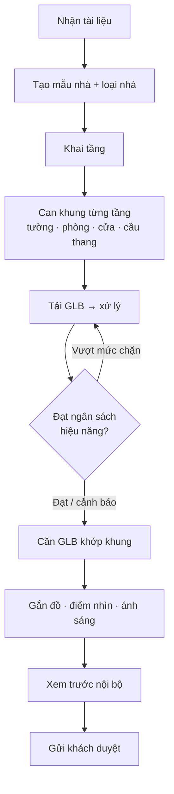
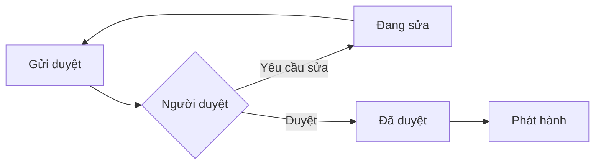
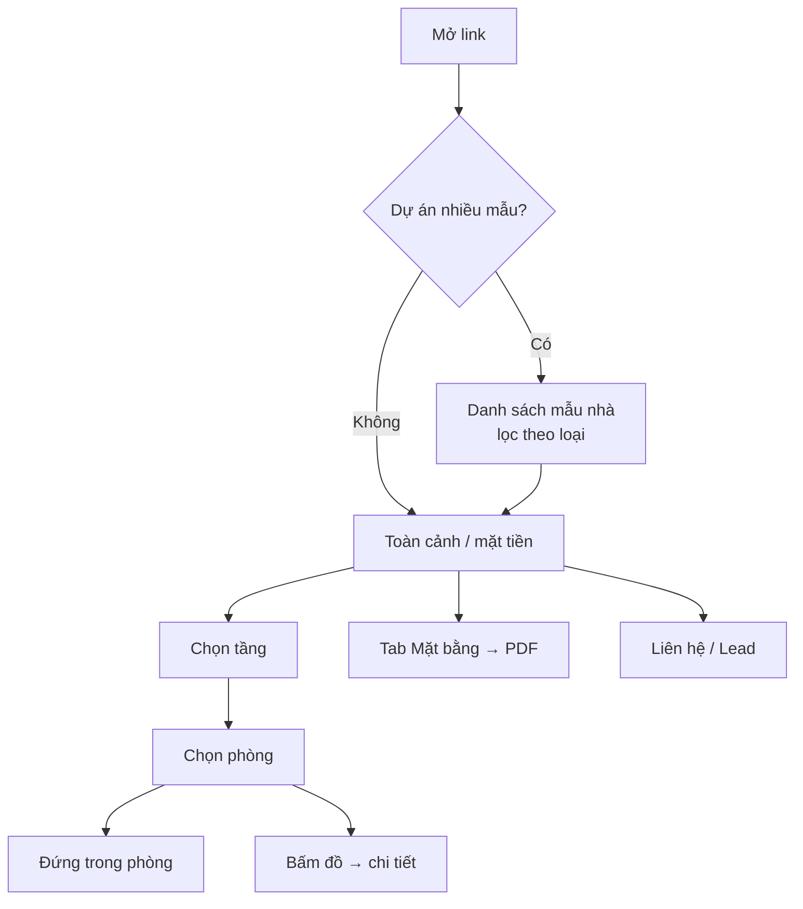
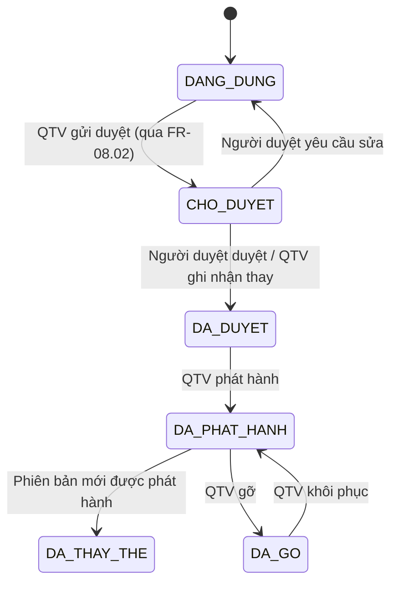
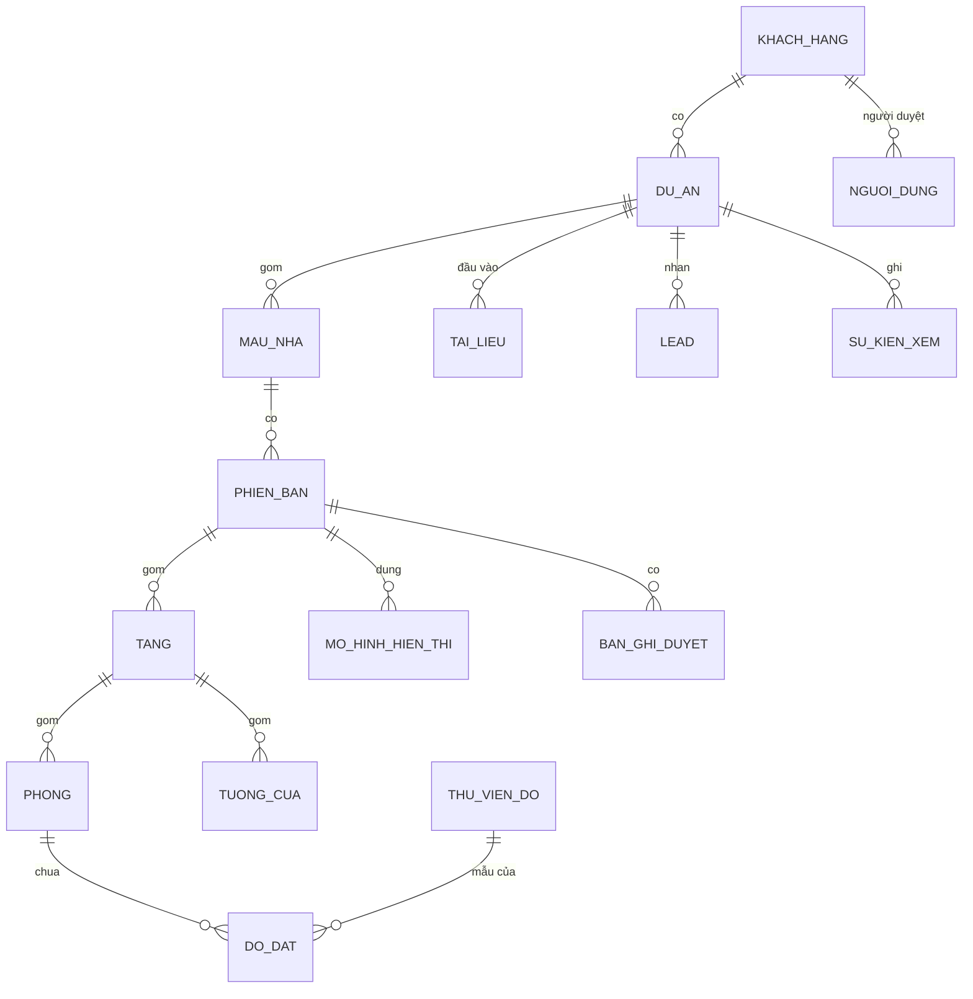
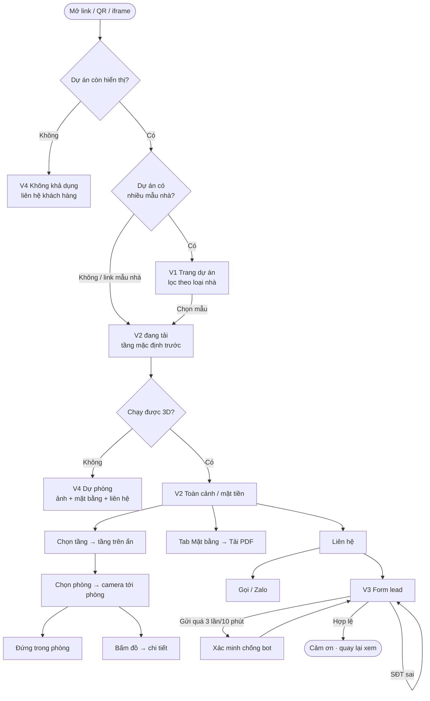
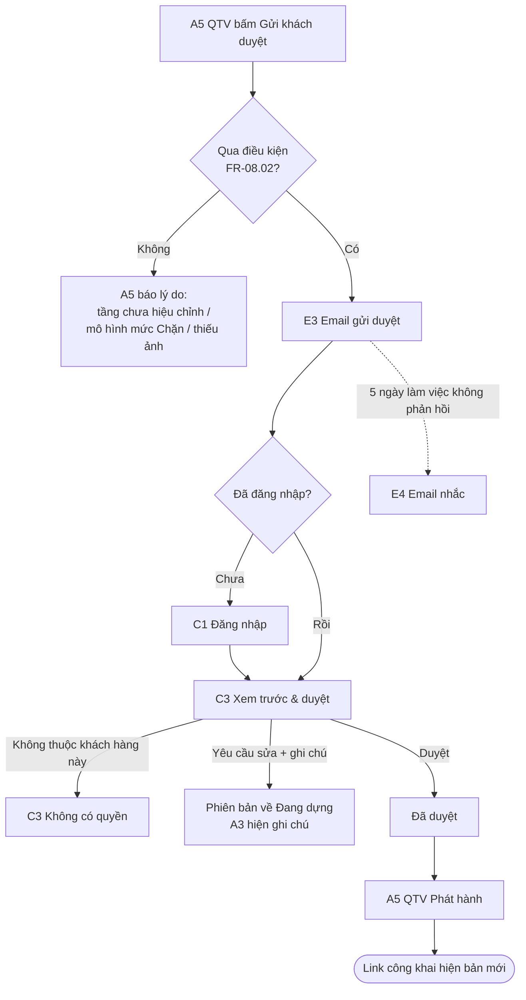
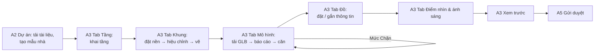

# SRS — Nền tảng "Nhà mẫu online có bản vẽ"

**Nền tảng để đội của nhà cung cấp chuyển tài liệu quảng cáo của bên bán nhà thành trang xem 3D tương tác kèm bản vẽ kỹ thuật, giúp người mua hiểu nhà từ xa và giúp bên bán có thêm khách quan tâm.**

| | |
|---|---|
| Phiên bản | 0.4 — CR-2 (Draft, chờ duyệt): thêm M12 Tham quan ảnh thật (item 02) · 0.3 — CR-1: thêm màn V5 Chính sách dữ liệu (NFR-04) |
| Trạng thái | Approved (G1 ✅ 2026-10-24 · khanhtt) |
| Owner (PO) | khanhtt |
| Reviewer | khanhtt (quy mô S — tự soát) |
| Nguồn | `items/01-interior-showcase-platform/00a-requirement-analysis.md` v0.2 · `00b-market-research.md` v0.2 · `00c-market-summary.md` · quyết định DEC-1…DEC-11 (Phụ lục B) · prototype `src/` |
| Last update | 2026-10-24 · PO |

> **TL;DR**
> - **Vấn đề:** người mua khó hình dung nhà qua ảnh tĩnh hoặc panorama; nhà mẫu thật đắt (khoảng 2 tỷ ₫/căn); bản vẽ có kích thước chỉ đến tay khách khi đã ký hợp đồng; bên bán không biết ai quan tâm.
> - **Giải pháp:** đội nhà cung cấp dựng **mẫu nhà** (khung tường–phòng–cửa + mô hình 3D) bằng công cụ nội bộ, rồi phát hành **một link** mang thương hiệu khách: người xem đi lại trong nhà 3D, xem từng tầng/phòng, bấm vào đồ và mở **mặt bằng có kích thước**, sau đó để lại thông tin liên hệ.
> - **Phase 1 (MVP):** 4 loại nhà (căn hộ, nhà phố nhiều tầng, biệt thự, nhà cấp 4/nhà vườn) · xem 3D · mặt bằng cơ bản xuất PDF · quản trị nội bộ · thương hiệu, nhúng web, QR · thu lead · thống kê · chủ đầu tư duyệt trước khi phát hành.
> - **Phase 2:** đủ bộ bản vẽ (trần, điện, khung tên TCVN, DXF, đính kèm mặt cắt). **Phase 3:** báo giá theo đồ, chọn căn theo bảng hàng.
> - **Chỉ số chính:** một mẫu căn hộ đi từ nhận tài liệu tới link được duyệt trong ≤ 3 ngày công; trang xem hiện được hình đầu tiên trong ≤ 5 giây trên 4G.

---

## 1. Giới thiệu

**Mục đích & người đọc:** làm cơ sở cho tech spec, phát triển, kiểm thử và nghiệm thu. Người đọc: PO, architect, dev BE/FE, QA, đội kinh doanh của nhà cung cấp.

| Trong phạm vi | Ngoài phạm vi (giai đoạn này) |
|---|---|
| Trang xem công khai: 3D, tầng, phòng, chi tiết đồ, mặt bằng, liên hệ | Khách hàng tự dựng hoặc tự sửa mẫu nhà (P4+) |
| Công cụ nội bộ: khách hàng, dự án, mẫu nhà, khung, mô hình 3D, đồ, phát hành | Báo giá theo đồ, máy tính giá (P3) |
| Cổng khách hàng: xem trước, duyệt, lead, thống kê | Đọc trực tiếp file SKP, MAX, DWG (người dựng xuất GLB/DXF/PDF trước) |
| Mặt bằng cơ bản có kích thước, xuất PDF (P1); bộ bản vẽ đầy đủ (P2) | Render ảnh chân thực kiểu V-Ray/Corona; VR kính; streaming GPU |
| Thương hiệu khách, nhúng website, QR | Tên miền riêng cho khách (P3) |
| Lead và thống kê lượt xem | Tích hợp CRM, thanh toán online, hoá đơn (P3+) |
| Giao diện tiếng Việt, đơn vị mét | Đa ngôn ngữ (P3+) |

**Thuật ngữ**

| Thuật ngữ | Nghĩa |
|---|---|
| Nhà cung cấp | Đơn vị của user: bán gói, dựng mẫu nhà, vận hành nền tảng |
| Khách hàng | Bên bán nhà ký hợp đồng với nhà cung cấp: chủ đầu tư/sàn BĐS, công ty xây nhà trọn gói, công ty thiết kế–thi công nội thất |
| Người xem | Người mua nhà hoặc người quan tâm, mở link, không đăng nhập |
| Dự án | Tập hợp mẫu nhà của một khách hàng phát hành chung (vd một khu đô thị, hoặc bộ mẫu nhà của một công ty xây nhà) |
| Mẫu nhà | Một thiết kế xem được trong 3D: một loại căn hộ, một mẫu nhà phố, một biệt thự… |
| Loại nhà | Căn hộ · Nhà phố/nhà nhiều tầng · Biệt thự · Nhà cấp 4/nhà vườn |
| Tầng | Một mặt sàn của mẫu nhà, có cao độ và chiều cao; căn hộ duplex có 2 tầng |
| Khu vực ngoài nhà | Sân, vườn, hồ bơi, sân thượng, mái — có trong mặt bằng và 3D, không tính là phòng |
| Khung (khung ngữ nghĩa) | Dữ liệu mô tả tường, phòng, cửa đi, cửa sổ, cầu thang của từng tầng. Là nguồn sinh mặt bằng và kích thước |
| Mô hình hiển thị | File 3D (GLB) do người dựng xuất từ SketchUp/3ds Max/Blender, dùng để hiển thị đẹp |
| Đồ | Đồ nội thất, thiết bị, vật liệu hoàn thiện có thông tin hiển thị cho người xem |
| Điểm nhìn | Vị trí camera được đặt sẵn (toàn cảnh, mặt tiền, từng phòng) |
| Phiên bản | Ảnh chụp nội dung mẫu nhà tại một thời điểm; được duyệt và phát hành theo phiên bản |
| Phát hành | Đưa một phiên bản đã duyệt lên link công khai |
| Lead | Thông tin liên hệ người xem để lại |
| Dòng miễn trừ | Câu thông báo "hình ảnh mang tính minh hoạ…" hiển thị trên trang xem |

**Tham chiếu:** `00b-market-research.md` · Luật Kinh doanh BĐS 2023 Điều 6 (công khai thông tin) · NĐ 16/2025/NĐ-CP · NĐ 13/2023/NĐ-CP về bảo vệ dữ liệu cá nhân · TCVN 5570/5571/5671/6083:2012 (cho P2).

## 2. Bối cảnh & bài toán

**Hiện tại (AS-IS):**
1. Bên bán nhà thuê studio làm phối cảnh tĩnh (350 nghìn – 8 triệu ₫/ảnh), phim 3D, hoặc panorama VR360 (10–45 triệu ₫/gói). Dự án lớn xây nhà mẫu thật (khoảng 2 tỷ ₫/căn, 2017).
2. Sales gửi ảnh, PDF, link panorama qua Zalo/Facebook.
3. Người mua hỏi lại kích thước phòng và cách bố trí; sales trả lời thủ công hoặc hẹn đến xem.
4. Bản vẽ có kích thước chỉ đến tay người mua sau khi ký hợp đồng thiết kế–thi công.
5. Bên bán không biết ai đã xem tài liệu, xem phần nào.

| # | Vấn đề | Hệ quả |
|---|---|---|
| P1 | Người mua khó hình dung không gian qua ảnh tĩnh; panorama chỉ đứng tại điểm chụp | Phải đến tận nơi xem; quyết định chậm |
| P2 | Nhà mẫu thật đắt và không có cho mọi loại căn/mẫu nhà | Chỉ dự án lớn làm được; nhiều loại căn không có mẫu |
| P3 | Người mua không có kích thước và bố trí rõ ràng trước khi ký | Sales tốn thời gian trả lời; dễ hiểu sai, dẫn tới tranh chấp |
| P4 | Mỗi loại nhà có cách xem riêng: căn hộ một sàn, nhà phố nhiều tầng, biệt thự có sân vườn, nhà cấp 4 có mái | Một công cụ xem chỉ hợp một loại sẽ không bán được cho đủ 3 nhóm khách |
| P5 | Bên bán không biết ai quan tâm và quan tâm gì từ tài liệu gửi đi | Mất khách tiềm năng; không đo được hiệu quả marketing |
| P6 | Nội dung quảng cáo có thể lệch hồ sơ, không có bằng chứng bên bán đã duyệt | Rủi ro pháp lý cho cả bên bán và nhà cung cấp |
| P7 | Nếu mỗi mẫu nhà phải qua lập trình viên mới lên được | Chi phí sản xuất cao, giá bán 25–50 triệu ₫/mẫu không có lãi |

| Mục tiêu | Chỉ số | Hiện tại | Mục tiêu P1 |
|---|---|---|---|
| Sản xuất nhanh | Ngày công từ nhận tài liệu tới link được duyệt | Chưa có (prototype viết tay trong code) | Căn hộ ≤ 3 ngày công; nhà phố/biệt thự ≤ 5 ngày công *(đề xuất, cần xác nhận)* |
| Xem được trên điện thoại | Thời gian tới hình 3D đầu tiên trên 4G, máy tầm trung | — | ≤ 5 giây |
| Có khách quan tâm | Tỉ lệ phiên xem để lại lead | Không đo được | Đo được; mục tiêu ≥ 2% *(đề xuất, chưa có mốc)* |
| Bán được | Số khách hàng pilot dùng thật | 0 | ≥ 2 khách hàng, ≥ 2 loại nhà khác nhau trong 3 tháng sau go-live |

## 3. Stakeholder & tác nhân

| Stakeholder | Quan tâm chính |
|---|---|
| Chủ nhà cung cấp (khanhtt) | Bán được gói; chi phí sản xuất mỗi mẫu thấp; khách gia hạn hosting |
| Khách hàng (bên bán nhà) | Thêm lead, chốt nhanh, rẻ hơn nhà mẫu, an toàn pháp lý |
| Người xem | Mở là xem được, hiểu kích thước và bố trí, liên hệ dễ |

| Tác nhân | Loại | Vai trò |
|---|---|---|
| Quản trị viên (QTV) | Người — nhà cung cấp | Quản lý khách hàng, dự án, tài khoản, gói; phát hành; gỡ |
| Người dựng | Người — nhà cung cấp | Dựng mẫu nhà: khung, mô hình 3D, đồ, điểm nhìn; gửi duyệt |
| Người duyệt của khách hàng | Người — khách hàng | Xem trước, duyệt hoặc yêu cầu sửa; xem lead, thống kê; tải lead |
| Người xem | Người — công khai | Xem trang, để lại lead |
| Bộ xử lý mô hình | Job hệ thống | Kiểm tra và tối ưu file GLB tải lên, báo cáo kích thước/hiệu năng |
| Dịch vụ email | Hệ thống ngoài | Gửi thông báo duyệt, lead mới |

## 4. Quy trình nghiệp vụ (TO-BE)

**Map yêu cầu thô → TO-BE**

| Yêu cầu thô | Bước TO-BE |
|---|---|
| "Khách có thể vào và preview chi tiết nội thất, chọn nhà, xoay 3D" | 4.4 B1–B8 |
| "Chuyển đổi từ quảng cáo cơ bản sang mô hình 3D" | 4.2 B1–B9 |
| "Bản thiết kế kỹ thuật chuẩn" | 4.2 B4 (khung) → 4.4 B7 (mặt bằng); P2 đủ bộ |
| "Xem 3D theo nhiều loại nhà" | 4.2 B2–B3, 4.4 B3–B5 |
| Chủ đầu tư duyệt, lead, thống kê, thương hiệu (user chốt cho P1) | 4.3, 4.5, 4.1 B3 |

### 4.1 Mở khách hàng & dự án
- **B1.** QTV tạo khách hàng (tên, logo, màu chủ đạo, thông tin liên hệ, gói, ngày hết hạn hosting) → hệ thống lưu, khách hàng ở trạng thái Hoạt động.
- **B2.** QTV tạo tài khoản người duyệt cho khách hàng → hệ thống gửi email mời đặt mật khẩu.
- **B3.** QTV tạo dự án thuộc khách hàng (tên, địa điểm, mô tả, ảnh bìa, cấu hình liên hệ: số điện thoại/Zalo, email nhận lead) → hệ thống cấp đường dẫn dự án cố định.

### 4.2 Dựng mẫu nhà
- **B1.** Người dựng tải tài liệu đầu vào lên dự án (ảnh/PDF mặt bằng, phối cảnh, GLB, DXF) → hệ thống lưu kèm tên, loại, người tải.
- **B2.** Người dựng tạo mẫu nhà: tên, **loại nhà**, diện tích công bố, số phòng ngủ/WC, mô tả → hệ thống tạo mẫu nhà ở trạng thái Nháp, phiên bản 1.
- **B3.** Người dựng khai **tầng**: tên (Tầng 1, Lửng, Sân thượng…), thứ tự, cao độ sàn, chiều cao tầng → hệ thống sắp xếp tầng từ thấp tới cao.
- **B4.** Với mỗi tầng, người dựng đặt ảnh/PDF mặt bằng làm nền, **hiệu chỉnh tỷ lệ** bằng một đoạn đã biết kích thước, rồi vẽ hoặc can **tường, phòng, cửa đi, cửa sổ, cầu thang, khu vực ngoài nhà** → hệ thống tính diện tích phòng, hiện kích thước ngay trên màn vẽ.
- **B5.** Người dựng tải mô hình hiển thị (GLB) cho từng tầng, cho ngoại thất, hoặc cho cả nhà → bộ xử lý kiểm tra, tối ưu, báo số liệu so với ngân sách hiệu năng (BR-07).
- **B6.** Người dựng căn mô hình hiển thị khớp với khung (dịch, xoay, tỷ lệ), xem chồng hai lớp → hệ thống lưu phép căn.
- **B7.** Người dựng thêm **đồ**: đặt đồ từ thư viện, hoặc chọn một đối tượng trong mô hình hiển thị rồi gắn thông tin (tên, loại, kích thước, chất liệu, thương hiệu, mô tả, ảnh) → hệ thống liên kết đồ với phòng.
- **B8.** Người dựng đặt **điểm nhìn** (toàn cảnh, mặt tiền, từng phòng), ánh sáng ngày/đêm, ảnh đại diện → hệ thống lưu.
- **B9.** Người dựng mở xem trước nội bộ; QTV soát → **gửi khách duyệt** (4.3).



| Mã | Ngoại lệ | Xử lý |
|---|---|---|
| EX-1 | File GLB hỏng hoặc không đọc được | Báo lỗi kèm lý do; không lưu vào mẫu nhà |
| EX-2 | GLB vượt ngân sách hiệu năng | Mức cảnh báo: cho dùng, hiện cảnh báo. Mức chặn: không cho gửi duyệt cho tới khi thay file (BR-07) |
| EX-3 | Tầng chưa hiệu chỉnh tỷ lệ | Không hiện kích thước; không cho gửi duyệt mẫu nhà (BR-05) |
| EX-4 | Mô hình hiển thị lệch khung quá 0,2 m tại điểm kiểm | Cảnh báo khi xem chồng; người dựng quyết định |
| EX-5 | Mẫu nhà không có mô hình hiển thị cho một tầng | Tầng đó hiển thị khối dựng từ khung (tường, sàn, cửa) — không chặn |

### 4.3 Duyệt & phát hành
- **B1.** QTV gửi phiên bản cho khách duyệt → hệ thống đổi trạng thái thành Chờ khách duyệt, gửi email kèm link xem trước (không công khai) cho người duyệt.
- **B2.** Người duyệt xem trước trên điện thoại hoặc máy tính, chọn **Duyệt** hoặc **Yêu cầu sửa** (kèm ghi chú, có thể chọn tầng/phòng) → hệ thống ghi bản ghi duyệt (người, thời điểm, phiên bản, ghi chú).
- **B3a.** Yêu cầu sửa → mẫu nhà về Đang sửa; người dựng sửa → quay lại 4.3 B1.
- **B3b.** Duyệt → QTV phát hành → link công khai hiện phiên bản này.
- **B4.** Cập nhật sau khi đã phát hành: người dựng tạo phiên bản mới; link công khai vẫn hiện phiên bản cũ cho tới khi phiên bản mới được duyệt và phát hành (BR-02).



| Mã | Ngoại lệ | Xử lý |
|---|---|---|
| EX-6 | Người duyệt không phản hồi sau 5 ngày làm việc | Hệ thống nhắc qua email một lần; QTV thấy trong danh sách chờ |
| EX-7 | QTV cần phát hành khi khách đã duyệt ngoài hệ thống (Zalo, giấy) | Cho phép "Ghi nhận duyệt thay" kèm tệp bằng chứng bắt buộc; bản ghi ghi rõ người nhập |

### 4.4 Người xem xem nhà
- **B1.** Người xem mở link dự án (hoặc link mẫu nhà, QR, iframe trên web khách) → hệ thống hiển thị trang mang thương hiệu khách hàng.
- **B2.** Dự án có nhiều mẫu nhà → người xem thấy danh sách mẫu nhà (ảnh, loại nhà, diện tích, số phòng ngủ), lọc theo loại nhà → chọn một mẫu.
- **B3.** Hệ thống mở **toàn cảnh**: căn hộ thì nhìn từ trên xuống; nhà có ngoại thất thì nhìn mặt tiền và xoay quanh nhà.
- **B4.** Người xem **chọn tầng** → các tầng phía trên ẩn đi, camera chuyển tới tầng đó.
- **B5.** Người xem chọn phòng (trên danh sách, trên mặt bằng mini, hoặc bấm vào sàn phòng) → camera bay tới phòng; tường chắn tầm nhìn tự hạ thấp.
- **B6.** Người xem bật **đứng trong phòng** → camera ở tầm mắt 1,6 m, kéo để nhìn quanh, đi sang phòng khác qua điểm chuyển.
- **B7.** Người xem bấm vào đồ → bảng chi tiết (tên, kích thước, chất liệu, thương hiệu, mô tả, ảnh).
- **B8.** Người xem mở tab **Mặt bằng** → mặt bằng từng tầng có kích thước, tên và diện tích phòng; tải PDF.
- **B9.** Người xem bấm **Liên hệ** → gọi, chat Zalo, hoặc điền form lead (4.5).



| Mã | Ngoại lệ | Xử lý |
|---|---|---|
| EX-8 | Thiết bị/trình duyệt không chạy được 3D | Hiện chế độ dự phòng: ảnh phối cảnh + mặt bằng + nút liên hệ; ghi nhận vào thống kê |
| EX-9 | Mạng chậm, tải quá 15 giây | Hiện tiến trình; tải tầng đang xem trước, tầng khác sau |
| EX-10 | Dự án bị gỡ, hết hạn hosting hoặc mẫu nhà chưa phát hành | Trang thông báo "Nội dung không còn khả dụng" kèm thông tin liên hệ khách hàng (nếu còn hợp đồng) hoặc của nhà cung cấp |

### 4.5 Lead & thống kê
- **B1.** Người xem điền form: họ tên, số điện thoại (bắt buộc), email, nhu cầu, tick đồng ý xử lý dữ liệu → hệ thống lưu lead kèm dự án, mẫu nhà, phòng đang xem, nguồn (link/QR/nhúng).
- **B2.** Hệ thống gửi email báo lead mới cho email nhận lead của dự án trong ≤ 5 phút.
- **B3.** Người duyệt của khách hàng xem danh sách lead, đánh dấu Đã liên hệ, tải file CSV.
- **B4.** Hệ thống ghi nhận lượt xem và tương tác (mẫu nhà, tầng, phòng, đồ, mặt bằng, nút liên hệ); khách hàng và QTV xem báo cáo theo khoảng ngày.

| Mã | Ngoại lệ | Xử lý |
|---|---|---|
| EX-11 | Số điện thoại sai định dạng | Báo lỗi tại ô nhập, không gửi |
| EX-12 | Gửi trùng (cùng SĐT, cùng dự án, trong 24 giờ) | Gộp vào lead cũ, tăng số lần liên hệ (BR-09) |
| EX-13 | Gửi hàng loạt (spam) | Giới hạn ≤ 3 lần gửi/10 phút từ một thiết bị; vượt thì yêu cầu xác minh chống bot |

## 5. Yêu cầu chức năng

Ưu tiên MoSCoW: **M** = bắt buộc trong phase ghi ở cột Phase · **S** = nên có · **C** = có thì tốt.

### 5.1 M01 — Khách hàng, dự án, tài khoản

| ID | Yêu cầu | Ưu tiên | Phase | Nguồn |
|---|---|:---:|:---:|---|
| FR-01.01 | Hệ thống phải cho QTV tạo, sửa, tạm ngưng khách hàng với: tên, logo, màu chủ đạo, thông tin liên hệ, gói, ngày hết hạn hosting | M | 1 | 4.1 B1, P7 |
| FR-01.02 | Hệ thống phải cho QTV tạo dự án thuộc một khách hàng với: tên, địa điểm, mô tả, ảnh bìa, số điện thoại, Zalo, email nhận lead | M | 1 | 4.1 B3 |
| FR-01.03 | Hệ thống phải cấp cho mỗi dự án và mỗi mẫu nhà một đường dẫn công khai cố định, không đổi khi nội dung cập nhật | M | 1 | BR-02 |
| FR-01.04 | Hệ thống phải cho QTV tạo tài khoản Người dựng và Người duyệt; người duyệt chỉ gắn với một khách hàng | M | 1 | 4.1 B2 |
| FR-01.05 | Hệ thống phải gửi email mời đặt mật khẩu khi tạo tài khoản, và cho đặt lại mật khẩu qua email | M | 1 | 4.1 B2 |
| FR-01.06 | Hệ thống phải tự gỡ trang công khai của dự án khi khách hàng bị tạm ngưng hoặc quá ngày hết hạn hosting, và khôi phục khi gia hạn | S | 1 | BR-08 |

### 5.2 M02 — Tài liệu đầu vào

| ID | Yêu cầu | Ưu tiên | Phase | Nguồn |
|---|---|:---:|:---:|---|
| FR-02.01 | Hệ thống phải cho người dựng tải lên dự án các tệp ảnh (JPG/PNG), PDF, GLB/glTF, DXF; mỗi tệp ≤ 200 MB | M | 1 | 4.2 B1 |
| FR-02.02 | Hệ thống phải hiển thị danh sách tài liệu theo dự án, có xem trước ảnh và PDF | S | 1 | 4.2 B1 |

### 5.3 M03 — Dựng khung mẫu nhà

| ID | Yêu cầu | Ưu tiên | Phase | Nguồn |
|---|---|:---:|:---:|---|
| FR-03.01 | Hệ thống phải cho tạo mẫu nhà với loại nhà thuộc: Căn hộ · Nhà phố/nhà nhiều tầng · Biệt thự · Nhà cấp 4/nhà vườn; kèm diện tích công bố, số phòng ngủ, số WC, mô tả | M | 1 | P4, 4.2 B2 |
| FR-03.02 | Hệ thống phải cho khai từ 1 đến 10 tầng mỗi mẫu nhà, mỗi tầng có tên, thứ tự, cao độ sàn (m), chiều cao tầng (m); cho phép tầng lửng và sân thượng | M | 1 | P4, 4.2 B3 |
| FR-03.03 | Hệ thống phải cho đặt ảnh/trang PDF mặt bằng làm nền của một tầng và hiệu chỉnh tỷ lệ bằng một đoạn thẳng có kích thước nhập vào (mm) | M | 1 | 4.2 B4, P7 |
| FR-03.04 | Hệ thống phải cho vẽ tường (độ dày, chiều cao), phòng (đa giác, tên, công năng), cửa đi, cửa sổ (rộng, cao, cao độ bậu, hướng mở) trên tầng; tường không bắt buộc vuông góc | M | 1 | 4.2 B4 |
| FR-03.05 | Hệ thống phải cho đặt cầu thang (vị trí, hướng lên, nối tầng nào với tầng nào) | M | 1 | P4 |
| FR-03.06 | Hệ thống phải cho vẽ khu vực ngoài nhà (sân, vườn, hồ bơi, sân thượng, ban công, lô gia) có tên và diện tích | M | 1 | P4 |
| FR-03.07 | Hệ thống phải tự tính và hiện diện tích từng phòng, tổng diện tích sàn từng tầng và toàn nhà, theo BR-04 | M | 1 | P3 |
| FR-03.08 | Hệ thống phải hiện kích thước tường và phòng ngay khi vẽ; hỗ trợ bắt điểm, bắt góc 0/45/90°, hoàn tác/làm lại | M | 1 | P7 |
| FR-03.09 | Hệ thống phải cho sao chép tầng hoặc sao chép cả mẫu nhà để làm mẫu tương tự | S | 1 | P7 |
| FR-03.10 | Hệ thống phải cho nhập khung từ tệp DXF (lớp tường/cửa đã đặt tên theo quy ước) | C | 2 | P7 |

### 5.4 M04 — Mô hình hiển thị

| ID | Yêu cầu | Ưu tiên | Phase | Nguồn |
|---|---|:---:|:---:|---|
| FR-04.01 | Hệ thống phải cho gắn tệp GLB vào một tầng, vào ngoại thất, hoặc vào cả mẫu nhà | M | 1 | 4.2 B5 |
| FR-04.02 | Hệ thống phải tự kiểm tra và tối ưu GLB sau khi tải lên, rồi báo: số tam giác, số đối tượng vẽ, dung lượng texture, dung lượng tải về — kèm mức Đạt/Cảnh báo/Chặn theo BR-07 | M | 1 | EX-1, EX-2, NFR-01 |
| FR-04.03 | Hệ thống phải cho căn mô hình hiển thị với khung (dịch, xoay, tỷ lệ) và xem chồng hai lớp | M | 1 | 4.2 B6 |
| FR-04.04 | Khi một tầng chưa có mô hình hiển thị, hệ thống phải dựng khối tường–sàn–cửa từ khung để vẫn xem được 3D | M | 1 | EX-5 |
| FR-04.05 | Hệ thống phải cho chọn ánh sáng Ngày và Đêm cho mẫu nhà, và cho phép tắt chế độ Đêm | S | 1 | 4.2 B8 |
| FR-04.06 | Hệ thống phải cho đặt điểm nhìn có tên (toàn cảnh, mặt tiền, từng phòng) và chọn điểm nhìn mặc định | M | 1 | 4.2 B8 |
| FR-04.07 | Hệ thống phải cho đặt ảnh đại diện mẫu nhà (tải lên hoặc chụp từ điểm nhìn) | M | 1 | 4.4 B2 |

### 5.5 M05 — Đồ & thư viện

| ID | Yêu cầu | Ưu tiên | Phase | Nguồn |
|---|---|:---:|:---:|---|
| FR-05.01 | Hệ thống phải có thư viện đồ dùng chung cho toàn nhà cung cấp: tên, loại, kích thước (mm), chất liệu, thương hiệu, mô tả, ảnh, mô hình 3D (tuỳ chọn), các biến thể màu/hoàn thiện | M | 1 | P7 |
| FR-05.02 | Hệ thống phải cho đặt đồ từ thư viện vào phòng (vị trí, góc xoay, biến thể) | M | 1 | 4.2 B7 |
| FR-05.03 | Hệ thống phải cho chọn một đối tượng trong mô hình hiển thị và gắn thông tin đồ cho nó (không cần mô hình riêng) | M | 1 | 4.2 B7 |
| FR-05.04 | Hệ thống phải tự gán đồ vào phòng theo vị trí trên khung | S | 1 | 4.4 B7 |
| FR-05.05 | Hệ thống phải cho người xem đổi biến thể màu/hoàn thiện của đồ trong 3D | C | 1 | 00c F7 |
| FR-05.06 | Hệ thống phải hiện giá đồ và tổng giá theo phòng/mẫu nhà, cập nhật khi đổi biến thể | M | 3 | DEC-6 |

### 5.6 M06 — Trang xem 3D

| ID | Yêu cầu | Ưu tiên | Phase | Nguồn |
|---|---|:---:|:---:|---|
| FR-06.01 | Hệ thống phải hiện trang dự án gồm danh sách mẫu nhà đã phát hành (ảnh, tên, loại nhà, diện tích, số phòng ngủ) và lọc theo loại nhà | M | 1 | 4.4 B2, P4 |
| FR-06.02 | Hệ thống phải mở mẫu nhà tại điểm nhìn mặc định và cho xoay, phóng to, di chuyển bằng chuột và cảm ứng | M | 1 | P1 |
| FR-06.03 | Với mẫu nhà nhiều tầng, hệ thống phải cho chọn tầng; khi chọn, các tầng phía trên ẩn và camera chuyển tới tầng đó trong ≤ 1 giây | M | 1 | P4 |
| FR-06.04 | Hệ thống phải có chế độ "Cả nhà" hiện mọi tầng và ngoại thất để xoay quanh nhà | M | 1 | P4 |
| FR-06.05 | Hệ thống phải cho chọn phòng (danh sách, mặt bằng mini, bấm sàn) và đưa camera tới phòng đó | M | 1 | P1 |
| FR-06.06 | Hệ thống phải tự hạ thấp các tường nằm giữa camera và vùng đang xem; người xem chọn được Tự cắt / Tường thấp / Đầy đủ | M | 1 | P1 |
| FR-06.07 | Hệ thống phải có chế độ "Đứng trong phòng": camera tầm mắt 1,6 m so với sàn tầng, kéo để nhìn quanh, chuyển sang phòng kề qua điểm chuyển hoặc danh sách | M | 1 | P1 |
| FR-06.08 | Hệ thống phải hiện tên đồ khi rê chuột hoặc chạm, và mở bảng chi tiết khi bấm | M | 1 | 4.4 B7 |
| FR-06.09 | Hệ thống phải hiện danh sách đồ theo phòng; bấm một mục thì camera tới đồ đó và mở chi tiết | S | 1 | 4.4 B7 |
| FR-06.10 | Hệ thống phải cho chuyển Ngày/Đêm nếu mẫu nhà có bật chế độ Đêm | S | 1 | FR-04.05 |
| FR-06.11 | Hệ thống phải hiện dòng miễn trừ trên mọi trang xem, nội dung do QTV cấu hình theo dự án | M | 1 | P6, BR-06 |
| FR-06.12 | Hệ thống phải hiện chế độ dự phòng (ảnh + mặt bằng + liên hệ) khi thiết bị không chạy được 3D | M | 1 | EX-8 |
| FR-06.13 | Hệ thống phải tải tầng/khu vực đang xem trước, phần còn lại tải sau, có thanh tiến trình | M | 1 | EX-9, NFR-01 |
| FR-06.14 | Hệ thống phải cho xem toàn màn hình và chia sẻ link (sao chép, Zalo, Facebook) | S | 1 | 4.4 B1 |
| FR-06.15 | Hệ thống phải cho mở thẳng tới một mẫu nhà / tầng / phòng qua đường dẫn | S | 1 | P5 |

### 5.7 M07 — Mặt bằng & bản vẽ

| ID | Yêu cầu | Ưu tiên | Phase | Nguồn |
|---|---|:---:|:---:|---|
| FR-07.01 | Hệ thống phải sinh mặt bằng từng tầng từ khung: tường (đúng độ dày), cửa đi có cung mở, cửa sổ, cầu thang, tên phòng, diện tích phòng, đồ (nét đơn giản) | M | 1 | P3, DEC-5 |
| FR-07.02 | Hệ thống phải ghi kích thước trên mặt bằng: kích thước tổng hai phương, kích thước từng đoạn tường ngoài, kích thước thông thuỷ từng phòng, đơn vị mm | M | 1 | P3, BR-04 |
| FR-07.03 | Hệ thống phải hiện mặt bằng trong tab "Mặt bằng" của trang xem, phóng to/kéo được, chọn tầng; bấm phòng trên mặt bằng thì 3D tới phòng đó | M | 1 | 4.4 B8 |
| FR-07.04 | Hệ thống phải xuất PDF mặt bằng các tầng (khổ A3 ngang, tỷ lệ 1:50 hoặc 1:100 tự chọn theo kích thước nhà) với tên dự án, mẫu nhà, tầng, logo khách hàng, ngày phiên bản, dòng miễn trừ | M | 1 | P3 |
| FR-07.05 | Mặt bằng phải sinh lại tự động khi khung thay đổi; không cho sửa tay trên mặt bằng | M | 1 | BR-05 |
| FR-07.06 | Hệ thống phải sinh mặt bằng bố trí trần (cao độ trần, đèn) và mặt bằng điện (ổ cắm, công tắc, đèn) từ các điểm người dựng đặt trên khung | M | 2 | DEC-5, 00c F11 |
| FR-07.07 | Hệ thống phải trình bày bản vẽ theo TCVN: khung tên (TCVN 5571), nét (TCVN 5570), chữ (TCVN 4608), ký hiệu phòng (TCVN 6003) | M | 2 | 00c F13 |
| FR-07.08 | Hệ thống phải xuất DXF cho mặt bằng các loại | M | 2 | DEC-5 |
| FR-07.09 | Hệ thống phải cho đính kèm bản vẽ PDF/DXF do người dựng cung cấp (mặt cắt, mặt đứng, chi tiết đồ gỗ) vào bộ bản vẽ trên trang xem | M | 2 | DEC-5 |
| FR-07.10 | Hệ thống phải sinh mặt đứng triển khai theo phòng | C | 2 | 00b §8 |

### 5.8 M08 — Phiên bản, duyệt, phát hành

| ID | Yêu cầu | Ưu tiên | Phase | Nguồn |
|---|---|:---:|:---:|---|
| FR-08.01 | Hệ thống phải quản lý mẫu nhà theo phiên bản; mỗi lần gửi duyệt khoá nội dung phiên bản đó | M | 1 | P6, BR-01 |
| FR-08.02 | Hệ thống phải chặn gửi duyệt khi: còn tầng chưa hiệu chỉnh tỷ lệ, còn mô hình ở mức Chặn, hoặc chưa có ảnh đại diện | M | 1 | BR-05, BR-07 |
| FR-08.03 | Hệ thống phải gửi email cho người duyệt kèm link xem trước riêng (không công khai, cần đăng nhập) khi có phiên bản chờ duyệt | M | 1 | 4.3 B1 |
| FR-08.04 | Hệ thống phải cho người duyệt Duyệt hoặc Yêu cầu sửa kèm ghi chú (gắn được vào tầng/phòng) | M | 1 | 4.3 B2 |
| FR-08.05 | Hệ thống phải lưu bản ghi duyệt không sửa được: người, thời điểm, phiên bản, quyết định, ghi chú | M | 1 | P6, BR-03 |
| FR-08.06 | Hệ thống phải chỉ cho phát hành phiên bản đã duyệt; phát hành thay phiên bản đang công khai mà không đổi link | M | 1 | BR-01, BR-02 |
| FR-08.07 | Hệ thống phải cho QTV "Ghi nhận duyệt thay" kèm tệp bằng chứng bắt buộc | S | 1 | EX-7 |
| FR-08.08 | Hệ thống phải cho QTV gỡ phát hành và khôi phục phiên bản đã phát hành trước đó | M | 1 | EX-10 |
| FR-08.09 | Hệ thống phải nhắc người duyệt qua email một lần nếu chưa phản hồi sau 5 ngày làm việc | C | 1 | EX-6 |

### 5.9 M09 — Thương hiệu & chia sẻ

| ID | Yêu cầu | Ưu tiên | Phase | Nguồn |
|---|---|:---:|:---:|---|
| FR-09.01 | Trang xem phải hiện logo, tên, màu chủ đạo của khách hàng; không hiện thương hiệu nhà cung cấp ngoài một dòng chữ nhỏ ở chân trang (QTV tắt được theo gói) | M | 1 | 00c F15 |
| FR-09.02 | Hệ thống phải tạo mã nhúng (iframe) cho dự án và cho từng mẫu nhà, chạy được trên website khách hàng | M | 1 | 4.4 B1 |
| FR-09.03 | Hệ thống phải tạo mã QR (PNG, SVG) cho dự án và từng mẫu nhà, tải về được | M | 1 | 4.4 B1 |
| FR-09.04 | Hệ thống phải gắn nguồn truy cập (link trực tiếp / QR / nhúng) vào lượt xem và lead | S | 1 | P5 |
| FR-09.05 | Hệ thống phải cho khách hàng dùng tên miền riêng | C | 3 | 00c |

### 5.10 M10 — Lead

| ID | Yêu cầu | Ưu tiên | Phase | Nguồn |
|---|---|:---:|:---:|---|
| FR-10.01 | Trang xem phải có nút Liên hệ gồm: gọi điện, chat Zalo, form để lại thông tin — hiện theo cấu hình dự án | M | 1 | P5 |
| FR-10.02 | Form lead phải có: họ tên, số điện thoại (bắt buộc), email, nhu cầu, ô đồng ý xử lý dữ liệu cá nhân (bắt buộc) | M | 1 | BR-09, NFR-04 |
| FR-10.03 | Hệ thống phải lưu lead kèm dự án, mẫu nhà, tầng/phòng đang xem, nguồn truy cập, thời điểm | M | 1 | P5 |
| FR-10.04 | Hệ thống phải gửi email báo lead mới tới email nhận lead của dự án trong ≤ 5 phút | M | 1 | 4.5 B2 |
| FR-10.05 | Hệ thống phải cho người duyệt và QTV xem danh sách lead, lọc theo ngày/mẫu nhà, đánh dấu Đã liên hệ, tải CSV | M | 1 | 4.5 B3 |
| FR-10.06 | Hệ thống phải gộp lead trùng và chống spam theo BR-09, EX-13 | M | 1 | EX-12, EX-13 |
| FR-10.07 | Hệ thống phải đẩy lead sang CRM/Zalo OA của khách hàng | C | 3 | 00b §3 |

### 5.11 M11 — Thống kê

| ID | Yêu cầu | Ưu tiên | Phase | Nguồn |
|---|---|:---:|:---:|---|
| FR-11.01 | Hệ thống phải ghi nhận lượt xem theo BR-10 và các tương tác: mở mẫu nhà, chọn tầng, chọn phòng, đứng trong phòng, bấm đồ, mở mặt bằng, tải PDF, bấm liên hệ, gửi lead | M | 1 | P5 |
| FR-11.02 | Hệ thống phải hiện báo cáo theo dự án và khoảng ngày: lượt xem, người xem duy nhất, thời gian xem trung bình, top mẫu nhà, top phòng, top đồ, số lead, tỉ lệ lead/lượt xem, theo nguồn truy cập, theo loại thiết bị | M | 1 | P5 |
| FR-11.03 | Hệ thống phải cho tải báo cáo dạng CSV | S | 1 | P5 |

### 5.12 M12 — Tham quan ảnh thật *(CR-2, item 02 — chờ G1)*

Chế độ xem thứ hai của mẫu nhà: chuỗi ảnh chụp nhà thật theo đường đi, người xem bấm Tiếp để chuyển cảnh. Đặc tả đầy đủ (FR-12.01–12.15, BR-T1–T5, NFR-T1–T4, kịch bản chụp) ở `items/02-real-photo-tour/01-srs.md`.

| ID | Yêu cầu (tóm tắt) | Ưu tiên | Phase |
|---|---|:---:|:---:|
| FR-12.01–12.04 | Tour 2–60 cảnh; tải nhiều ảnh, tự xếp theo số tên tệp; đổi thứ tự; tên, mô tả, điểm đi tiếp, phòng liên kết | M | 1 |
| FR-12.05 | Chuyển cảnh mô phỏng (phóng vào điểm đi tiếp + mờ dần) ≤ 1,2 s | M | 1 |
| FR-12.06 | Clip chuyển cảnh tải lên cho từng cặp | S | 1 |
| FR-12.07–12.09 | Trình xem: Tiếp/Lùi/chấm/phím/vuốt/tự chạy, thẻ thông tin, liên kết phòng 3D, tải trước | M | 1 |
| FR-12.10 | Mẫu nhà chỉ có tour phát hành được | M | 1 |
| FR-12.11–12.13 | Lead/thống kê theo cảnh · xem thử chuyển cảnh · kịch bản chụp PDF | S/M | 1 |
| FR-12.14 | Tự gọi AI tạo clip chuyển cảnh | C | 2 |

**Sửa:** FR-08.02 — gửi duyệt khi có ≥ 1 tầng hợp lệ **hoặc** tour ≥ 2 cảnh. FR-06.01 — thẻ mẫu nhà có nhãn "3D" / "Ảnh thật".

### 5.13 Ma trận phân quyền (Phase 1)

| Chức năng | QTV | Người dựng | Người duyệt (khách hàng) | Người xem |
|---|:---:|:---:|:---:|:---:|
| Quản lý khách hàng, tài khoản, gói | ✔ | | | |
| Tạo/sửa dự án | ✔ | Sửa nội dung | | |
| Tải tài liệu đầu vào | ✔ | ✔ | | |
| Dựng khung, mô hình, đồ, điểm nhìn | ✔ | ✔ | | |
| Quản lý thư viện đồ | ✔ | ✔ | | |
| Gửi duyệt | ✔ | | | |
| Duyệt / Yêu cầu sửa | Ghi nhận thay (có bằng chứng) | | Chỉ khách hàng của mình | |
| Phát hành / gỡ | ✔ | | | |
| Xem trước phiên bản chưa phát hành | ✔ | ✔ | Chỉ khách hàng của mình | |
| Lấy mã nhúng, QR | ✔ | | Chỉ khách hàng của mình | |
| Xem/tải lead | ✔ | | Chỉ khách hàng của mình | |
| Xem thống kê | ✔ | | Chỉ khách hàng của mình | |
| Xem trang công khai, gửi lead | ✔ | ✔ | ✔ | ✔ |

## 6. Use case

| ID | Tên | Tác nhân chính | FR |
|---|---|---|---|
| UC-01 | Mở khách hàng và dự án | QTV | FR-01.01–01.05 |
| UC-02 | Dựng khung một tầng | Người dựng | FR-03.02–03.08 |
| UC-03 | Gắn mô hình hiển thị và căn chỉnh | Người dựng | FR-04.01–04.04 |
| UC-04 | Gắn đồ và điểm nhìn | Người dựng | FR-05.01–05.04, FR-04.06 |
| UC-05 | Gửi duyệt, duyệt, phát hành | QTV, Người duyệt | FR-08.01–08.08 |
| UC-06 | Xem mẫu nhà nhiều tầng | Người xem | FR-06.01–06.13 |
| UC-07 | Xem và tải mặt bằng | Người xem | FR-07.01–07.04 |
| UC-08 | Để lại lead | Người xem | FR-10.01–10.06 |
| UC-09 | Xem lead và thống kê | Người duyệt, QTV | FR-10.05, FR-11.02 |
| UC-10 | Lấy mã nhúng và QR | QTV, Người duyệt | FR-09.02–09.03 |
| UC-11 | Cập nhật mẫu nhà đã phát hành | Người dựng, QTV | FR-08.01, 08.06 |

### UC-02 — Dựng khung một tầng

| | |
|---|---|
| Tác nhân | Người dựng |
| Tiền điều kiện | Mẫu nhà đã có tầng; có ảnh hoặc PDF mặt bằng tầng đó |
| Kích hoạt | Người dựng mở tầng trong trình dựng |
| Kết quả thành công | Tầng có tỷ lệ đã hiệu chỉnh, tường, phòng, cửa, cầu thang; diện tích phòng hiển thị |

**Luồng chính:**
1. Người dựng chọn ảnh/PDF mặt bằng làm nền.
2. Người dựng vẽ một đoạn trùng với một kích thước ghi trên ảnh và nhập số mm. Hệ thống tính tỷ lệ và đổi trạng thái tầng thành "Đã hiệu chỉnh".
3. Người dựng vẽ tường theo nền; hệ thống bắt điểm và hiện chiều dài.
4. Người dựng chọn vùng khép kín để tạo phòng, đặt tên và công năng; hệ thống tính diện tích.
5. Người dựng đặt cửa đi/cửa sổ lên tường, chỉnh rộng, cao, hướng mở.
6. Người dựng đặt cầu thang và khu vực ngoài nhà (nếu có).
7. Hệ thống lưu tự động sau mỗi thao tác.

**Ngoại lệ:** EX-3 (chưa hiệu chỉnh) · vùng phòng không khép kín → báo "Phòng chưa khép kín" và tô đỏ đoạn hở.

### UC-05 — Gửi duyệt, duyệt, phát hành

| | |
|---|---|
| Tác nhân | QTV, Người duyệt |
| Tiền điều kiện | Phiên bản ở trạng thái Đang dựng, qua các điều kiện FR-08.02 |
| Kích hoạt | QTV bấm "Gửi khách duyệt" |
| Kết quả thành công | Phiên bản Đã phát hành; link công khai hiện phiên bản này; có bản ghi duyệt |

**Luồng chính:**
1. QTV gửi duyệt; hệ thống khoá phiên bản, gửi email cho người duyệt.
2. Người duyệt mở link xem trước, đăng nhập, xem 3D và mặt bằng.
3. Người duyệt bấm Duyệt; hệ thống ghi bản ghi duyệt.
4. QTV bấm Phát hành; hệ thống thay phiên bản công khai.

**Ngoại lệ:** Yêu cầu sửa → 4.3 B3a · EX-6 · EX-7.

### UC-06 — Xem mẫu nhà nhiều tầng

| | |
|---|---|
| Tác nhân | Người xem |
| Tiền điều kiện | Mẫu nhà đã phát hành; dự án còn hạn |
| Kích hoạt | Người xem mở link/QR/iframe |
| Kết quả thành công | Người xem đã xem được tầng, phòng, đồ mong muốn |

**Luồng chính:**
1. Hệ thống hiện mặt tiền mẫu nhà (nhà có ngoại thất) hoặc toàn cảnh (căn hộ).
2. Người xem chọn "Tầng 2"; tầng 3 trở lên và mái ẩn đi, camera nhìn xuống tầng 2.
3. Người xem bấm sàn "Phòng ngủ 1"; camera tới phòng, tường phía trước hạ thấp.
4. Người xem bật "Đứng trong phòng", kéo nhìn quanh.
5. Người xem bấm vào giường; bảng chi tiết mở.

**Ngoại lệ:** EX-8, EX-9, EX-10.

## 7. Trạng thái & quy tắc nghiệp vụ

**Trạng thái phiên bản mẫu nhà**



**Trạng thái dự án (công khai):** Đang hiển thị ↔ Tạm gỡ (khách hàng tạm ngưng hoặc hết hạn hosting, BR-08).

| ID | Quy tắc | Ví dụ |
|---|---|---|
| BR-01 | Chỉ phiên bản Đã duyệt mới được phát hành. Phiên bản Chờ duyệt bị khoá, không sửa được | Phiên bản 3 đang Chờ duyệt → người dựng muốn sửa thì phải đợi kết quả hoặc QTV rút về Đang dựng |
| BR-02 | Mỗi mẫu nhà có tối đa 1 phiên bản Đã phát hành. Link công khai cố định, luôn hiện phiên bản đó | v2 đang công khai; v3 được duyệt rồi phát hành → link cũ hiện v3, v2 thành Đã thay thế |
| BR-03 | Bản ghi duyệt không sửa, không xoá; lưu ít nhất 5 năm sau khi hợp đồng kết thúc *(đề xuất, cần xác nhận)* | — |
| BR-04 | Kích thước ghi bằng mm, số nguyên. Diện tích tính bằng m², làm tròn 2 chữ số thập phân. Diện tích phòng tính theo **lòng tường (thông thuỷ)**. Tổng diện tích sàn tầng tính theo mép ngoài tường bao | Phòng lòng tường 3.600 × 4.200 mm → 15,12 m². Tầng bao ngoài 5.000 × 15.000 mm → 75,00 m² |
| BR-05 | Tầng chưa hiệu chỉnh tỷ lệ thì không hiện kích thước, không sinh mặt bằng, không cho gửi duyệt mẫu nhà | Mẫu nhà 3 tầng, tầng 3 chưa hiệu chỉnh → nút "Gửi duyệt" bị khoá, báo "Tầng 3 chưa hiệu chỉnh tỷ lệ" |
| BR-06 | Mọi trang xem và mọi PDF xuất ra phải có dòng miễn trừ của dự án. Mặc định: "Hình ảnh 3D và bản vẽ mang tính minh hoạ, có thể thay đổi theo thực tế thi công và hồ sơ được phê duyệt." | — |
| BR-07 | Ngân sách hiệu năng cho phần hiển thị cùng lúc (một tầng + ngoại thất): mức Cảnh báo và mức Chặn do architect đặt ở `02` sao cho đạt NFR-01, NFR-02 | Tầng 2 vượt mức Chặn → không cho gửi duyệt |
| BR-08 | Quá ngày hết hạn hosting 7 ngày mà chưa gia hạn → dự án tự Tạm gỡ; dữ liệu giữ 90 ngày rồi mới được xoá (QTV xác nhận) | Hết hạn 01/3 → gỡ 08/3 → được xoá từ 06/6 |
| BR-09 | Số điện thoại hợp lệ: 10 chữ số, bắt đầu bằng 0 (cho phép nhập +84). Lead cùng số điện thoại, cùng dự án, trong 24 giờ → gộp, tăng "số lần liên hệ" | +84 912 345 678 → lưu 0912345678. Gửi lại sau 3 giờ → lead cũ, số lần = 2 |
| BR-10 | Một lượt xem = một phiên mở trang; phiên kết thúc sau 30 phút không tương tác. Người xem duy nhất tính theo thiết bị, không định danh cá nhân | Mở lúc 9:00, rời, quay lại 9:20 → 1 lượt; quay lại 10:00 → 2 lượt |
| BR-11 | Người duyệt chỉ thấy dữ liệu của khách hàng mình. Người dựng không thấy lead | — |
| BR-12 | Mặt bằng chỉ sinh từ khung; không có chỉnh sửa tay trên mặt bằng | Muốn đổi kích thước phòng → sửa khung, mặt bằng và 3D khối tự cập nhật |

## 8. Yêu cầu phi chức năng

| ID | Loại | Yêu cầu (đo được) | Cách kiểm |
|---|---|---|---|
| NFR-01 | Hiệu năng tải | Trên 4G (≈ 10 Mbps) và máy tầm trung (tham chiếu: Samsung Galaxy A54, iPhone 12): hình 3D đầu tiên ≤ 5 giây; mẫu nhà xem được đầy đủ tầng đầu ≤ 10 giây; dung lượng tải lần đầu ≤ 15 MB | Đo trên 2 máy tham chiếu với mạng giả lập 10 Mbps, 3 mẫu nhà mẫu (căn hộ, nhà phố 4 tầng, biệt thự) |
| NFR-02 | Hiệu năng hiển thị | ≥ 30 khung hình/giây khi xoay trên máy tầm trung; chuyển tầng/phòng ≤ 1 giây | Đo FPS trung bình trong 30 giây thao tác |
| NFR-03 | Tương thích | Chrome, Safari, Edge 2 bản mới nhất; Safari iOS 16+; Chrome Android 10+; **trình duyệt trong Zalo và Facebook** trên iOS và Android; màn hình từ 360 px | Ma trận kiểm thử trên thiết bị thật |
| NFR-04 | Dữ liệu cá nhân | Lead chỉ thu khi người xem đồng ý; có liên kết chính sách xử lý dữ liệu; khách hàng xoá được lead; tuân thủ NĐ 13/2023/NĐ-CP | Rà soát form, chính sách; kiểm thao tác xoá |
| NFR-05 | Bảo mật | HTTPS toàn bộ; mật khẩu băm; khoá tài khoản 15 phút sau 5 lần sai; dữ liệu khách hàng cách ly theo BR-11; link xem trước yêu cầu đăng nhập | Kiểm thử quyền chéo giữa 2 khách hàng; quét bảo mật cơ bản |
| NFR-06 | Sẵn sàng | Trang xem công khai ≥ 99,5%/tháng; công cụ nội bộ ≥ 99% giờ hành chính | Giám sát uptime |
| NFR-07 | Năng suất sản xuất | Người dựng đã quen công cụ dựng xong khung một căn hộ 2 phòng ngủ ≤ 2 giờ, một nhà phố 4 tầng ≤ 1 ngày; tổng thời gian tới link được duyệt theo §2 | Bấm giờ 3 mẫu nhà thật trong pilot |
| NFR-08 | Độ chính xác bản vẽ | Kích thước trên mặt bằng sai lệch ≤ ±10 mm so với khung; PDF in đúng tỷ lệ ghi (sai ≤ 0,5%) | Đo trên PDF in A3 |
| NFR-09 | Sao lưu | Sao lưu dữ liệu hằng ngày, giữ 30 ngày; khôi phục ≤ 4 giờ | Diễn tập khôi phục 1 lần trước go-live |
| NFR-10 | Ngôn ngữ | Giao diện tiếng Việt có dấu đầy đủ; số theo định dạng VN (1.234,56) | Soát giao diện |

## 9. Dữ liệu nghiệp vụ



| Thực thể | Thông tin chính | Ghi chú |
|---|---|---|
| Khách hàng | Tên, logo, màu, liên hệ, gói, hạn hosting, trạng thái | |
| Người dùng | Họ tên, email, vai trò, khách hàng (nếu là người duyệt) | Mật khẩu bí mật |
| Dự án | Tên, địa điểm, mô tả, ảnh bìa, liên hệ, email nhận lead, dòng miễn trừ, đường dẫn | |
| Mẫu nhà | Tên, loại nhà, diện tích công bố, số PN/WC, mô tả, ảnh đại diện, đường dẫn | |
| Phiên bản | Số, trạng thái (§7), người tạo, thời điểm | Nội dung khoá khi gửi duyệt |
| Tầng | Tên, thứ tự, cao độ sàn, chiều cao, nền mặt bằng, tỷ lệ đã hiệu chỉnh | |
| Phòng / khu vực ngoài nhà | Tên, công năng, đa giác, diện tích | Diện tích tính theo BR-04 |
| Tường, cửa, cầu thang | Hình học, kích thước, hướng mở, tầng nối | Nguồn sinh mặt bằng |
| Mô hình hiển thị | Tệp, phạm vi (tầng/ngoại thất/cả nhà), phép căn, chỉ số hiệu năng, mức | |
| Thư viện đồ | Tên, loại, kích thước, chất liệu, thương hiệu, mô tả, ảnh, biến thể, mô hình 3D | Giá: P3 |
| Đồ đặt | Đồ thư viện hoặc đối tượng trong mô hình, vị trí, góc, biến thể, phòng | |
| Điểm nhìn | Tên, vị trí, hướng, mặc định | |
| Bản ghi duyệt | Phiên bản, người, thời điểm, quyết định, ghi chú, bằng chứng | Không sửa/xoá (BR-03) |
| Tài liệu đầu vào | Tệp, loại, người tải, thời điểm | Có thể chứa bản vẽ của khách — bí mật |
| Lead | Họ tên, SĐT, email, nhu cầu, đồng ý, dự án, mẫu nhà, phòng, nguồn, số lần liên hệ, trạng thái | **Dữ liệu cá nhân** — NFR-04 |
| Sự kiện xem | Phiên, thiết bị, nguồn, loại sự kiện, đối tượng, thời điểm | Không định danh cá nhân |

## 10. Giao diện chính

<!-- Viết bởi ai-ux-design-screens 2026-10-24. Phác thảo ASCII (quy mô S); Figma có thể làm sau nếu user yêu cầu. -->

### 10.1 Kiểm kê UI hiện có → REUSE / EXTEND / NEW

Nguồn: `docs/ai/system/system-map.md`, `src/components/*`, `src/three/*` (prototype — DEC-1: tham khảo, không mặc định là nền production).

| Màn / thành phần cần | Có sẵn trong prototype | Phân loại | Ghi chú |
|---|---|:---:|---|
| V2 Xem mẫu nhà — khung trang (thanh trên, panel trái, panel phải, gợi ý thao tác) | `src/components/Viewer.tsx` | EXTEND | Thêm chọn tầng, tab Mặt bằng, nút Liên hệ, thương hiệu khách, miễn trừ |
| Cảnh 3D, camera toàn cảnh/phòng/đứng trong phòng, cắt tường, ngày/đêm | `src/three/HouseScene.tsx`, `Structure.tsx` | EXTEND | Thêm nhiều tầng, ẩn tầng trên, ngoại thất, mô hình GLB |
| Chọn đồ, khung viền, nhãn khi rê | `src/three/Furniture.tsx` | REUSE | Đổi nguồn dữ liệu đồ |
| Mặt bằng mini SVG | `src/components/FloorPlan.tsx` | EXTEND | Thêm kích thước, cửa có cung mở, cầu thang → dùng chung cho tab Mặt bằng và PDF |
| V1 Trang dự án (thẻ mẫu nhà) | `src/components/HouseList.tsx` | EXTEND | Thêm lọc loại nhà, thương hiệu khách, liên hệ |
| V3 Form lead, V4 Dự phòng/Không khả dụng | — | NEW | |
| C1–C5 Cổng khách hàng | — | NEW | |
| A1–A6 Công cụ nội bộ (đặc biệt A3 Trình dựng) | — | NEW | A3 là màn lớn nhất của Phase 1 |
| Email E1–E5 | — | NEW | |

**Định hướng giao diện:** trang xem công khai (V1–V4) mang **thương hiệu khách hàng**: khung giao diện trung tính, màu chủ đạo của khách chỉ dùng cho điểm nhấn (nút chính, mục đang chọn, viền chọn). Cổng khách hàng và công cụ nội bộ dùng thương hiệu nhà cung cấp.

### 10.2 User journey

**UC-06 + UC-07 + UC-08 — Người xem (V1 → V2 → V3)**



**UC-05 — Duyệt (A5 → email → C3 → A5)**



**UC-02 + UC-03 + UC-04 — Người dựng (A2 → A3)**



**UC-09 — Người duyệt xem lead & thống kê:** E5 Email lead mới → C1 Đăng nhập → C4 Lead (lọc, đánh dấu Đã liên hệ, Tải CSV) · C2 → C5 Thống kê. Không thuộc khách hàng → trang "Bạn không có quyền xem dự án này".

### 10.3 Danh sách màn

| Kênh | Màn | Mục đích | Vai trò | FR |
|---|---|---|---|---|
| Web công khai | **V1** Trang dự án | Giới thiệu dự án, chọn mẫu nhà | Người xem | 06.01, 09.01, 10.01, 06.11 |
| Web công khai | **V2** Xem mẫu nhà | 3D, tầng, phòng, đồ, mặt bằng, liên hệ | Người xem; Người duyệt/QTV ở chế độ xem trước | 05.05, 06.02–06.15, 07.01–07.04, 09.01, 10.01 |
| Web công khai | **V3** Form lead (ngăn kéo trong V1/V2) | Để lại thông tin | Người xem | 10.02, 10.06 |
| Web công khai | **V4** Dự phòng · Không khả dụng | Khi không chạy 3D / dự án bị gỡ | Người xem | 06.12, 01.06, EX-10 |
| Web công khai | V5 Chính sách dữ liệu (`/v/:dự-án/chinh-sach-du-lieu`) | Nội dung chính sách xử lý dữ liệu do QTV soạn theo dự án; link từ ô đồng ý ở V3 | Người xem | NFR-04 |
| Cổng khách hàng | C1 Đăng nhập · Quên mật khẩu · Đặt mật khẩu | | Người duyệt | 01.05 |
| Cổng khách hàng | C2 Dự án của tôi | Dự án, mẫu nhà, trạng thái, mã nhúng, QR | Người duyệt | 09.02, 09.03 |
| Cổng khách hàng | **C3** Xem trước & duyệt | Duyệt / yêu cầu sửa | Người duyệt | 08.03–08.05 |
| Cổng khách hàng | **C4** Lead | Danh sách lead | Người duyệt | 10.05 |
| Cổng khách hàng | **C5** Thống kê | Báo cáo lượt xem, lead | Người duyệt | 09.04, 11.02, 11.03 |
| Nội bộ | A1 Khách hàng & tài khoản | Tạo/sửa/tạm ngưng khách hàng; tài khoản | QTV | 01.01, 01.04, 01.06 |
| Nội bộ | A2 Dự án | Thông tin, liên hệ, miễn trừ, tài liệu, danh sách mẫu nhà, sao chép mẫu | QTV, Người dựng | 01.02, 01.03, 02.01–02.02, 03.01, 03.09 |
| Nội bộ | **A3** Trình dựng mẫu nhà | Tầng · Khung · Mô hình · Đồ · Điểm nhìn & ánh sáng · Xem trước | QTV, Người dựng | 03.02–03.09, 04.01–04.07, 05.02–05.04 |
| Nội bộ | A4 Thư viện đồ | Quản lý đồ dùng chung | QTV, Người dựng | 05.01 |
| Nội bộ | **A5** Phiên bản & phát hành | Gửi duyệt, ghi nhận duyệt thay, phát hành, gỡ, khôi phục | QTV | 08.01–08.08 |
| Nội bộ | A6 Lead & thống kê toàn hệ thống | Như C4, C5 nhưng mọi khách hàng | QTV | 10.05, 11.02 |
| Web công khai | **V6** Tour ảnh thật *(CR-2)* | Tab "Ảnh thật" trong V2 hoặc toàn trang khi mẫu nhà chỉ có tour | Người xem | 12.05–12.11 |
| Nội bộ | **A7** Tour ảnh *(CR-2)* | Tab "Ảnh thật" trong A3: tải ảnh, thứ tự, điểm đi tiếp, clip, xem thử, kịch bản chụp | QTV, Người dựng | 12.01–12.06, 12.12, 12.13 |
| Email | E1 Mời tài khoản · E2 Đặt lại mật khẩu · E3 Gửi duyệt · E4 Nhắc duyệt · E5 Lead mới | | | 01.05, 08.03, 08.09, 10.04 |

### 10.4 Đặc tả màn chính

#### V1 — Trang dự án

| | |
|---|---|
| Mục đích | Người xem hiểu dự án là gì và chọn mẫu nhà để xem |
| Vào | Link dự án, QR, iframe. **Ra:** V2 (chọn mẫu), V3 (Liên hệ) |
| Hiển thị | Logo + tên khách hàng · tên dự án, địa điểm, mô tả ngắn, ảnh bìa · bộ lọc loại nhà (chỉ hiện loại có mẫu) · thẻ mẫu nhà: ảnh đại diện, tên, loại nhà, diện tích, số phòng ngủ, số tầng · dòng miễn trừ |
| Hành động | Lọc theo loại · mở mẫu nhà · Liên hệ (gọi, Zalo, form) |
| Chữ | Lọc: "Tất cả · Căn hộ · Nhà phố · Biệt thự · Nhà vườn". Nút thẻ: "Xem 3D". Nút liên hệ: "Liên hệ tư vấn" |

| Trạng thái | Hiển thị |
|---|---|
| Đang tải | Khung thẻ xám nhấp nháy, giữ đúng bố cục |
| Trống (chưa mẫu nào phát hành) | "Dự án đang cập nhật mẫu nhà. Để lại số điện thoại để nhận thông báo khi có." + nút "Liên hệ tư vấn" |
| Lọc không ra kết quả | "Chưa có mẫu {loại nhà} trong dự án này." + "Xem tất cả" |
| Lỗi tải | "Không tải được dự án. Kiểm tra kết nối rồi thử lại." + "Thử lại" |
| Không khả dụng | → V4 |

```
Mobile 360 px                          Desktop
┌──────────────────────────┐   ┌────────────────────────────────────────────────┐
│ [Logo] Sunrise Garden  ☰ │   │ [Logo] Sunrise Garden · Bắc Giang  [Liên hệ tư vấn]│
├──────────────────────────┤   ├────────────────────────────────────────────────┤
│ [ảnh bìa]                │   │ [ảnh bìa]  Khu nhà phố, biệt thự ven sông …     │
│ Sunrise Garden           │   │ [Tất cả][Nhà phố][Biệt thự]                     │
│ Bắc Giang                │   │ ┌────────┐ ┌────────┐ ┌────────┐               │
│ [Tất cả][Nhà phố][Biệt…] │   │ │ [ảnh]  │ │ [ảnh]  │ │ [ảnh]  │               │
│ ┌──────────────────────┐ │   │ │Nhà phố │ │Biệt thự│ │Biệt thự│               │
│ │ [ảnh]                │ │   │ │A1 5×20 │ │B2      │ │B3 góc  │               │
│ │ Nhà phố A1           │ │   │ │100 m²  │ │280 m²  │ │320 m²  │               │
│ │ 100 m² · 4PN · 4 tầng│ │   │ │4PN·4T  │ │4PN·3T  │ │5PN·3T  │               │
│ │            [Xem 3D]  │ │   │ │[Xem 3D]│ │[Xem 3D]│ │[Xem 3D]│               │
│ └──────────────────────┘ │   │ └────────┘ └────────┘ └────────┘               │
│ …                        │   │ Hình ảnh 3D và bản vẽ mang tính minh hoạ…       │
│ [   Liên hệ tư vấn   ]   │   └────────────────────────────────────────────────┘
└──────────────────────────┘
```

#### V2 — Xem mẫu nhà

| | |
|---|---|
| Mục đích | Người xem hiểu không gian, kích thước và đồ trong nhà |
| Vào | Từ V1, link mẫu nhà, link sâu tới tầng/phòng (FR-06.15). **Ra:** V1 (← Mẫu khác), V3, PDF mặt bằng |
| Hiển thị | Thanh trên: logo, tên mẫu, loại nhà, diện tích, số PN · công tắc **3D / Mặt bằng** · Liên hệ · **Chọn tầng** (ẩn nếu 1 tầng): danh sách từ trên xuống + "Cả nhà" · **Phòng** của tầng đang chọn + mặt bằng mini · thanh chế độ: Toàn cảnh / Mặt tiền (chỉ nhà có ngoại thất) / Đứng trong phòng · Tường: Tự cắt / Tường thấp / Đầy đủ · Ngày/Đêm (nếu bật) · Chia sẻ, Toàn màn hình · **Chi tiết đồ** khi chọn: ảnh, tên, loại, kích thước (mm), chất liệu, thương hiệu, mô tả, biến thể (nếu có) · danh sách đồ trong phòng · dòng miễn trừ |
| Tab Mặt bằng | Chọn tầng · mặt bằng có kích thước, tên + diện tích phòng · phóng to/kéo · bấm phòng → về 3D tại phòng đó · nút "Tải PDF mặt bằng" |
| Hành động | Xoay/phóng/di chuyển · chọn tầng · chọn phòng · bấm đồ · đổi chế độ · tải PDF · chia sẻ (Sao chép link, Zalo, Facebook) · Liên hệ |
| Chữ | Gợi ý (desktop): "Kéo để xoay · Cuộn để phóng to · Nhấp đúp sàn để vào phòng". Gợi ý (mobile): "Kéo một ngón để xoay · Chụm để phóng to · Chạm sàn để vào phòng". Đứng trong phòng: "Kéo để nhìn quanh · Chạm mũi tên để sang phòng khác". Sao chép: "Đã sao chép link" |

| Trạng thái | Hiển thị |
|---|---|
| Đang tải | Ảnh đại diện mờ làm nền + thanh tiến trình "Đang tải tầng 1… 45%"; panel tầng/phòng hiện ngay từ dữ liệu khung. Tầng khác tải ngầm; chọn tầng chưa tải xong → tiến trình tại tầng đó |
| Tải quá 15 giây | Thêm dòng "Mạng đang chậm. Bạn có thể xem Mặt bằng trong lúc chờ." + nút "Xem mặt bằng" |
| Không chạy được 3D | → V4 Dự phòng |
| Lỗi tải mô hình | "Không tải được mô hình 3D." + "Thử lại" + "Xem mặt bằng" |
| Mẫu nhà chưa có mặt bằng (không xảy ra sau BR-05) | Ẩn tab Mặt bằng |
| Phòng không có đồ | Panel chi tiết: "Phòng này chưa có thông tin đồ." |
| Chế độ xem trước (C3/A3) | Dải trên cùng "BẢN XEM TRƯỚC · Phiên bản {n} · Chưa công khai"; lượt xem không tính vào thống kê |
| Tải PDF thành công | Trình duyệt tải tệp `{du-an}-{mau-nha}-mat-bang.pdf` |

```
Desktop
┌──────────────────────────────────────────────────────────────────────────┐
│ [Logo] ← Mẫu khác   Biệt thự B2 · 280 m² · 4PN   [ 3D | Mặt bằng ] [Liên hệ]│
├───────────┬──────────────────────────────────────────────────┬───────────┤
│ TẦNG      │                                                  │ Giường    │
│  Mái      │                                                  │ Haven 1m8 │
│  Tầng 3   │                 (cảnh 3D)                        │ [ảnh]     │
│ ●Tầng 2   │                                                  │ 1.800×    │
│  Tầng 1   │                                                  │ 2.100 mm  │
│  Cả nhà   │                                                  │ Khung gỗ  │
│───────────│                                                  │ sồi, bọc  │
│ PHÒNG     │                                                  │ nỉ        │
│ [PN1][PN2]│                                                  │───────────│
│ [WC][Sảnh]│ [Toàn cảnh][Mặt tiền][Đứng trong phòng]          │ ĐỒ TRONG  │
│ ┌───────┐ │ Tường [Tự cắt▾]  [☼ Ngày/Đêm]  [⤢] [Chia sẻ]     │ PHÒNG (6) │
│ │ mặt   │ │ Kéo để xoay · Cuộn để phóng to · Nhấp đúp sàn…   │ …         │
│ │ bằng  │ │                                                  │           │
│ └───────┘ │                                                  │           │
├───────────┴──────────────────────────────────────────────────┴───────────┤
│ Hình ảnh 3D và bản vẽ mang tính minh hoạ…                                 │
└──────────────────────────────────────────────────────────────────────────┘

Mobile 360 px
┌──────────────────────────┐
│ ← [Logo] Biệt thự B2  [☰]│
│      [ 3D | Mặt bằng ]   │
├──────────────────────────┤
│ [T3][●T2][T1][Cả nhà]    │  ← chip tầng cuộn ngang
│                          │
│        (cảnh 3D)         │
│                          │
│ [Toàn cảnh][Mặt tiền][Vào]│
├──────────────────────────┤
│ ▔▔▔ Phòng ngủ 1 · 15,12 m²│  ← ngăn kéo kéo lên: phòng,
│ Giường Haven 1m8   ›     │     đồ, chi tiết đồ
├──────────────────────────┤
│ [ Gọi ] [ Zalo ] [Để lại SĐT]│ ← thanh liên hệ cố định
└──────────────────────────┘
```

#### V3 — Form lead (ngăn kéo)

| | |
|---|---|
| Mục đích | Người xem để lại thông tin để được tư vấn |
| Hiển thị | Tiêu đề "Nhận tư vấn {tên mẫu nhà}" · Họ và tên · Số điện thoại* · Email · Bạn quan tâm (Mua để ở / Đầu tư / Tư vấn nội thất / Khác) · Lời nhắn · ☐ "Tôi đồng ý để {tên khách hàng} liên hệ và xử lý thông tin theo [chính sách dữ liệu]"* |
| Validate | SĐT theo BR-09; ô đồng ý bắt buộc; email đúng định dạng nếu có |
| Chữ lỗi | SĐT: "Số điện thoại cần 10 chữ số, bắt đầu bằng 0 (ví dụ 0912 345 678)." · Đồng ý: "Bạn cần đồng ý để chúng tôi liên hệ." · Email: "Email chưa đúng định dạng." |

| Trạng thái | Hiển thị |
|---|---|
| Đang gửi | Nút "Đang gửi…", khoá form |
| Thành công | "Cảm ơn {tên}! {Tên khách hàng} sẽ liên hệ bạn sớm." + "Tiếp tục xem nhà" |
| Lỗi mạng | "Chưa gửi được. Thông tin của bạn vẫn còn, bấm Gửi lại." (giữ dữ liệu đã nhập) |
| Vượt giới hạn | Hiện xác minh chống bot, sau đó gửi |

#### V4 — Dự phòng · Không khả dụng

| Biến thể | Hiển thị |
|---|---|
| Dự phòng (không chạy 3D) | "Thiết bị của bạn chưa hiển thị được 3D. Bạn vẫn xem được ảnh và mặt bằng bên dưới." · ảnh đại diện + ảnh phối cảnh · mặt bằng từng tầng · Tải PDF · Liên hệ |
| Không khả dụng | "Nội dung này hiện không còn hiển thị." · Còn hợp đồng: logo + liên hệ khách hàng. Hết hợp đồng: liên hệ nhà cung cấp |

#### C3 — Xem trước & duyệt

| | |
|---|---|
| Mục đích | Người duyệt xem đúng phiên bản sắp phát hành và ra quyết định có bằng chứng |
| Vào | Link trong E3, hoặc C2. **Ra:** C2 |
| Hiển thị | V2 ở chế độ xem trước + thanh duyệt cố định đáy: "Phiên bản {n} · gửi lúc {giờ, ngày} bởi {QTV}" · nút **Yêu cầu sửa** · nút **Duyệt phiên bản này** · lịch sử duyệt các phiên bản trước |
| Yêu cầu sửa | Hộp ghi chú (bắt buộc, ≥ 10 ký tự) + chọn tầng/phòng liên quan (tuỳ chọn, chọn nhiều) |
| Duyệt | Hộp xác nhận: "Bạn duyệt phiên bản {n} của {mẫu nhà}. Nội dung này sẽ được phép công khai. Lần duyệt được ghi lại kèm tên bạn và thời điểm." · [Huỷ] [Xác nhận duyệt] |

| Trạng thái | Hiển thị |
|---|---|
| Đang tải | Như V2 |
| Không có quyền (khách hàng khác) | "Bạn không có quyền xem dự án này." + "Về Dự án của tôi" |
| Phiên bản đã được xử lý | "Phiên bản {n} đã được {duyệt / yêu cầu sửa} lúc {giờ} bởi {người}." — ẩn nút |
| Phiên bản đã bị rút về | "Phiên bản này đã được nhà cung cấp rút lại để chỉnh sửa." |
| Thành công | Toast "Đã duyệt phiên bản {n}" / "Đã gửi yêu cầu sửa" |

```
┌──────────────────────────────────────────────────────────────┐
│ BẢN XEM TRƯỚC · Phiên bản 3 · Chưa công khai                  │
│ ……………………………… (V2) ………………………………                              │
├──────────────────────────────────────────────────────────────┤
│ Phiên bản 3 · gửi 24/10/2026 14:05 bởi Khánh                  │
│                         [ Yêu cầu sửa ] [ Duyệt phiên bản này ]│
└──────────────────────────────────────────────────────────────┘
```

#### C4 — Lead

| | |
|---|---|
| Hiển thị | Bộ lọc: dự án, mẫu nhà, khoảng ngày, trạng thái (Mới / Đã liên hệ) · bảng: thời điểm, họ tên, SĐT, email, quan tâm, mẫu nhà · phòng đang xem, nguồn (Link / QR / Nhúng), số lần liên hệ, trạng thái |
| Hành động | Đánh dấu Đã liên hệ · Tải CSV · Xoá lead (xác nhận: "Xoá vĩnh viễn thông tin của {tên}? Không khôi phục được.") |
| Trạng thái | Trống: "Chưa có lead nào trong khoảng thời gian này." · Đang tải: dòng xương · Lỗi: "Không tải được danh sách. Thử lại." · Không quyền: như C3 |

#### C5 — Thống kê

| | |
|---|---|
| Hiển thị | Khoảng ngày (7 / 30 / 90 ngày / tuỳ chọn) · ô số: lượt xem, người xem, thời gian xem TB, lead, tỉ lệ lead/lượt xem · biểu đồ lượt xem theo ngày · top mẫu nhà · top phòng · top đồ · theo nguồn (Link/QR/Nhúng) · theo thiết bị (Điện thoại/Máy tính/Dự phòng) |
| Hành động | Đổi khoảng ngày · lọc mẫu nhà · Tải CSV |
| Trạng thái | Trống: "Chưa có lượt xem. Chia sẻ link hoặc QR để bắt đầu." + nút "Lấy link & QR" (→ C2) · Đang tải / Lỗi / Không quyền như C4 |

#### A3 — Trình dựng mẫu nhà

| | |
|---|---|
| Mục đích | Người dựng tạo mẫu nhà từ tài liệu, không cần lập trình |
| Bố cục | Thanh trên: tên mẫu nhà, phiên bản + trạng thái, "Đã lưu lúc {giờ}", Xem trước · cột trái: **tầng** (thêm, sắp xếp, sao chép, sửa cao độ/chiều cao) · tab: **Khung · Mô hình · Đồ · Điểm nhìn & ánh sáng** · vùng làm việc 2D (Khung) hoặc 3D (Mô hình, Đồ, Điểm nhìn) · panel phải: thuộc tính đối tượng đang chọn · thanh trạng thái: danh sách kiểm tra gửi duyệt |
| Tab Khung | Công cụ: Chọn · Hiệu chỉnh tỷ lệ · Tường · Phòng · Cửa đi · Cửa sổ · Cầu thang · Khu vực ngoài nhà · Đo · độ mờ nền · bắt điểm · Hoàn tác/Làm lại. Thuộc tính: độ dày, chiều cao tường; tên, công năng, diện tích phòng; rộng, cao, cao độ bậu, hướng mở cửa |
| Tab Mô hình | Tải GLB (gắn cho: tầng hiện tại / ngoại thất / cả nhà) → thẻ báo cáo: tam giác, đối tượng vẽ, texture, dung lượng, mức **Đạt / Cảnh báo / Chặn** · công cụ căn: dịch, xoay, tỷ lệ, xem chồng khung |
| Tab Đồ | Thư viện (tìm, lọc loại) kéo vào phòng · hoặc "Chọn từ mô hình" → bấm đối tượng → gắn thông tin · danh sách đồ theo phòng |
| Tab Điểm nhìn & ánh sáng | Thêm điểm nhìn từ góc hiện tại, đặt tên, đặt mặc định · bật/tắt Đêm · chụp ảnh đại diện |
| Ghi chú yêu cầu sửa | Nếu phiên bản bị yêu cầu sửa: dải vàng trên cùng "Khách yêu cầu sửa: {ghi chú}" + tầng/phòng liên quan được đánh dấu |

| Trạng thái | Hiển thị |
|---|---|
| Tầng chưa hiệu chỉnh | Dải trên vùng vẽ: "Tầng này chưa hiệu chỉnh tỷ lệ. Vẽ một đoạn trùng kích thước đã biết để bắt đầu." — kích thước ẩn |
| Phòng chưa khép kín | Viền đỏ tại đoạn hở + "Phòng chưa khép kín" |
| Đang xử lý GLB | Thẻ "Đang tối ưu mô hình… (thường dưới 2 phút)" |
| GLB lỗi | "Không đọc được tệp {tên}. Hãy xuất lại dạng GLB từ SketchUp/3ds Max/Blender." |
| Mức Chặn | Thẻ đỏ: "Vượt ngân sách hiển thị: {chỉ số} / {giới hạn}. Giảm chi tiết hoặc gộp đối tượng rồi tải lại." |
| Mất kết nối | "Mất kết nối — thay đổi sẽ lưu khi có mạng lại." Không cho rời trang khi còn thay đổi chưa lưu |
| Phiên bản đang chờ duyệt | Chỉ xem: "Phiên bản {n} đang chờ khách duyệt — không sửa được." + nút "Tạo phiên bản mới" (chỉ khi đã phát hành) |
| Không quyền (người duyệt mở link nội bộ) | "Bạn không có quyền truy cập trang này." |

```
┌────────────────────────────────────────────────────────────────────────────┐
│ Biệt thự B2 · Phiên bản 3 · Đang dựng   Đã lưu 14:02     [Xem trước] [⋯]    │
├──────────┬───────────────────────────────────────────────────┬─────────────┤
│ TẦNG  [+]│ [Khung][Mô hình][Đồ][Điểm nhìn & ánh sáng]         │ THUỘC TÍNH  │
│ Mái      │ [Chọn][Tỷ lệ][Tường][Phòng][Cửa][Cửa sổ][Thang]… │ Phòng       │
│ Tầng 3   │ ┌───────────────────────────────────────────────┐ │ Tên: PN1    │
│●Tầng 2   │ │  (ảnh mặt bằng mờ làm nền)                    │ │ Công năng:  │
│ Tầng 1   │ │   ┌──────────3.600──────────┐                 │ │ Phòng ngủ   │
│          │ │   │  PN1  15,12 m²          │4.200            │ │ Diện tích:  │
│ +0,00 m  │ │   └──────────────────)──────┘                 │ │ 15,12 m²    │
│ cao 3,3 m│ │                                               │ │             │
│          │ └───────────────────────────────────────────────┘ │             │
├──────────┴───────────────────────────────────────────────────┴─────────────┤
│ Gửi duyệt: ✓ 4/4 tầng đã hiệu chỉnh · ⚠ Tầng 2 mô hình Cảnh báo · ✓ Ảnh đại diện│
└────────────────────────────────────────────────────────────────────────────┘
```

#### A5 — Phiên bản & phát hành

| | |
|---|---|
| Hiển thị | Bảng phiên bản: số, trạng thái (§7), người tạo, ngày · bản ghi duyệt (người, thời điểm, quyết định, ghi chú, bằng chứng) · link công khai + phiên bản đang công khai |
| Hành động theo trạng thái | Đang dựng → **Gửi khách duyệt** (hiện danh sách lý do nếu chưa đạt FR-08.02) · Chờ duyệt → **Rút về để sửa**, **Ghi nhận duyệt thay** (bắt buộc tải tệp bằng chứng + ghi chú) · Đã duyệt → **Phát hành** · Đã phát hành → **Gỡ**, **Tạo phiên bản mới** · Đã gỡ / Đã thay thế → **Khôi phục phát hành** |
| Xác nhận | Phát hành: "Phát hành phiên bản {n}? Link công khai sẽ hiện phiên bản này thay cho phiên bản {m}." · Gỡ: "Gỡ {mẫu nhà} khỏi trang công khai? Người xem sẽ thấy thông báo không khả dụng." |
| Trạng thái | Chưa có phiên bản gửi: "Chưa gửi duyệt lần nào." · Lỗi thao tác: "Không phát hành được: {lý do}. Thử lại." · Thành công: toast "Đã phát hành phiên bản {n}" |

#### Màn phụ (đặc tả gọn)

| Màn | Nội dung · trạng thái chính |
|---|---|
| C1 Đăng nhập | Email, mật khẩu, "Quên mật khẩu?". Lỗi: "Email hoặc mật khẩu chưa đúng." · Khoá: "Tài khoản tạm khoá 15 phút do nhập sai nhiều lần." |
| C2 Dự án của tôi | Thẻ dự án → mẫu nhà + trạng thái (Đang dựng / Chờ bạn duyệt / Đã phát hành) · "Chờ bạn duyệt" nổi bật · Lấy link · Mã nhúng (nút "Sao chép mã") · Tải QR (PNG/SVG). Trống: "Chưa có dự án nào. Nhà cung cấp sẽ thêm khi bắt đầu triển khai." |
| A1 Khách hàng & tài khoản | Bảng khách hàng (trạng thái, hạn hosting, số dự án) · form khách hàng (logo, màu, liên hệ, gói, hạn) · tài khoản (vai trò, gửi lại lời mời) · Tạm ngưng (xác nhận nêu hệ quả FR-01.06) |
| A2 Dự án | Tab Thông tin (liên hệ, email nhận lead, dòng miễn trừ) · Tài liệu (kéo thả, xem trước, ≤ 200 MB/tệp; lỗi: "Tệp {tên} vượt 200 MB") · Mẫu nhà (tạo, loại nhà, sao chép mẫu, mở A3, mở A5) |
| A4 Thư viện đồ | Lưới đồ, tìm, lọc loại · form đồ (biến thể, ảnh, mô hình) · xoá đồ đang dùng → "Đồ này đang dùng ở {n} mẫu nhà, không xoá được." |
| A6 | Như C4/C5, thêm bộ lọc khách hàng |
| E1–E5 | E1 "Mời bạn tham gia {tên nền tảng}" + nút Đặt mật khẩu (hết hạn 72 giờ) · E2 đặt lại mật khẩu (hết hạn 1 giờ) · E3 "{Mẫu nhà} phiên bản {n} cần bạn duyệt" + nút Xem & duyệt · E4 nhắc sau 5 ngày làm việc · E5 "Lead mới: {họ tên} · {SĐT} · {mẫu nhà}" + nút Xem lead |

### 10.5 Kiểm phủ FR → màn (Phase 1)

| FR | Màn | | FR | Màn |
|---|---|---|---|---|
| 01.01, 01.04 | A1 | | 06.01 | V1 |
| 01.02, 01.03 | A2 | | 06.02–06.10, 06.13–06.15 | V2 |
| 01.05 | C1, E1, E2 | | 06.11 | V1, V2, V4, PDF |
| 01.06 | A1, V4 | | 06.12 | V4 |
| 02.01–02.02 | A2 | | 07.01–07.04 | V2 tab Mặt bằng, V4 |
| 03.01, 03.09 | A2 | | 07.05 | A3 (tự sinh — không có màn sửa) |
| 03.02–03.08 | A3 Tầng, Khung | | 08.01–08.02, 08.06–08.08 | A5 |
| 04.01–04.04 | A3 Mô hình | | 08.03 | E3, C3 |
| 04.05–04.07 | A3 Điểm nhìn & ánh sáng | | 08.04–08.05 | C3, A5 |
| 05.01 | A4 | | 08.09 | E4 |
| 05.02–05.04 | A3 Đồ | | 09.01 | V1–V4 |
| 05.05 | V2 chi tiết đồ | | 09.02–09.03 | C2 |
| 10.01–10.03, 10.06 | V1, V2, V3 | | 09.04, 11.01–11.03 | C5, A6 |
| 10.04 | E5 | | 10.05 | C4, A6 |

**Kết quả:** mọi FR Phase 1 đều tới được qua ít nhất một màn. Không cần đổi FR.

**Quyết định UX:**

| DEC | Bối cảnh | Lựa chọn | Lý do |
|---|---|---|---|
| DEC-12 | Form lead | Ngăn kéo trong V1/V2, không phải trang riêng | Người xem không rời cảnh 3D; giữ ngữ cảnh mẫu nhà/phòng cho lead (FR-10.03) |
| DEC-13 | Điều hướng tầng trên mobile | Chip tầng cuộn ngang trên cảnh 3D; phòng/đồ trong ngăn kéo kéo lên | Màn 360 px không đủ chỗ cho panel cố định như prototype |
| DEC-14 | Liên hệ trên mobile | Thanh liên hệ cố định đáy (Gọi · Zalo · Để lại SĐT) | Mục tiêu chính của trang là lead (P5) |
| DEC-15 | Thiết kế | Phác thảo ASCII trong SRS; Figma làm sau nếu user yêu cầu | Quy mô S |

## 11. Tích hợp ngoài

| Hệ thống | Mục đích | Dữ liệu vào/ra | Ràng buộc |
|---|---|---|---|
| Dịch vụ email giao dịch | Mời tài khoản, đặt lại mật khẩu, gửi duyệt, nhắc duyệt, báo lead | Ra: email | Gửi ≤ 5 phút; tên miền gửi có SPF/DKIM |
| Zalo | Nút chat Zalo (mở link `zalo.me/<số>`), chia sẻ link | Ra: link | Không dùng API Zalo OA ở P1 |
| Facebook | Chia sẻ link (thẻ xem trước: tiêu đề, ảnh, mô tả) | Ra: link | Thẻ xem trước đúng khi dán link |
| Chống bot | Xác minh khi vượt giới hạn gửi lead (EX-13) | Vào/ra: token | Chọn dịch vụ ở `02` |

## 12. Giả định · ràng buộc · rủi ro · câu hỏi mở

| ID | Giả định | Nếu sai thì |
|---|---|---|
| AS-01 | Người dựng (đội nhà cung cấp) xuất được GLB từ SketchUp/3ds Max/Blender | Cần bước chuyển đổi FBX/OBJ phía server (P2) |
| AS-02 | Khách hàng cung cấp được mặt bằng có ít nhất một kích thước ghi rõ | Phải đo/khảo sát; thời gian sản xuất tăng |
| AS-03 | Người mua coi trọng mặt bằng có kích thước (chưa phỏng vấn) | Hạ ưu tiên M07 P2; tập trung 3D + lead |
| AS-04 | 3D thật chạy được trong trình duyệt Zalo trên máy tầm trung | Tăng vai trò chế độ dự phòng; giảm ngân sách hiệu năng |

| ID | Ràng buộc |
|---|---|
| CN-01 | Không đọc trực tiếp SKP/DWG trên server (giấy phép; `00b` §8) |
| CN-02 | Quy mô S: một người giữ mọi vai, agent hỗ trợ |
| CN-03 | Giá bán dự kiến 25–50 triệu ₫/mẫu căn hộ → chi phí sản xuất + hạ tầng mỗi mẫu phải thấp hơn nhiều |

| ID | Rủi ro | Mức | Giảm thiểu |
|---|---|:---:|---|
| RK-01 | Pháp lý quảng cáo nhà trên giấy | Cao | Duyệt có bản ghi (FR-08.05), miễn trừ (BR-06), điều khoản hợp đồng |
| RK-02 | 3D chạy kém trên máy yếu / Zalo | Cao | NFR-01–03, BR-07, chế độ dự phòng FR-06.12 |
| RK-03 | Thời gian dựng mỗi mẫu cao | Cao | NFR-07; thư viện đồ; sao chép tầng/mẫu (FR-03.09) |
| RK-04 | Phase 1 rộng (4 loại nhà + nội bộ + cổng khách hàng + lead + thống kê) với quy mô S | Cao | Chia P1 thành các lát dọc trong `03-plan`; ưu tiên thứ tự: xem 3D đa tầng → trình dựng → duyệt/phát hành → lead → thống kê |
| RK-05 | Chưa phỏng vấn khách hàng | Cao | Phỏng vấn song song với spec; pilot 1–2 khách |

| # | Câu hỏi mở | Hỏi ai | Ảnh hưởng tới | Chặn G1? |
|---|---|---|---|:---:|
| Q12 | Mục tiêu ngày công (§2) và năng suất (NFR-07) có phù hợp năng lực đội không? | User | NFR-07, giá | Không — dùng số đề xuất |
| Q13 | Thời gian lưu bản ghi duyệt (BR-03) và lead sau khi hết hợp đồng? | User + tư vấn pháp lý | BR-03, NFR-04 | Không — dùng mặc định đề xuất |
| Q14 | Có giữ dòng "Powered by" của nhà cung cấp mặc định không? | User | FR-09.01 | Không |
| Q15 | Thời hạn mong muốn cho Phase 1 và ngân sách hạ tầng/tháng? | User | `03-plan`, kiến trúc | Không — cần trước Plan |
| Q16 | Tên sản phẩm/thương hiệu nhà cung cấp? | User | Giao diện, email | Không |

## 13. Nghiệm thu & lộ trình

| ID | Tiêu chí nghiệm thu | Cách kiểm | FR |
|---|---|---|---|
| AC-01 | Dựng được và phát hành 4 mẫu nhà, mỗi loại một mẫu: căn hộ 2PN, nhà phố 4 tầng có tầng lửng + sân thượng, biệt thự 3 tầng có sân vườn + hồ bơi, nhà cấp 4 mái dốc — không cần lập trình viên | Đội dựng thực hiện trên môi trường test, ghi giờ | 03.*, 04.*, 05.*, 08.* |
| AC-02 | Với nhà phố 4 tầng: chọn T2 thì T3, T4, mái ẩn; camera tới T2 trong ≤ 1 giây; "Cả nhà" hiện lại đủ | Thao tác trên máy tham chiếu | 06.03, 06.04 |
| AC-03 | Bấm sàn một phòng → camera tới phòng, tường phía trước hạ thấp; bật Đứng trong phòng → camera ở 1,6 m, kéo nhìn quanh được | Thao tác | 06.05–06.07 |
| AC-04 | Bấm một đồ → bảng chi tiết đúng thông tin đã gắn | So với dữ liệu nhập | 06.08, 05.02–05.03 |
| AC-05 | Tab Mặt bằng hiện đủ tầng, tên phòng, diện tích theo BR-04, kích thước tổng và từng phòng; PDF A3 in ra đo đúng tỷ lệ (sai ≤ 0,5%) | Đo trên bản in | 07.01–07.04, NFR-08 |
| AC-06 | Phòng lòng tường 3.600 × 4.200 mm hiện diện tích 15,12 m² | Dựng phòng mẫu | 03.07, BR-04 |
| AC-07 | Không gửi duyệt được khi còn tầng chưa hiệu chỉnh hoặc mô hình ở mức Chặn; thông báo nêu đúng tầng/mô hình | Dựng thiếu có chủ đích | 08.02, BR-05, BR-07 |
| AC-08 | Người duyệt yêu cầu sửa → phiên bản về Đang dựng; duyệt → QTV phát hành được; bản ghi duyệt có đủ người/thời điểm/phiên bản và không sửa được | Đi trọn luồng | 08.03–08.06 |
| AC-09 | Phát hành v3 khi v2 đang công khai → cùng link hiện v3 | So link trước/sau | 08.06, BR-02 |
| AC-10 | Trang xem hiện logo, màu khách hàng, dòng miễn trừ; mã nhúng chạy trên một trang HTML ngoài; QR quét ra đúng link | Kiểm thủ công | 09.01–09.03, 06.11 |
| AC-11 | Gửi lead hợp lệ → có trong danh sách khách hàng và email đến trong ≤ 5 phút; gửi lại cùng SĐT trong 24 giờ → gộp, số lần = 2; SĐT sai → báo lỗi tại ô | Thử 3 tình huống | 10.02–10.06, BR-09 |
| AC-12 | Người duyệt khách hàng A không xem được dự án, lead, thống kê của khách hàng B | Kiểm quyền chéo | BR-11, NFR-05 |
| AC-13 | Báo cáo thống kê hiện lượt xem, top phòng, top đồ, số lead, tỉ lệ lead/lượt xem khớp với dữ liệu thử đã tạo | Tạo 20 phiên thử có kịch bản | 11.01–11.02 |
| AC-14 | Đạt NFR-01, NFR-02 trên 2 máy tham chiếu với 3 mẫu nhà ở AC-01; mở được trong trình duyệt Zalo và Facebook (iOS + Android) | Đo theo cách kiểm của NFR | NFR-01–03 |
| AC-15 | Trên thiết bị tắt WebGL → hiện chế độ dự phòng có ảnh, mặt bằng, liên hệ | Tắt WebGL | 06.12 |

| Giai đoạn | Nội dung (module / FR) | Điều kiện chuyển giai đoạn |
|---|---|---|
| **Phase 1 — MVP xem 3D đa loại nhà** | M01–M06, M07 (FR-07.01–07.05), M08–M11 — mọi FR có cột Phase = 1 | Đạt AC-01…AC-15; 1 khách hàng pilot phát hành ≥ 2 mẫu nhà thật |
| **Phase 1b — Tham quan ảnh thật** *(CR-2)* | M12 FR-12.01–12.13 | G1 item 02; chốt Q-1 công nghệ chuyển cảnh |
| **Phase 2 — Bộ bản vẽ đầy đủ** | FR-07.06–07.10 (trần, điện, TCVN, DXF, đính kèm, mặt đứng), FR-03.10 (nhập DXF) | Pilot phản hồi về giá trị bản vẽ (AS-03) |
| **Phase 3 — Bán hàng sâu** | FR-05.06 (giá, tổng giá), FR-09.05 (tên miền riêng), FR-10.07 (CRM/Zalo OA); chọn căn theo bảng hàng/sa bàn dự án (FR mới, viết khi tới) | Doanh thu từ ≥ 3 khách hàng |

---

## Phụ lục A — Truy vết

| Vấn đề | FR | UC | AC |
|---|---|---|---|
| P1 Khó hình dung | FR-06.02–06.10 | UC-06 | AC-02–AC-04 |
| P2 Nhà mẫu đắt | FR-06.*, FR-09.* (thay thế bằng link) | UC-06, UC-10 | AC-01, AC-10 |
| P3 Thiếu kích thước, bố trí | FR-03.07, FR-07.01–07.05 | UC-02, UC-07 | AC-05, AC-06 |
| P4 Nhiều loại nhà | FR-03.01–03.06, FR-06.01, 06.03, 06.04 | UC-02, UC-06 | AC-01, AC-02 |
| P5 Không biết ai quan tâm | FR-10.*, FR-11.*, FR-09.04 | UC-08, UC-09 | AC-11, AC-13 |
| P6 Rủi ro pháp lý | FR-08.*, FR-06.11 | UC-05 | AC-07–AC-09, AC-10 |
| P7 Chi phí sản xuất | FR-01.*, FR-02.*, FR-03.*, FR-04.*, FR-05.01–05.04 | UC-01–UC-04 | AC-01, NFR-07 |

## Phụ lục B — Decisions

| DEC | Bối cảnh | Lựa chọn | Lý do | Người chốt | Ngày |
|---|---|---|---|---|---|
| DEC-1 | Có code demo 3D | Giữ làm prototype tham khảo | User chọn | khanhtt | 2026-10-24 |
| DEC-3 | Mô hình kinh doanh | Dịch vụ + nền tảng của nhà cung cấp; khách: CĐT/sàn, xây trọn gói, thiết kế–thi công | User làm rõ | khanhtt | 2026-10-24 |
| DEC-4 | Cách đưa thiết kế vào | Lai: khung trên web + GLB; người dựng là đội nhà cung cấp | Có cả hình đẹp và bản vẽ tự sinh (`00b` §8) | khanhtt | 2026-10-24 |
| DEC-5 | Bản vẽ | Tự sinh cơ bản; đính kèm mặt cắt/chi tiết | Khả thi kỹ thuật | khanhtt | 2026-10-24 |
| DEC-6 | Ưu tiên | Bản vẽ là xương sống; báo giá sau MVP | User chốt | khanhtt | 2026-10-24 |
| DEC-7 | Market research v0.2 | Chấp nhận để viết SRS | User yêu cầu viết SRS theo phase sau khi xem bản tóm gọn | khanhtt | 2026-10-24 |
| DEC-8 | Loại nhà Phase 1 | Căn hộ · Nhà phố/nhiều tầng · Biệt thự · Nhà cấp 4/nhà vườn | User chọn | khanhtt | 2026-10-24 |
| DEC-9 | Nhập nội dung Phase 1 | Có công cụ quản trị nội bộ tối thiểu (không qua dev) | User chọn | khanhtt | 2026-10-24 |
| DEC-10 | Bản vẽ theo phase | P1: mặt bằng cơ bản có kích thước + PDF; P2: đủ bộ (trần, điện, TCVN, DXF, đính kèm) | User chọn | khanhtt | 2026-10-24 |
| DEC-11 | Bổ sung Phase 1 | Thương hiệu + nhúng/QR · lead · thống kê · CĐT duyệt trước phát hành | User chọn | khanhtt | 2026-10-24 |
| CR-1 | Review G2 (R-25) | Thêm V5 + trường chính sách dữ liệu của dự án | NFR-04 cần trang chính sách cụ thể | Agent (DEC-16) | 2026-10-24 |
| CR-2 | Yêu cầu user 2026-10-24 | Thêm M12 Tham quan ảnh thật, V6, A7; sửa FR-08.02, FR-06.01 (item 02) | Mở phân khúc nhà đã xây (không cần dựng 3D) | khanhtt — chờ duyệt | 2026-10-24 |
| DEC-12…15 | UX | Form lead dạng ngăn kéo · chip tầng trên mobile · thanh liên hệ cố định đáy mobile · phác thảo ASCII | Xem §10.5 | UX (agent), chờ user | 2026-10-24 |

## Chốt G1
- [x] Mọi vấn đề P# có FR giải quyết; mọi FR M của Phase 1 có ≥ 1 AC (xem Phụ lục A, §13)
- [x] Phạm vi trong/ngoài rõ; ma trận quyền đủ cho Phase 1
- [x] Quy trình chính có ngoại lệ; BR có ví dụ số
- [x] NFR có con số và cách kiểm
- [x] Câu hỏi chặn G1 = 0 (Q12–Q16 không chặn, đã có mặc định đề xuất)
- [x] §10 có kiểm kê REUSE/EXTEND/NEW, journey, đặc tả màn chính đủ trạng thái và chữ thật, kiểm phủ FR → màn
