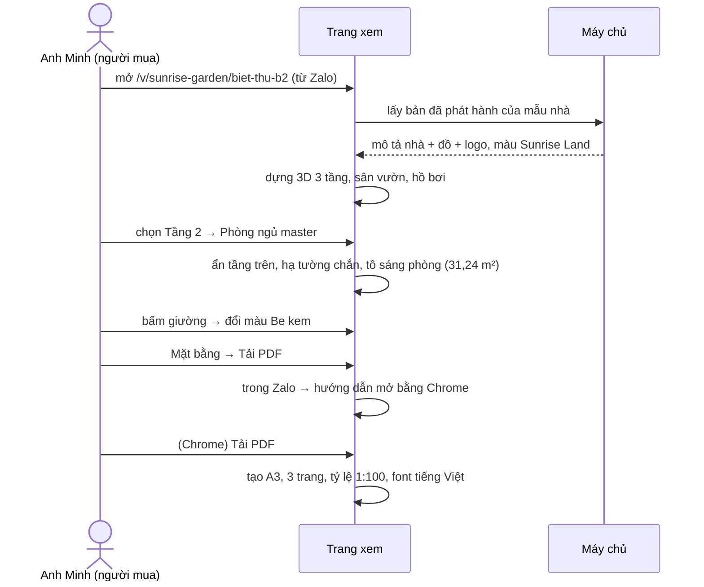

# Lát 1 — Xem nhà 3D nhiều tầng và mặt bằng có kích thước — Giải thích nghiệp vụ

| Trường | Giá trị |
|---|---|
| Item / lát | `01-interior-showcase-platform` · lát 1 (T-1…T-10) |
| Yêu cầu | FR-03.07, FR-04.04, FR-05.04–05.05, FR-06.01–06.15, FR-07.01–07.05, FR-09.01, FR-01.03; BR-02, BR-04, BR-05, BR-06, BR-08, BR-12; NFR-01–03, NFR-08, NFR-10 ([SRS](../../ai/system/SRS.md)) |
| Code | commit `27c6c81`, `8cf67e6`, `a4eb09f`, `951de62` (nhánh `feat/01-interior-showcase-platform`) |
| Người đọc | Dev mới vào dự án, reviewer, QA |
| Tác giả | Agent (DEC-16) |
| Reviewer | PO · Tech lead |
| Trạng thái | Draft |
| Last update | 2026-10-24 · Dev |

## TL;DR
- Lát này dựng phần người mua nhà nhìn thấy: mở một link, xem nhà 3D theo từng tầng, vào từng phòng, bấm vào đồ, mở mặt bằng có kích thước và tải PDF.
- Mọi thứ, cả 3D lẫn mặt bằng, đều vẽ ra từ **một bản mô tả nhà duy nhất** (tường, phòng, cửa, đồ), nên số đo trên bản vẽ luôn khớp với hình 3D.
- Người mua chỉ thấy **bản đã được chủ đầu tư duyệt**.
- Dữ liệu lát này là 4 mẫu nhà mẫu tạo sẵn. Công cụ để đội dựng nhà thật nằm ở lát 2.

## 0. Giải thích đơn giản

Đây là phần **"nhà mẫu online"**: thay vì dẫn khách đến căn hộ mẫu thật, sales gửi một đường link qua Zalo. Khách mở trên điện thoại là đi lại được trong ngôi nhà, như cầm một mô hình sa bàn có thể mở nóc ra nhìn vào trong.

**Ý tưởng chính.** Mỗi mẫu nhà được mô tả bằng những thứ một kiến trúc sư sẽ ghi trên bản vẽ: các tầng và cao độ, từng bức tường dài bao nhiêu, dày bao nhiêu, phòng nào ở đâu, cửa đặt chỗ nào, mở về phía nào, đồ nào kê ở đâu. Từ bản mô tả đó, hệ thống tự làm ba việc:
1. dựng ngôi nhà 3D;
2. vẽ mặt bằng có ghi kích thước và diện tích;
3. in mặt bằng ra PDF khổ A3 đúng tỷ lệ.

Vì cả ba đến từ một nguồn, sẽ không có chuyện 3D vẽ phòng 4 m còn bản vẽ ghi 3,8 m.

### Bước 1 — Khách mở link dự án
- Thấy logo, màu và tên của chủ đầu tư, không thấy thương hiệu của đơn vị làm phần mềm (chỉ có một dòng chữ nhỏ ở chân trang nếu gói cước cho phép).
- Thấy danh sách mẫu nhà (căn hộ, nhà phố, biệt thự, nhà vườn) và lọc được theo loại.
- Nếu chủ đầu tư đã ngừng hợp đồng quá 7 ngày, trang báo "Nội dung này hiện không còn hiển thị". Có thời gian ân hạn để không tắt ngay khi khách chậm gia hạn vài ngày.

### Bước 2 — Khách chọn một mẫu nhà
- Nhà nhiều tầng mở ở chế độ "Cả nhà" để thấy toàn khối; căn hộ một sàn mở thẳng vào sàn đó.
- Chọn "Tầng 2" thì các tầng phía trên biến mất, như nhấc nắp hộp lên, để nhìn từ trên xuống thấy rõ các phòng của tầng 2.
- Bức tường nào nằm chắn giữa mắt khách và chỗ đang xem sẽ tự hạ thấp; xoay sang hướng khác thì tường dựng lại. Khách không cần biết "cắt tường" là gì mà vẫn luôn nhìn được vào trong.

### Bước 3 — Khách vào một phòng
- Bấm vào sàn phòng (hoặc tên phòng, hoặc ô phòng trên mặt bằng nhỏ) thì máy quay bay tới phòng đó, phòng được tô sáng.
- Bật "Đứng trong phòng" thì máy quay hạ xuống tầm mắt người (1,6 m), đứng ở cuối phòng nhìn về phía đầu phòng. Kéo để nhìn quanh, bấm sàn chỗ khác (kể cả phòng bên cạnh) thì người mẫu tự tìm đường qua cửa, né đồ mà đi tới.

### Bước 4 — Khách bấm vào một món đồ
- Hiện tên, kích thước (mm), chất liệu, thương hiệu, mô tả.
- Nếu đồ có nhiều màu ("Xám đá", "Be kem", "Xanh rêu"), bấm màu là đồ trong nhà đổi màu ngay. Lựa chọn này chỉ để khách hình dung, không lưu lại và chưa có giá; giá theo đồ để sang Phase 3.

### Bước 5 — Khách mở "Mặt bằng"
- Mỗi tầng một bản vẽ: tường đen đặc, cửa có cung mở, cửa sổ ba nét, cầu thang có bậc và mũi tên, tên phòng, diện tích phòng, kích thước lòng phòng, chuỗi kích thước bên ngoài.
- "Tải PDF mặt bằng": A3 ngang, mỗi tầng một trang, tự chọn tỷ lệ 1:50 hoặc 1:100 cho vừa giấy, có khung thông tin (logo, tên dự án, mẫu nhà, tầng, phiên bản, ngày) và dòng miễn trừ.
- Mở link trong Zalo hay Facebook thì app đó không cho tải tệp. Hệ thống báo "Mở bằng trình duyệt để tải PDF" kèm nút sao chép link, thay vì im lặng không làm gì.

### Ví dụ một vòng đầy đủ
Anh Minh thấy quảng cáo dự án Sunrise Garden trên Facebook. Sales Lan gửi anh link qua Zalo: `…/v/sunrise-garden/biet-thu-b2`.
1. Anh mở trên điện thoại. Sau khoảng 3 giây thấy biệt thự 3 tầng, sân vườn phía trước, hồ bơi phía sau.
2. Anh chạm "Tầng 2": tầng 3 và sân thượng biến mất, thấy 3 phòng ngủ.
3. Anh chạm phòng "Phòng ngủ master": màn hình ghi 31,24 m²; mở bản vẽ thấy lòng phòng 5.845 × 5.345 mm.
4. Anh chạm vào cái giường: "Giường Haven 1m8 · 1.800 × 1.050 × 2.100 mm · Khung gỗ, đầu giường bọc nỉ". Anh đổi màu sang "Be kem" để xem.
5. Anh bấm "Mặt bằng" → "Tải PDF": app Zalo báo nên mở bằng Chrome. Anh mở bằng Chrome, tải được tệp `sunrise-garden-biet-thu-b2-mat-bang.pdf` 3 trang.

### Lưu ý
- 4 mẫu nhà hiện có là dữ liệu mẫu tạo sẵn, nội thất được xếp tự động theo loại phòng. Mẫu nhà thật sẽ do đội dựng bằng công cụ ở lát 2.
- Chưa có nút "Để lại số điện thoại" (lát 4); hiện chỉ có Gọi và Zalo.
- Hình 3D dựng từ khối đơn giản. Khi đội dựng tải mô hình đẹp xuất từ SketchUp/3ds Max lên (lát 2), mô hình đó thay cho tường khối.

## 1. Vì sao cần
- Người mua khó hình dung nhà qua ảnh tĩnh; panorama 360 chỉ đứng tại điểm chụp (P1).
- Nhà mẫu thật rất đắt, khoảng 2 tỷ ₫/căn (P2).
- Người mua thường hỏi lại "phòng rộng bao nhiêu, kê được gì" mà sales phải trả lời tay (P3).
- Bên bán có đủ loại nhà: căn hộ một sàn, nhà phố nhiều tầng có lửng, biệt thự có sân vườn, nhà cấp 4 (P4).

Nếu không có lát này, sản phẩm không có gì để đem đi demo bán hàng.

| Lát này làm | Lát này không làm |
|---|---|
| Trang dự án, trang xem nhà 3D, tab mặt bằng, PDF, trang dự phòng khi không chạy được 3D, trang không khả dụng, trang chính sách dữ liệu | Công cụ dựng nhà (lát 2) · gửi duyệt, phát hành qua giao diện (lát 3) · thu lead, thống kê (lát 4) · mặt bằng trần, điện, khung tên TCVN, DXF (Phase 2) · giá (Phase 3) |
| 4 mẫu nhà mẫu đủ 4 loại | Tải mô hình GLB thật (lát 2) |

## 2. Ai dùng, ở đâu, khi nào
| Vai | Màn hình / điểm vào | Lúc nào dùng |
|---|---|---|
| Người mua nhà | Link `/v/<dự-án>` hoặc `/v/<dự-án>/<mẫu-nhà>`; QR; khung nhúng trên web chủ đầu tư | Khi nhận link từ sales hoặc thấy quảng cáo |
| Sales của chủ đầu tư | Gửi link có sẵn tầng/phòng (`?floor=…&room=…`) | Tư vấn từ xa qua Zalo |
| Đội dựng (nội bộ) | Lệnh `npm run seed` tạo dữ liệu mẫu | Demo, kiểm thử |

## 3. Tình huống thực tế
| # | Tình huống | Hệ thống làm gì | Vì sao |
|---|---|---|---|
| 1 | Khách xem nhà phố 4 tầng, muốn nhìn tầng 2 | Ẩn tầng lửng trở lên khỏi khung nhìn tầng 2, camera bay tới tầng 2 | Nhìn từ trên xuống mới thấy bố trí phòng |
| 2 | Khách xoay ra phía trước nhà | Tường mặt tiền tự hạ, tường phía sau vẫn đứng | Luôn nhìn được vào trong mà không phải chỉnh gì |
| 3 | Điện thoại cũ không chạy được 3D | Hiện ảnh đại diện, ảnh phối cảnh, mặt bằng từng tầng, nút tải PDF và liên hệ | Không mất khách chỉ vì máy yếu |
| 4 | Chủ đầu tư quên gia hạn 3 ngày | Trang vẫn hiện bình thường; quá 7 ngày mới báo không khả dụng | Không làm gián đoạn chiến dịch vì trễ hạn vài ngày |
| 5 | Đội dựng sửa diện tích công bố sau khi đã phát hành | Trang công khai vẫn hiện số cũ cho tới khi bản mới được duyệt và phát hành | Khách chỉ thấy nội dung chủ đầu tư đã duyệt |
| 6 | Khách mở link trong Zalo, bấm Tải PDF | Báo mở bằng trình duyệt, có nút sao chép link | Zalo/Facebook chặn tải tệp |

## 4. Luồng ví dụ từ đầu đến cuối

## 5. Quy tắc nghiệp vụ và lý do
| Quy tắc | Con số / điều kiện | Vì sao | ID |
|---|---|---|---|
| Diện tích phòng tính theo lòng tường | Phòng lòng 3.600 × 4.200 mm → 15,12 m²; làm tròn 2 chữ số | Người mua so với "diện tích thông thuỷ" trong hợp đồng | BR-04 |
| Diện tích sàn tầng tính theo mép ngoài tường bao | Ví dụ 5.000 × 15.000 → 75,00 m²; không có đường bao thì lấy hình chữ nhật bao (cảnh báo) | Khớp cách tính diện tích xây dựng | BR-04 |
| Tầng chưa hiệu chỉnh tỷ lệ thì không có mặt bằng | — | Kích thước sai còn tệ hơn không có kích thước | BR-05 |
| Trang công khai chỉ hiện bản đã duyệt; link không đổi khi cập nhật | Mỗi mẫu nhà tối đa 1 bản đang phát hành | QR đã in vẫn dùng được; an toàn pháp lý | BR-01, BR-02 |
| Đường dẫn khoá sau lần phát hành đầu | Đổi tên đường dẫn → báo lỗi | Link và QR đã gửi khách không bị chết | FR-01.03 |
| Mọi trang và mọi PDF có dòng miễn trừ | Mặc định "Hình ảnh 3D và bản vẽ mang tính minh hoạ…" | Quảng cáo nhà trên giấy có rủi ro pháp lý | BR-06 |
| Tự gỡ khi quá hạn | Hết hạn + 7 ngày; gia hạn là hiện lại ngay | Không tắt quá sớm, không cần ai bật lại tay | BR-08 |
| Mặt bằng không sửa tay | Chỉ sửa mô tả nhà, bản vẽ tự vẽ lại | Bản vẽ luôn khớp 3D | BR-12 |
| Ảnh nền mặt bằng gốc của khách không bao giờ công khai | Bị bỏ khỏi bản phát hành | Bản vẽ gốc là tài liệu riêng của chủ đầu tư | R-01 |

## 6. Điểm dễ hiểu nhầm
- **"Đổi màu đồ có lưu không?"** Không. Đó chỉ là để khách thử; mỗi lần mở lại trang là về màu mặc định.
- **"Sửa thông tin mẫu nhà mà trang không đổi?"** Đúng thiết kế. Trang công khai lấy từ bản đã duyệt; phải gửi duyệt và phát hành lại (lát 3).
- **"Vì sao logo đổi được ngay mà mô tả nhà thì không?"** Logo, màu, số điện thoại là thông tin của khách hàng, đổi không cần duyệt. Nội dung nhà thì phải duyệt (DEC-28).
- **"Kích thước trên mặt bằng là tim tường hay mép?"** Chuỗi ngoài đo từ mép ngoài tới mép lỗ cửa và tim tường ngăn; kích thước ghi trong phòng là lòng phòng (thông thuỷ).
- **"Tường hạ thấp theo quy tắc nào?"** Tường nào cắt ngang đường nhìn từ mắt khách tới điểm đang xem thì hạ; đúng cả với tường xiên.
- **"Nhà phố có mặt tiền mà căn hộ thì không?"** Căn hộ chỉ có một sàn trong toà nhà, không có ngoại thất riêng, nên nút "Mặt tiền" bị ẩn.

## 7. Bản đồ nghiệp vụ → code
| Khái niệm nghiệp vụ | Code | Test chứng minh |
|---|---|---|
| Mô tả nhà (tầng, tường, phòng, cửa, đồ) | `packages/core/src/schema.ts` | `packages/core/test/core.test.ts` — "tài liệu dựng từ hình chữ nhật hợp lệ theo schema" |
| Diện tích phòng / sàn (BR-04) | `packages/core/src/rules.ts` (`roomArea`, `floorGrossArea`) | `core.test.ts` — "BR-04 diện tích" |
| Chia tường thành khối đặc / lỗ cửa | `packages/core/src/geometry.ts` (`wallSegments`) | `core.test.ts` — "wallSegments" |
| Vẽ mặt bằng + kích thước + chống chèn mã | `packages/core/src/plan/planSvg.ts`, `plan/escape.ts` | `core.test.ts` — "planSvg" |
| Bản phát hành (snapshot), bỏ ảnh nền | `apps/api/src/services/snapshot.ts` | `apps/api/test/public.test.ts` — "file input (ảnh nền) không bao giờ đọc được…" |
| Duyệt / phát hành / thay bản cũ / khoá đường dẫn | `apps/api/src/services/workflow.ts` | `public.test.ts` — "workflow" |
| Trang công khai, khả dụng theo hợp đồng (BR-08) | `apps/api/src/services/public.ts`, `services/access.ts` | `public.test.ts` — "BR-08: quá hạn hosting 7 ngày…" |
| Quyền đọc ảnh, mô hình | `apps/api/src/services/fileAccess.ts`, `routes/files.ts` | `public.test.ts` — "/files quyền" |
| Dữ liệu 4 mẫu nhà | `apps/api/src/seed/demoHouses.ts`, `seed/seed.ts` | `public.test.ts` — "seed AC-01" |
| Cảnh 3D: tầng, tường, cắt tường, cầu thang, sân | `apps/web/src/scene/FloorGroup.tsx`, `scene/HouseScene.tsx` | kiểm bằng ảnh chụp Playwright (E2E ở T-30) |
| Đồ nội thất, chọn, đổi màu | `apps/web/src/scene/Items.tsx`, `viewer/ItemPanel.tsx` | E2E (T-30) |
| Trang xem, link sâu, mobile | `apps/web/src/viewer/HousePage.tsx`, `viewer/viewer.css` | E2E (T-30) |
| Tab mặt bằng, PDF A3 | `apps/web/src/viewer/PlanTab.tsx`, `lib/pdf.ts`, `lib/pdfScale.ts` | `apps/web/test/viewer.test.ts` — "chọn tỷ lệ…" |

## 7b. Lối đi trong nhà (DEC-52, 2026-10-25)

Một module duy nhất `packages/core/src/nav.ts` quyết định "người đi được ở đâu" cho ba nơi: người mẫu trong trình xem 3D (`apps/web/src/scene/walk.ts`), cảnh báo khi gửi duyệt (`submitChecks`) và test nhà mẫu (`apps/api/test/demo-layout.test.ts`). Ba nơi luôn ra cùng kết quả.

| Quy tắc | Lý do |
|---|---|
| Tường, kính cửa sổ (kể cả kính sát sàn), đồ cao ≥ 15 cm là vật cản hình hộp đúng kích thước; ô cửa đi không chặn; thân người bán kính 0,2 m | Trước đây đầu tường được bo tròn nên lấn vào khung cửa: cửa 0,9 m chỉ còn 0,7 m, người mẫu hay kẹt |
| Cảnh báo khi gửi duyệt: phòng không vào được, phòng không còn chỗ đứng, lối vào hẹp < 0,65 m, đồ chắn cửa (trong 0,6 m), không tới được chân / đầu cầu thang, phòng chật (không có chỗ trống rộng 1 m) | Người xem 3D sẽ kẹt đúng ở những chỗ này; đội dựng sửa trước khi khách thấy |
| Bấm sàn → tìm đường (A*, ưu tiên đi giữa lối) | Đi thẳng thì gặp tường là dừng — người xem tưởng hỏng |
| Đi bằng phím gần cửa mà bị chặn → kéo hướng đi vào giữa cửa | Đi chéo lệch tâm dính cạnh khung cửa (bắt được 23/210 lần trước khi sửa) |
| Xếp đồ nhà mẫu (`seed/furnish.ts`) chừa 0,9 m trước cửa, hai đầu cầu thang và chỗ đầu thang từ tầng dưới lên; còn hẹp thì bỏ bớt đồ phụ (cây, đèn, ghế…) | Hàm xếp cũ đặt sofa chắn cửa chính, kệ TV chắn cửa bếp, tủ áo chắn cửa WC |

Kiểm hồi quy khi đổi logic đi bộ: `?debug3d=1` có `window.__hdWalkTo(x, z)` để kịch bản tự động cho người mẫu đi qua mọi phòng, mọi cửa, mọi cầu thang.

## 7c. Đi lại kiểu game: bộ vật lý + navmesh (DEC-53, 2026-10-25)

Người mẫu ở chế độ "Đứng trong phòng" giờ đi như nhân vật trong game, không còn trượt trên mặt bằng 2D:

| Người xem làm | Hệ thống làm | Code |
|---|---|---|
| Giữ W / ↑ đi tới, A / D xoay, Shift chạy | Bộ điều khiển nhân vật (Rapier) đẩy thân hình viên thuốc 1,7 m: trượt dọc tường, lướt qua khung cửa (có hỗ trợ kéo vào giữa cửa), có trọng lực | `apps/web/src/scene/physics/walker.ts` |
| Đi tới cầu thang và cứ giữ W | Leo từng vế (dốc liền), qua chiếu nghỉ, lên tới sàn tầng trên thì tự chọn tầng đó | `walkGeometry.ts` (dốc + chiếu nghỉ), `HouseScene.tsx` (chọn tầng theo độ cao) |
| Bấm vào sàn bất kỳ (kể cả phòng khác) | Tìm đường trên navmesh (Recast/Detour) qua cửa, né đồ, lên xuống cầu thang | `walker.pathTo` |
| Kéo xoay camera trong phòng hẹp | Camera thu ngắn trước tường (cần lò xo), không lọt ra sau tường | `walker.springArm` |

**Vì sao không còn đi ra ngoài khoảng không:** va chạm lấy từ sàn thật của từng tầng (phòng, ban công, sân thượng, đường bao) — chỗ không có sàn thì không đứng được; mép sàn tầng trên, miệng lỗ thang (trừ chỗ bước ra khỏi thang), hồ bơi, ranh khu đất có lan can vô hình.

**Thang chữ U** (`Stair.shape = 'u'`): vế 1 lên ở nửa phải, chiếu nghỉ cuối thang, vế 2 quay lại ở nửa trái; vào và ra cùng một phía nên các tầng xếp chồng thang cùng một chỗ được — kiểu thang phổ biến của nhà phố. Thang thẳng xếp chồng cùng một chỗ là bố cục sai (vế dưới đụng đầu vào vế trên, không có lối sang vế kế) — trình dựng có lựa chọn "Kiểu thang" trong bảng thuộc tính cầu thang.

**Kiểm hồi quy:** `apps/web/test/walk-physics.test.ts` mô phỏng (không cần trình duyệt) trên 4 nhà mẫu: đi qua mọi phòng, đi phím qua mọi cửa (chéo lệch tâm), leo mọi cầu thang lên + xuống, tìm đường lên từng phòng tầng trên, đi lung tung 60 giây mỗi tầng không rời sàn, camera không có vật cản giữa người và camera. Trên trình duyệt: `?debug3d=1` có `window.__hdWalker` và `window.__hdWalkTo(x, z, y)`.

## 8. Giới hạn hiện tại và giả định
- Dữ liệu là mẫu; nội thất xếp tự động nên vài chỗ chưa hợp lý (ví dụ cửa garage 3,8 m vẽ thành cửa cánh, vì schema chưa có cửa cuốn).
- Mô hình GLB thật, quy ước node `item_*`/`wall_*` đã có code nhưng chưa được kiểm với file thật (rủi ro BE-R4, kiểm ở lát 2).
- Chưa đo NFR-01/02 trên máy thật; bundle trang xem hiện khoảng 340 KB gzip (dưới mục tiêu 900 KB).
- Chế độ "Đứng trong phòng" đặt người đứng ở cuối phòng theo hướng mặt bằng; phòng có cửa vào ở phía khác có thể chưa phải góc đẹp nhất. Điểm nhìn đặt tay ở lát 2 sẽ khắc phục.

## Liên kết
- SRS: [`docs/ai/system/SRS.md`](../../ai/system/SRS.md) §4.4, §5.6–5.7, §7
- Spec: `02` §5.2–5.4, §6 API-60/61, §6.2; `02a` §4.1; `02b` §3
- Test cases: `04` TC-03.01–03.02, TC-06.*, TC-07.*, TC-02.03, TC-08.07
