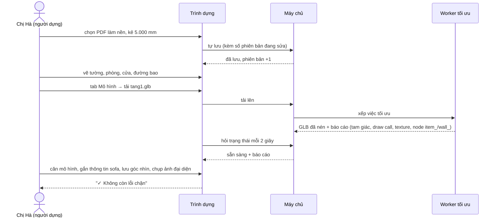

# Lát 2 — Công cụ nội bộ và trình dựng nhà — Giải thích nghiệp vụ

| Trường | Giá trị |
|---|---|
| Item / lát | `01-interior-showcase-platform` · lát 2 (T-11…T-21) |
| Yêu cầu | FR-01.01–01.05, FR-02.*, FR-03.01–03.09, FR-04.01–04.07, FR-05.01–05.04, FR-09.02–09.03; BR-03, BR-05, BR-07, BR-09, BR-10; EX-1, EX-4 ([SRS](../../ai/system/SRS.md)) |
| Code | commit `453e502`, `9384644`, `dc27d10`, `fbd8118`, `f86007f` (nhánh `feat/01-interior-showcase-platform`) |
| Người đọc | Dev mới vào dự án, reviewer, QA |
| Tác giả | Agent (DEC-16) |
| Reviewer | PO · Tech lead |
| Trạng thái | Draft |
| Last update | 2026-10-24 · Dev |

## TL;DR
- Lát này dựng **công cụ cho đội triển khai của mình** (không phải cho khách hàng tự làm): quản lý khách hàng, dự án, tài liệu đầu vào, rồi dựng từng mẫu nhà.
- Trình dựng có 4 tab: **Khung** (can tường/phòng/cửa từ ảnh mặt bằng), **Mô hình** (tải GLB đẹp từ SketchUp/3ds Max/Blender và căn khớp), **Đồ** (đặt đồ thư viện, gắn thông tin cho đồ trong mô hình), **Điểm nhìn & ảnh**.
- Thanh **"Gửi duyệt"** ở chân trình dựng liệt kê lỗi chặn và cảnh báo. Nút gửi duyệt và phát hành là lát 3.
- Mọi thay đổi tự lưu. Hai người sửa cùng lúc thì người lưu sau phải tải lại, không ai bị ghi đè âm thầm.

## 0. Giải thích đơn giản

Bên bán nhà gửi cho đội mình một bộ hồ sơ: ảnh hoặc PDF mặt bằng, có khi kèm file 3D. Đội dựng làm theo trình tự giống một hoạ viên:

1. **Đặt ảnh mặt bằng làm nền rồi chỉnh tỷ lệ.** Kẻ một đoạn trùng với kích thước đã ghi trên bản vẽ, ví dụ cạnh 8.000 mm, rồi gõ "8000". Từ lúc đó mọi nét vẽ đều ra đúng milimét.
2. **Can lại khung nhà:** tường, phòng, cửa đi, cửa sổ, cầu thang, sân vườn, đường bao. Đây là "bản mô tả nhà" đã nói ở lát 1. Mặt bằng có kích thước và hình 3D khối đều sinh ra từ đây.
3. **Nếu có mô hình 3D đẹp** (đã có vật liệu, đèn, trang trí), tải lên để thay cho khối tường đơn giản. Máy chủ tự nén file, ví dụ 1,27 MB còn 52 KB, rồi báo file có nặng quá với điện thoại hay không.
4. **Thêm đồ:** chọn từ thư viện chung (sofa, giường…) rồi bấm lên sàn để đặt. Nếu mô hình đẹp đã có sẵn đồ thì bấm vào món đó để gắn tên, kích thước, chất liệu.
5. **Chọn góc nhìn đẹp và chụp ảnh đại diện.** Ảnh đại diện hiện trên danh sách mẫu nhà và khi chia sẻ link qua Zalo/Facebook.

### Ví dụ một vòng đầy đủ
Chị Hà ở đội dựng nhận hồ sơ "Nhà phố 5×15" của công ty xây nhà An Phát.
1. Vào **Khách hàng** tạo "An Phát", chọn màu thương hiệu, tải logo, mời anh Tuấn bên An Phát làm người duyệt. Anh Tuấn nhận email đặt mật khẩu.
2. Vào **Dự án** "Khu nhà phố An Phát Riverside", tải `mat-bang-tang-1.pdf` vào mục tài liệu.
3. Tạo mẫu nhà "Nhà phố 5×15", loại nhà phố, diện tích công bố 75 m². Mở trình dựng, chọn PDF làm nền, kẻ cạnh mặt tiền rồi nhập 5000.
4. Vẽ 4 tường bao, vẽ phòng khách, đặt cửa chính và cửa sổ. Thanh dưới báo "Tầng 1 chưa có đường bao", chị vẽ thêm đường bao. Bấm "Sao chép" để tạo tầng 2 từ tầng 1, rồi sửa lại vách.
5. Tab **Mô hình**: tải `tang1.glb` xuất từ SketchUp. Hệ thống báo "Đạt · 180.000 tam giác · 3 đồ, 12 tường gắn được", nhưng cũng báo "Mô hình lệch khung 450 mm ở cạnh trái". Chị nhập X = −450 thì cảnh báo mất.
6. Tab **Đồ**: bấm "Chọn từ mô hình", chạm vào sofa, đặt tên "Sofa Milano 3 chỗ", nhập kích thước 2.200 × 850 × 900 mm.
7. Tab **Điểm nhìn & ảnh**: xoay tới góc đẹp, bấm "Lưu góc nhìn hiện tại" rồi "Chụp từ góc hiện tại". Thanh dưới hiện "✓ Không còn lỗi chặn". Mẫu nhà sẵn sàng gửi anh Tuấn duyệt (lát 3).

### Lưu ý
- Trình dựng là công cụ nội bộ. Khách hàng (người duyệt bên An Phát) không vào được và chỉ thấy bản xem trước để duyệt (lát 3).
- Đồ đặt trong trình dựng và đồ gắn trong mô hình đều hiện trên trang xem, và người mua bấm vào được như nhau.

## 1. Vì sao cần
- Mô hình kinh doanh là **dịch vụ + nền tảng**: đội mình chuyển quảng cáo cơ bản của bên bán thành nhà 3D có bản vẽ. Năng suất của đội dựng quyết định giá dịch vụ và số dự án nhận được.
- Bên bán gửi đủ loại đầu vào: ảnh chụp bản vẽ, PDF, có khi có file SketchUp. Công cụ phải nhận cả hai đường: can từ ảnh, và dùng mô hình có sẵn.
- Điện thoại người mua rất khác nhau. Mô hình quá nặng thì trang không mở được, và khách bỏ đi trước khi thấy nhà.

| Lát này làm | Lát này không làm |
|---|---|
| Đăng nhập, khoá khi sai mật khẩu nhiều lần, mời người dùng, quên mật khẩu · khách hàng, tài khoản · dự án, tài liệu đầu vào, mẫu nhà, sao chép · thư viện đồ · trình dựng 4 tab · tối ưu GLB · kiểm trước khi gửi | Gửi duyệt, duyệt, phát hành, trang phiên bản (lát 3) · cổng khách hàng ngoài màn đăng nhập (lát 3–4) · thu lead, thống kê (lát 4) · tự nhận phòng từ ảnh, vẽ trần/điện (Phase 2) |

## 2. Ai dùng, ở đâu, khi nào
| Vai | Màn hình / điểm vào | Lúc nào dùng |
|---|---|---|
| Quản trị viên (đội mình) | `/studio/clients`, `/studio/projects`, `/studio/library` | Nhận khách hàng mới, mở dự án, mời người duyệt |
| Người dựng (đội mình) | `/studio/houses/<id>/edit` | Dựng mẫu nhà từ hồ sơ khách gửi |
| Người duyệt (bên bán nhà) | `/portal/login`, email mời đặt mật khẩu | Nhận lời mời; duyệt ở lát 3 |

## 3. Tình huống thực tế
| # | Tình huống | Hệ thống làm gì | Vì sao |
|---|---|---|---|
| 1 | Người dựng gõ sai mật khẩu 5 lần | Khoá đăng nhập 15 phút | Chống dò mật khẩu |
| 2 | Quản trị vô hiệu một tài khoản đang mở trình dựng | Phiên đó mất ngay ở thao tác kế tiếp | Người đã nghỉ việc không còn sửa được dữ liệu khách |
| 3 | Tạm ngưng hợp đồng với một khách hàng | Người duyệt của khách đó bị đăng xuất | Hết hợp đồng thì hết quyền vào |
| 4 | Hai người cùng mở một mẫu nhà, cùng sửa | Người lưu sau nhận báo "Mẫu nhà vừa được sửa ở nơi khác" và phải tải lại; phần chưa lưu ở tab đó bị bỏ | Không âm thầm ghi đè công việc của người khác |
| 5 | Ảnh nền chưa hiệu chỉnh tỷ lệ | Vẫn vẽ được, nhưng thanh kiểm báo lỗi chặn "chưa hiệu chỉnh tỷ lệ" | Mặt bằng sai số còn tệ hơn không có (BR-05) |
| 6 | Tải file 3D hỏng hoặc không phải GLB | Báo "Không đọc được tệp mô hình. Hãy xuất lại dạng GLB…" | Người dựng biết phải làm gì, không phải đọc lỗi kỹ thuật (EX-1) |
| 7 | Mô hình quá nặng cho điện thoại | Báo "Gần vượt" hoặc "Vượt ngân sách"; vượt thì không gửi duyệt được | Người mua dùng máy tầm trung vẫn phải mở được (BR-07) |
| 8 | Mô hình đặt lệch so với khung đã can | Báo "lệch … mm ở cạnh …" khi lệch quá 200 mm | Đồ đặt theo khung sẽ lơ lửng hoặc xuyên tường nếu mô hình lệch (EX-4) |
| 9 | Thay file mô hình mới mà món đồ đã gắn thông tin không còn trong file | Báo lỗi chặn "không còn đối tượng …" | Người mua bấm vào chỗ đó sẽ không có gì |
| 10 | Mẫu nhà đang chờ duyệt | Trình dựng chuyển sang chỉ xem | Thứ chủ đầu tư đang duyệt phải đứng yên (BR-03) |

## 4. Luồng ví dụ từ đầu đến cuối

## 5. Quy tắc nghiệp vụ và lý do
| Quy tắc | Con số / điều kiện | Vì sao | ID |
|---|---|---|---|
| Ngân sách hiển thị theo góc xem một tầng (gồm tầng đó, các tầng dưới, mô hình ngoại thất, đồ) | Cảnh báo: 400.000 tam giác · 120 draw call · 128 MB texture · 10 MB tải. Chặn: 800.000 · 250 · 256 MB · 14 MB | Máy tầm trung giữ được khoảng 30 khung hình/giây và tải nhanh qua 4G | BR-07 |
| Lệch mô hình so với khung | > 200 mm ở bất kỳ cạnh nào thì cảnh báo | Sai số can tay khoảng 50–100 mm; vượt 200 mm là đặt nhầm | EX-4 |
| Tên node trong file 3D | `item_…` là đồ gắn thông tin được; `wall_…` là tường được hạ khi chắn tầm nhìn | Phần mềm 3D không biết đâu là đồ, đâu là tường; dùng quy ước đặt tên là cách rẻ nhất | N-02 |
| Kiểm trước khi gửi | Chặn: chưa có tầng, quá số tầng tối đa, chưa hiệu chỉnh, phòng chưa khép, mô hình đang xử lý/lỗi, node đã mất, vượt ngân sách, thiếu ảnh đại diện. Cảnh báo: thiếu đường bao, gần vượt ngân sách, chưa có điểm nhìn mặc định | Lỗi chặn làm trang xem sai hoặc hỏng; cảnh báo chỉ làm trang kém đẹp | FR-03.08 |
| Ảnh phối cảnh | Tối đa 12 ảnh | Dùng cho trang dự phòng khi máy không chạy được 3D; nhiều hơn thì tải chậm | FR-04.07 |
| Người dựng chỉ sửa nội dung, không sửa hợp đồng | Không đổi được hạn hosting, gói, đường dẫn đã khoá | Tách việc kỹ thuật khỏi việc thương mại | BR-09 |
| Người duyệt chỉ thấy dự án của khách hàng mình | Dự án khách khác → 403 | Dữ liệu của chủ đầu tư này không lộ sang chủ đầu tư khác | BR-10 |
| Không vô hiệu quản trị viên cuối cùng | — | Tránh khoá cả hệ thống | TC-01.15 |

## 6. Điểm dễ hiểu nhầm
- **"Tải mô hình rồi sao tường khối biến mất?"** Đúng thiết kế. Tầng đã có mô hình thì mô hình thay cho tường khối. Khung tường vẫn còn trong dữ liệu để vẽ mặt bằng và tính diện tích.
- **"Cao độ mô hình tính từ đâu?"** Tính từ cốt ±0 của nhà, không phải từ sàn tầng. Khi tải mô hình cho tầng 2, ô "Cao độ" tự điền bằng cao độ sàn tầng 2.
- **"Đồ thư viện và đồ trong mô hình khác nhau thế nào?"** Đồ thư viện có kích thước, biến thể màu từ thư viện chung, và đặt/xoay được. Đồ trong mô hình nằm cố định trong file 3D, chỉ gắn thêm thông tin, không di chuyển được trong trình dựng.
- **"Ngân sách sao tính theo tầng, không theo cả nhà?"** Người mua xem từng tầng; khi xem tầng 2 thì tầng 3 bị ẩn. Thứ phải vẽ cùng lúc là tầng đang xem cộng các tầng dưới.
- **"Ảnh đại diện chụp ra có bị đen không?"** Không. Cảnh 3D trong trình dựng giữ lại khung hình để chụp được.
- **"Tự lưu có tạo phiên bản mới không?"** Không. Tự lưu chỉ tăng số "revision" của bản đang dựng. Phiên bản mới (v2, v3) chỉ tạo khi sửa một mẫu nhà đã phát hành (lát 3).

## 7. Bản đồ nghiệp vụ → code
| Khái niệm nghiệp vụ | Code | Test chứng minh |
|---|---|---|
| Đăng nhập, khoá, phiên, thu hồi phiên | `apps/api/src/lib/auth.ts`, `routes/auth.ts` | `apps/api/test/auth.test.ts` — "sai 5 lần → khoá 15 phút", "vô hiệu user → phiên mất ngay" |
| Khách hàng, mời người duyệt, email | `routes/admin.ts`, `services/mail.ts`, `email/templates.ts` | `auth.test.ts` — "mời người duyệt → E1…", "tạm ngưng khách hàng…" |
| Dự án, quyền theo field, slug khoá | `routes/projects.ts` | `studio.test.ts` — "người dựng chỉ sửa được field nội dung", "slug khoá sau phát hành" |
| Tự lưu chống ghi đè | `routes/projects.ts` (If-Match), `apps/web/src/app/studio/editor/useAutosave.ts` | `studio.test.ts` — "autosave: thiếu If-Match…" |
| Tối ưu GLB, giữ tên `item_`/`wall_` | `apps/api/src/jobs/modelOptimize.ts`, `modelWorker.ts` | `model.test.ts` — "2.000 mesh…", "tệp rác → lỗi tiếng Việt (EX-1)", "tải GLB → processing → ready" |
| Ngân sách, kiểm trước khi gửi | `packages/core/src/rules.ts` (`budgetForFloor`, `levelOf`, `submitChecks`) | `packages/core/test/core.test.ts` |
| Trình dựng khung (can, hiệu chỉnh, bắt điểm, undo) | `apps/web/src/app/studio/editor/{store.ts, PlanCanvas.tsx, snap.ts, underlay.ts, Inspector.tsx}` | Playwright: vẽ 4 tường, phòng, cửa, hiệu chỉnh, tự lưu (E2E chính thức ở T-30) |
| Tab Mô hình (tải, báo cáo, căn, lệch khung) | `editor/ModelTab.tsx`, `editor/EditorScene.tsx` (`AlignGizmo`) | Playwright: tải GLB → "Đạt", lệch 4.550 mm được báo |
| Tab Đồ | `editor/ItemsTab.tsx` | Playwright: đặt bàn → gán "Phòng khách" |
| Tab Điểm nhìn & ảnh | `editor/ViewsTab.tsx` | Playwright: lưu góc nhìn, chụp ảnh đại diện → hết lỗi chặn |

## 8. Giới hạn hiện tại và giả định
- **Chưa thử với file SketchUp/3ds Max thật của khách** (rủi ro BE-R4). Mới kiểm bằng GLB tổng hợp: 2.000 mesh, node lồng 3 cấp.
- Bấm "Chọn từ mô hình" chỉ bắt được node đặt tên `item_…`. File của khách chưa đặt tên thì phải nhờ hoạ viên bên họ đổi tên, hoặc đội mình đổi trong Blender.
- Chưa có tự nhận phòng từ ảnh; người dựng vẽ tay từng phòng (Phase 2).
- Căn mô hình bằng gizmo chỉ dịch và xoay quanh trục đứng; không nghiêng, không méo.

## Liên kết
- SRS: [`docs/ai/system/SRS.md`](../../ai/system/SRS.md) §4.1–4.3, §5.1–5.5, §7
- Spec: `02` §5, §6 API-01…41; `02a` B4–B7; `02b` F7–F13
- Test cases: `04` TC-01.*, TC-03.*, TC-04.*, TC-05.*
