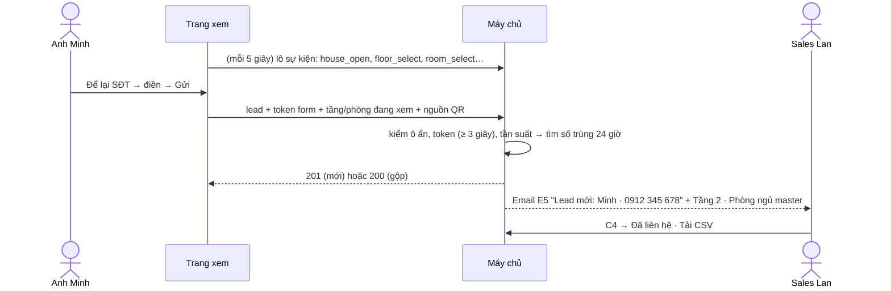

# Lát 4 — Lead và thống kê — Giải thích nghiệp vụ

| Trường | Giá trị |
|---|---|
| Item / lát | `01-interior-showcase-platform` · lát 4 (T-25…T-29) |
| Yêu cầu | FR-09.04, FR-10.01–10.06, FR-11.01–11.03; BR-09, BR-10; NFR-04; R-13, R-26, R-27, R-29 ([SRS](../../ai/system/SRS.md)) |
| Code | commit `31b047e`, `77a040d`, `c128c16` (nhánh `feat/01-interior-showcase-platform`) |
| Người đọc | Dev mới vào dự án, reviewer, QA |
| Tác giả | Agent (DEC-16) |
| Reviewer | PO · Tech lead |
| Trạng thái | Draft |
| Last update | 2026-10-24 · Dev |

## TL;DR
- Người mua đang xem nhà bấm **"Để lại SĐT"**, điền form. Sales của chủ đầu tư nhận email ngay, trong đó ghi khách đang xem **mẫu nhà nào, phòng nào**.
- Cùng một số điện thoại gửi lại trong 24 giờ thì **gộp** vào lead cũ ("liên hệ lần 2"), không tạo bản ghi trùng.
- Trang xem ghi lại lượt xem ẩn danh. Chủ đầu tư thấy số lượt xem, người xem, thời gian xem, phòng và đồ được xem nhiều, nguồn (link / QR / nhúng), và tỉ lệ ra lead.
- Đây là bằng chứng để **gia hạn hợp đồng**: con số cho thấy nhà mẫu online mang về bao nhiêu khách.

## 0. Giải thích đơn giản

**Lead.** Khách xem nhà xong muốn được gọi lại. Form hỏi: tên, số điện thoại (bắt buộc), email, quan tâm (mua để ở / đầu tư / tư vấn nội thất / khác), lời nhắn, và một ô đồng ý cho chủ đầu tư liên hệ (bắt buộc theo luật bảo vệ dữ liệu cá nhân). Gửi xong:
- sales nhận email "Lead mới: Minh · 0912 345 678", trong đó có "Đang xem: Tầng 2 · Phòng ngủ master";
- người duyệt bên khách thấy lead ở mục **Lead**, đánh dấu "Đã liên hệ", tải CSV về nhập vào CRM của họ.

**Chống spam.** Form có ba lớp, khách thật không thấy lớp nào:
1. Một ô ẩn mà chỉ bot mới điền. Có điền thì hệ thống trả "thành công" giả và không lưu.
2. Form phải mở ít nhất 3 giây mới gửi được, vì bot gửi ngay lập tức.
3. Gửi quá 3 lần trong 10 phút từ một máy (hoặc 20 lần từ một mạng) thì phải qua bước xác minh "không phải máy" (Cloudflare Turnstile).

**Thống kê.** Mỗi lần khách mở dự án, mở mẫu nhà, chọn tầng, chọn phòng, bấm vào đồ, mở mặt bằng, tải PDF, bấm gọi hoặc Zalo, trang đều ghi một sự kiện kèm mã thiết bị ngẫu nhiên. Mã này không phải danh tính. Một **lượt xem** là một phiên; khách bỏ đi quá 30 phút rồi quay lại thì tính phiên mới.

### Ví dụ một vòng đầy đủ
1. Sales Lan in QR lên tờ rơi. Anh Minh quét QR, link có thêm `?src=qr`.
2. Anh xem Tầng 2, bấm "Phòng ngủ master", rồi bấm "Để lại SĐT", điền "0912 345 678", chọn "Mua để ở", tick đồng ý, Gửi.
3. Màn hình báo "Cảm ơn Minh! Sunrise Land sẽ liên hệ bạn sớm." Email tới `sales@sunrise.vn`.
4. Tối đó anh Minh gửi lại với lời nhắn "Gọi sau 7 giờ tối". Lead cũ chuyển "liên hệ lần 2", trạng thái về "Mới", sales nhận email mới.
5. Cuối tháng, chị Lan mở **Thống kê**, chọn 30 ngày: 1.240 lượt xem, 31 lead (2,5%), QR chiếm 300 lượt xem. Chị tải CSV gửi sếp.

## 1. Vì sao cần
- Chủ đầu tư trả tiền để có khách. Không có lead thì nhà mẫu online chỉ là trang trưng bày.
- Biết khách đang xem phòng nào giúp sales mở đầu cuộc gọi đúng chủ đề.
- Muốn bán gia hạn thì phải có số liệu chứng minh hiệu quả, và phải so được giữa các kênh (link, QR, nhúng web).

| Lát này làm | Lát này không làm |
|---|---|
| Form lead (V3), chống bot, gộp trùng, E5 · danh sách lead, đánh dấu, xoá, CSV (C4, A6) · ghi sự kiện, thống kê, CSV (C5, A6) | Đồng bộ CRM, Zalo OA (Phase 2) · báo giá theo đồ (Phase 3) · phân bổ lead cho từng sales · dashboard thời gian thực |

## 2. Ai dùng, ở đâu, khi nào
| Vai | Màn hình / điểm vào | Lúc nào dùng |
|---|---|---|
| Người mua | Nút "Để lại SĐT" trên V1, V2, V4 | Khi muốn được tư vấn |
| Sales chủ đầu tư | Email E5 (gửi tới `contact.leadEmails` của dự án) | Ngay khi có lead |
| Người duyệt bên khách | `/portal/leads` (C4), `/portal/stats` (C5) | Theo dõi, xuất dữ liệu |
| Quản trị viên | `/studio/leads`, `/studio/stats` (A6, thêm lọc theo khách hàng) | Báo cáo cho khách, chuẩn bị gia hạn |

## 3. Tình huống thực tế
| # | Tình huống | Hệ thống làm gì | Vì sao |
|---|---|---|---|
| 1 | Nhập "+84 912 345 678" | Chuẩn hoá thành 0912345678 | Gộp trùng và CSV phải cùng một định dạng |
| 2 | Nhập "12345" | "Số điện thoại cần 10 chữ số, bắt đầu bằng 0 (ví dụ 0912 345 678)." | Số sai thì sales không gọi được |
| 3 | Gửi lại cùng số trong 24 giờ | Gộp, tăng "Số lần liên hệ", trạng thái về "Mới", vẫn gửi E5 "liên hệ lần 2" | Không trùng bản ghi nhưng sales vẫn biết khách quan tâm lại |
| 4 | Lần gửi sau không chọn phòng | Giữ tầng/phòng của lần trước | Không mất thông tin đã có |
| 5 | Bot điền ô ẩn | Trả thành công giả, không lưu, không gửi email | Bot không học được cách vượt |
| 6 | Gửi lần thứ 4 trong 10 phút | Hiện xác minh Turnstile; không cấu hình Turnstile thì báo "Bạn đã gửi quá nhiều lần. Thử lại sau ít phút." | Chặn spam mà không làm phiền khách thường |
| 7 | Mất mạng khi gửi | "Chưa gửi được. Thông tin của bạn vẫn còn, bấm Gửi lại." | Khách không phải gõ lại |
| 8 | Để trang mở hơn 2 giờ rồi mới gửi | Tự lấy token mới trước khi gửi | Token form hết hạn sau 2 giờ |
| 9 | Khách yêu cầu xoá dữ liệu | Người duyệt bấm Xoá: xoá vĩnh viễn và xoá nội dung email đã lưu | Nghĩa vụ theo NFR-04 |
| 10 | Tên lead là `=HYPERLINK(...)` | CSV ghi `'=HYPERLINK(...)` | Mở bằng Excel không chạy công thức độc (R-27) |
| 11 | Xem trước C3 | Không ghi sự kiện, không có form lead | Người duyệt xem không được tính là khách |

## 4. Luồng ví dụ từ đầu đến cuối

## 5. Quy tắc nghiệp vụ và lý do
| Quy tắc | Con số / điều kiện | Vì sao | ID |
|---|---|---|---|
| Gộp lead trùng | Cùng dự án + cùng SĐT, liên hệ gần nhất ≤ 24 giờ | Một khách bấm hai lần không thành hai lead | BR-09 |
| Phiên xem | > 30 phút không tương tác → phiên mới | Định nghĩa "một lượt xem" ổn định | BR-10 |
| Lượt xem | Số phiên có mở dự án hoặc mở mẫu nhà | Đếm người thật vào xem, không đếm từng cú bấm | API-80 |
| Tỉ lệ lead | Số lead ÷ số lượt xem, cùng khoảng ngày | Chỉ số so sánh giữa các kênh | FR-11.02 |
| Giới hạn tần suất lead | 3 lần / 10 phút / máy; 20 lần / 10 phút / IP | Chống spam | R-13 |
| Giới hạn sự kiện | 120 lô / phút / IP; ≤ 50 sự kiện / lô; ≤ 64 KB; giờ sự kiện lệch ≤ 24 giờ | Chống làm đầy cơ sở dữ liệu | R-29 |
| Khoảng thống kê | Mặc định 30 ngày; tối đa 366 ngày; ngày theo giờ Việt Nam | Truy vấn nhanh, số khớp lịch làm việc | API-80 |
| Người duyệt chỉ thấy lead và thống kê dự án của mình | Lead khách khác → 404 (không tiết lộ là có tồn tại) | Bảo mật dữ liệu khách hàng | BR-10 (quyền) |
| Xoá lead là xoá cứng | Kèm xoá dữ liệu cá nhân trong email đã lưu | Quyền được xoá dữ liệu | NFR-04, R-26 |

## 6. Điểm dễ hiểu nhầm
- **"Người xem" khác "lượt xem" thế nào?** Người xem đếm thiết bị khác nhau, lượt xem đếm phiên. Một người xem sáng và tối là 1 người xem, 2 lượt xem.
- **"Vì sao biểu đồ chỉ có lượt xem?"** Lead ít hơn lượt xem hàng chục lần. Vẽ chung một trục thì cột lead gần như bằng 0, còn dùng hai trục thì dễ đọc sai. Số lead theo ngày hiện khi rê chuột, và có trong CSV.
- **"Tên phòng trong thống kê lấy từ đâu?"** Từ bản đang phát hành. Phòng đã bị xoá ở phiên bản mới thì hiện "—".
- **"Gộp lead có làm mất lời nhắn cũ không?"** Trường nào lần sau để trống thì giữ giá trị cũ; trường có giá trị mới thì ghi đè.
- **"Không cấu hình Turnstile thì sao?"** Vẫn có ô ẩn, token form và giới hạn tần suất, chỉ thiếu bước xác minh. Production bắt buộc có khoá Turnstile (cấu hình kiểm khi khởi động).

## 7. Bản đồ nghiệp vụ → code
| Khái niệm nghiệp vụ | Code | Test chứng minh |
|---|---|---|
| Tạo/gộp lead, E5, xoá cứng, CSV | `apps/api/src/services/leads.ts` | `apps/api/test/leads.test.ts` — "tạo lead + E5…", "CSV có BOM và chặn công thức…" |
| Chống bot, giới hạn tần suất | `routes/leads.ts`, `lib/formToken.ts`, `lib/rateLimit.ts`, `lib/turnstile.ts` | `leads.test.ts` — "honeypot…", "form token…", "> 3 lần/10 phút…" |
| Ghi sự kiện, thống kê | `services/stats.ts` | `leads.test.ts` — "ghi lô sự kiện…", "người duyệt bắt buộc projectId…" |
| Phiên 30 phút, gửi lô | `apps/web/src/lib/tracker.ts` | `apps/web/test/viewer.test.ts` — "tracker (BR-10)" |
| Form lead V3 | `apps/web/src/viewer/LeadDrawer.tsx`, `viewer/main.tsx` | Playwright: lỗi tại ô → gửi → "Cảm ơn…" → sự kiện gửi kèm `source: qr` |
| C4, C5, A6 | `apps/web/src/app/portal/{Leads,Stats,filters}.tsx` | Playwright: đánh dấu đã liên hệ, CSV 200, ô số liệu và chú thích theo ngày |

## 8. Giới hạn hiện tại và giả định
- Giới hạn tần suất đếm trong bộ nhớ của một server (ADR-002). Khi chạy nhiều server phải chuyển sang bộ đếm dùng chung.
- Thời gian xem tính từ sự kiện đầu tới sự kiện cuối của phiên. Phiên chỉ có một sự kiện thì tính 0 giây.
- Chưa đo hiệu năng thống kê với 100.000 sự kiện (mục tiêu ≤ 1 giây). Đo ở bước chạy test.

## Liên kết
- SRS: [`docs/ai/system/SRS.md`](../../ai/system/SRS.md) §5.10–5.11, §7, §10.4 (V3, C4, C5)
- Spec: `02` API-62, 63, 70…72, 80, 81, §8; `02a` §4.2; `02b` F5, F6, F16
- Test cases: `04` TC-10.*, TC-11.*
